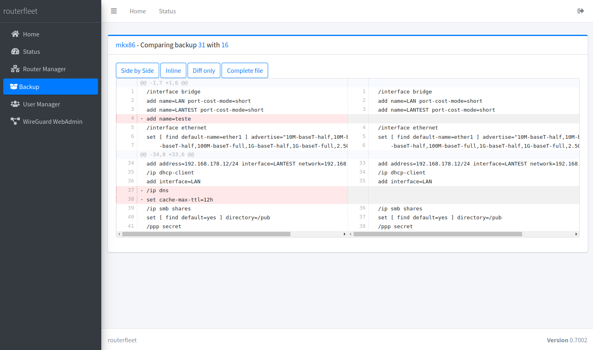
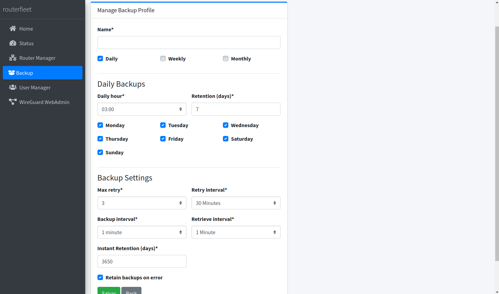
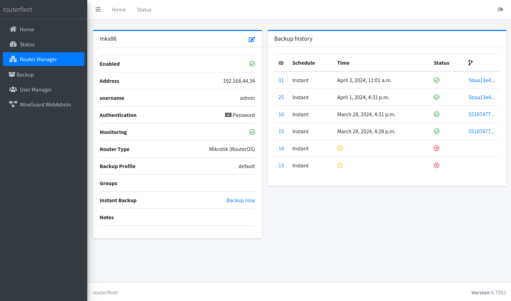
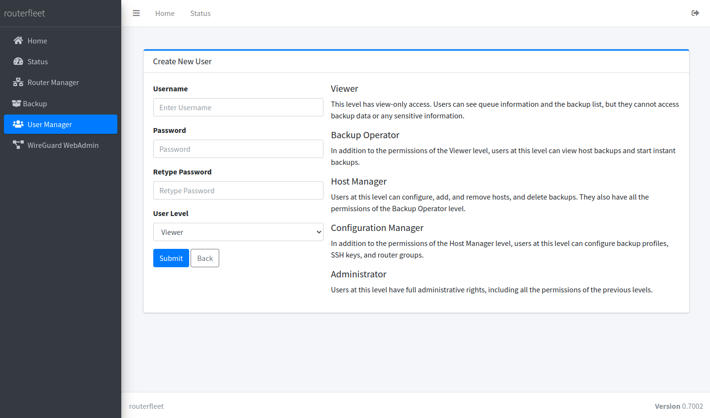

# RouterFleet Improved

Centralized backup, configuration management and fleet command execution for
network devices. RouterFleet keeps a configuration history for every device,
runs commands across a fleet on a schedule, watches whether devices are
reachable, and records who changed what.

Supported devices: **MikroTik RouterOS** (including branded units), **OpenWrt**,
**Ubiquiti airOS**, plus a *monitoring only* type for anything that just needs
to be pinged.

## What it does

- **Backups** — daily, weekly, monthly and on-demand, per-device retention,
  text and binary, with a line-by-line diff between any two of them and a flag
  on every backup that changed the configuration.
- **Fleet Commander** — commands with a payload per device type, run by hand or
  on a schedule, with **verified results**: a command counts as successful only
  when a verification command proves it, so an update that reboots a device
  mid-run is judged on its outcome rather than on an exit code it never sent.
- **Device inventory** — model, serial, OS and firmware version, architecture,
  CPU, and the version each device could be upgraded to.
- **Monitoring** — an independent container pings the fleet and records
  downtime; status changes raise notifications.
- **Notifications** — Telegram, ntfy.sh and CallMeBot (WhatsApp), with
  concatenation so a flapping link does not send fifty messages.
- **Audit log** — every sign-in attempt, and every configuration change field
  by field, in an append-only trail.
- **Secrets encrypted at rest** — device passwords are stored with Fernet
  symmetric encryption, never in cleartext.

## Screenshots

| | |
|---|---|
|  **Backup diff** |  **Backup profiles** |
|  **Device details** |  **User management** |

## Quick start

Requires Docker with the Compose plugin.

```bash
mkdir routerfleet && cd routerfleet
wget -O docker-compose.yml https://raw.githubusercontent.com/alessiobravi/routerfleet_improved/main/docker-compose.yml
wget -O .env https://raw.githubusercontent.com/alessiobravi/routerfleet_improved/main/.env.example
```

Edit `.env` — at minimum set `SERVER_ADDRESS` to the address you will reach the
server at, and `POSTGRES_PASSWORD` to something of your own:

```env
SERVER_ADDRESS=routerfleet.example.com
POSTGRES_PASSWORD=choose-something-long
TIMEZONE=Europe/Rome
```

Then start it:

```bash
docker compose up -d
```

Open `https://<SERVER_ADDRESS>` and create the first account, which becomes an
administrator. The certificate is self-signed unless you replace it — see
[Installation](docs/installation.md).

Using SQLite or an external Postgres instead? Use `docker-compose-no-postgres.yml`.

## Documentation

| Page | What it covers |
|---|---|
| [Architecture](docs/architecture.md) | The five containers, the scheduler, the data model |
| [Installation](docs/installation.md) | Deployment, TLS, environment variables |
| [Upgrading](docs/upgrading.md) | Upgrade paths, including from earlier RouterFleet projects |
| [Devices](docs/devices.md) | Device types, inventory, version states, the device list |
| [Backups](docs/backups.md) | Profiles, scheduling, the backup pipeline, retention, diffs |
| [Fleet Commander](docs/fleet-commander.md) | Commands, variants, verification, jobs, schedules |
| [Monitoring](docs/monitoring.md) | Reachability checks and downtime records |
| [Notifications](docs/notifications.md) | Channels, concatenation, daily reports |
| [Audit log](docs/audit-log.md) | Login history and the change log |
| [Users and permissions](docs/users.md) | The five permission levels, and what each one reaches |
| [Import tool](docs/import-tool.md) | Bulk device import from CSV |
| [Security](docs/security.md) | Secrets at rest, the scheduler endpoints, the monitoring key |
| [Operations](docs/operations.md) | Management commands, housekeeping, troubleshooting |

## License

MIT — see [LICENSE](LICENSE). RouterFleet Improved is a derivative work; the
authors it builds on are credited there.
