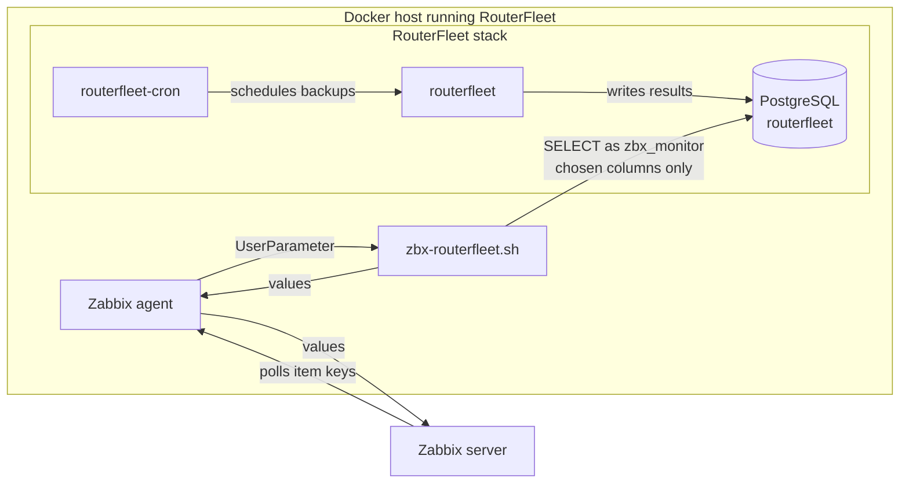

# Zabbix monitoring for RouterFleet

Monitor a RouterFleet installation with Zabbix: per-device backup health,
fleet-wide counters, and a collector that reports its own failures.

Everything here is self-contained - a template, a collector script, an agent
configuration fragment and a SQL grant file. No Zabbix server modules, no
agent patches, no network access from Zabbix to the database.

## What it monitors

**Backup health**

| Item | Key | Meaning |
|---|---|---|
| Backup age (per device) | `routerfleet.backup.age[<uuid>]` | Seconds since the last **successful** backup |
| Backup result (per device) | `routerfleet.backup.result[<uuid>]` | 1 if the most recent **attempt** succeeded |
| Monitored devices | `routerfleet.routers` | Enabled devices that have a backup profile |
| Failing devices | `routerfleet.failing` | Fleet-wide count of devices whose last attempt failed |
| Collector probe | `routerfleet.probe` | 1 when the collector reached the database |

**Security and operations** — read from RouterFleet Improved's SSH host-key
store, audit log and command jobs. A counter that cannot be read (a missing
grant, a missing table) reports `-1` and raises its own alarm; it never reports
a reassuring `0`.

| Item | Key | Meaning |
|---|---|---|
| Devices without a host key | `routerfleet.hostkeys.missing` | Enabled devices RouterFleet has never completed a connection to |
| Host keys learned recently | `routerfleet.hostkeys.new` | Keys first seen in the last hour — a device was rebuilt, replaced, or is not the one previously trusted |
| Failed sign-ins | `routerfleet.logins.failed` | Failed sign-ins in the last 15 minutes, all accounts and addresses |
| Audited changes | `routerfleet.changes.recent` | Configuration changes recorded in the last hour |
| Failed command jobs | `routerfleet.commands.failed` | Fleet Commander jobs with a failed or aborted task, last 24h |

Devices are discovered automatically. Adding a device to RouterFleet puts it
under monitoring within the discovery interval; removing one retires its items
after the discovery lifetime.

## How it fits together



The collector runs **on the Docker host**, not inside a container, and reaches
the database with `docker exec`. The database therefore needs no published
port and no network exposure for monitoring to work.

## Prerequisites

- RouterFleet deployed with Docker Compose, PostgreSQL variant
- Zabbix server 7.0 or later (the template targets the 8.0 export schema)
- Zabbix agent or agent 2 installed on the Docker host
- The agent's user able to run `docker exec` against the database container
- `UnsafeUserParameters` left at its default of `0`

## Installation

### 0. Get the kit onto the Docker host

The kit is part of the repository, not of the Docker images. On the Docker
host, fetch the current version of the repository and use its `contrib/zabbix`
folder:

```bash
wget -O routerfleet-main.tar.gz https://github.com/alessiobravi/routerfleet_improved/archive/refs/heads/main.tar.gz
tar xzf routerfleet-main.tar.gz routerfleet_improved-main/contrib/zabbix
cd routerfleet_improved-main/contrib/zabbix
```

(or `git clone https://github.com/alessiobravi/routerfleet_improved.git`).
The commands below run from that folder.

### 1. Create the read-only database role

Edit `sql/zbx_monitor.sql` and replace the placeholder password, then:

```bash
docker exec -i routerfleet-postgres \
  psql -U routerfleet -d routerfleet < sql/zbx_monitor.sql
```

The role is granted `SELECT` on the columns the collector reads and nothing
else - not the device passwords, not the backed-up configurations, not user
names, addresses or session keys. See
[design note 5](docs/design-notes.md) for why that matters.

Use this role for the kit's template only. **Do not link Zabbix's generic
"PostgreSQL" templates to it**: they need the `pg_monitor` role, and without it
the database log fills with `permission denied for function pg_ls_waldir` and
`unrecognized configuration parameter "zbx_tmp..."`. If you want PostgreSQL's
own health in Zabbix, give those templates a separate role with `pg_monitor` -
knowing that `pg_monitor` can read the text of every running query, which may
carry data.

**Moving to PostgreSQL 18** ([Upgrading](../../docs/upgrading.md#moving-to-postgresql-18)):
from 0.25.1 the migration script carries this role along, with its password and
grants - nothing to do. A database moved with an earlier version lost the role:
run the SQL above again.

### 2. Install the collector

```bash
sudo install -m 0755 scripts/zbx-routerfleet.sh /usr/local/sbin/zbx-routerfleet.sh
sudo /usr/local/sbin/zbx-routerfleet.sh probe      # expect: 1
sudo /usr/local/sbin/zbx-routerfleet.sh discovery  # expect: JSON with your devices
```

If your container or database names differ from the defaults, create
`/etc/default/zbx-routerfleet`:

```sh
RF_CONTAINER=routerfleet-postgres
RF_DB=routerfleet
RF_USER=zbx_monitor
```

### 3. Let the agent run it

```bash
sudo install -m 0644 agent/routerfleet.conf /etc/zabbix/zabbix_agent2.d/routerfleet.conf
sudo systemctl restart zabbix-agent2
```

For Zabbix agent 1, use `/etc/zabbix/zabbix_agentd.d/` and `zabbix-agent`.

The agent runs as the `zabbix` user, which must be able to reach the Docker
socket. Granting that is equivalent to granting root on the host, so prefer a
narrow `sudoers` rule over adding the user to the `docker` group:

```
zabbix ALL=(root) NOPASSWD: /usr/local/sbin/zbx-routerfleet.sh
```

and prefix the UserParameter commands with `sudo`.

### 4. Import the template

In the Zabbix frontend: **Data collection → Templates → Import**, and select
`templates/routerfleet-by-zabbix-agent.yaml`.

Then link **RouterFleet by Zabbix agent** to the host that represents your
Docker host.

### 5. Adjust the thresholds

| Macro | Default | Meaning |
|---|---|---|
| `{$ROUTERFLEET.BACKUP.MAX_AGE}` | `48h` | Backup counts as stale |
| `{$ROUTERFLEET.BACKUP.MAX_AGE.CRIT}` | `7d` | Stored configuration no longer a usable recovery point |
| `{$ROUTERFLEET.LOGINS.FAILED.MAX}` | `5` | Sustained failed sign-ins over 15 minutes that counts as an attack rather than a forgotten password |

Set `MAX_AGE` to roughly twice your backup interval, so a single missed run
does not alarm but two consecutive ones do.

## Verifying the installation

```bash
# the collector, directly
/usr/local/sbin/zbx-routerfleet.sh probe       # 1
/usr/local/sbin/zbx-routerfleet.sh routers     # number of monitored devices
/usr/local/sbin/zbx-routerfleet.sh failing     # 0 if all is well

# through the agent, from the Zabbix server
zabbix_get -s <docker-host> -k routerfleet.probe
zabbix_get -s <docker-host> -k routerfleet.backup.discovery
```

In the frontend, **Monitoring → Latest data** filtered to the host should show
one age item and one result item per device within an hour of linking.

## What alarms, and what deliberately does not

**Alarms**

- a device with no successful backup inside `MAX_AGE` (warning) or
  `MAX_AGE.CRIT` (high)
- a device whose most recent attempt failed (average)
- the collector unable to reach the database (high)
- no data from the agent for 30 minutes (average)
- an SSH host key newly accepted (warning) — see below
- failed sign-ins sustained above the threshold for 15 minutes (average)
- a device with no host key recorded for 24 hours (warning)
- a Fleet Commander job that completed with a failed task (warning)
- a counter the collector cannot read, reported as `-1` (average)

**Deliberately silent**

- *Devices without a backup profile.* They are not meant to be backed up, so a
  permanent staleness alarm would be noise. They are not discovered at all.
- *A single failed attempt that a retry then fixes.* The result item records
  it, and it is visible in history, but the staleness triggers are what
  escalate - the question that matters is whether a usable backup exists, not
  whether every individual attempt succeeded.
- *Backup content changes.* This integration monitors whether backups happen,
  not what is in them.
- *A single failed sign-in.* People mistype passwords. The trigger needs the
  rate to stay up for a full 15 minutes, which a person does not do.
- *Audited changes.* Counted and graphed, never alarmed: a change is normally
  somebody doing their job. The point is that an unexplained burst is visible
  afterwards without anyone having to go looking for it.

**One alarm worth reading carefully:** a newly accepted host key is not a
failure, and it will fire legitimately whenever a device is rebuilt or
replaced. It is in here because the one case that matters - a device
presenting a key nobody can account for - is otherwise completely silent, and
by the time it is noticed, credentials have already been sent to whatever
answered.

## Troubleshooting

**Values and what they mean**

Every count returns **-1** when its query could not run - database
unreachable, role missing, column not granted - as distinct from running and
finding nothing. Triggers test `>= 0` before comparing, and one trigger watches
for `-1` directly, so an upgrade that needs a new grant is noticed rather than
silently narrowing what is monitored.

The probe item is the exception: there `0` genuinely means "could not reach the
database", which is the thing being measured.

**Backups that keep only changes**

A backup whose configuration did not change is still recorded - succeeded, with
its finish time - and only its content is not stored again. The age and result
items count it like any other backup. RouterFleet keeps this as a contract for
integrations; [design note 1](docs/design-notes.md) has a query to confirm it
after an upgrade.

| Symptom | Cause |
|---|---|
| All items unsupported | Agent cannot run `docker exec`; check the sudoers rule |
| `probe` returns 0 | Role missing, wrong password, or container name differs |
| Discovery returns `{"data":[]}` | No enabled device has a backup profile assigned |
| Age is `999999999` | No successful backup on record for that device - see [design note 3](docs/design-notes.md) |
| Result always `1`, never `0` | You are running the old query - see [design note 2](docs/design-notes.md) |
| A counter shows `-1` | The collector could not read it: a grant from `sql/zbx_monitor.sql` is missing, or the table does not exist on this installation |

## Design notes

The non-obvious decisions, and one bug worth knowing about, are documented in
[docs/design-notes.md](docs/design-notes.md). The most important: **backup age
is the authoritative signal**, and the obvious way to query "did the last
backup fail?" silently never reports a failure.

## Layout

```
templates/routerfleet-by-zabbix-agent.yaml   importable Zabbix template
scripts/zbx-routerfleet.sh                   collector, runs on the Docker host
agent/routerfleet.conf                       UserParameter definitions
sql/zbx_monitor.sql                          read-only database role
docs/design-notes.md                         why it is built this way
```

## Licence

MIT, like the rest of RouterFleet Improved.
