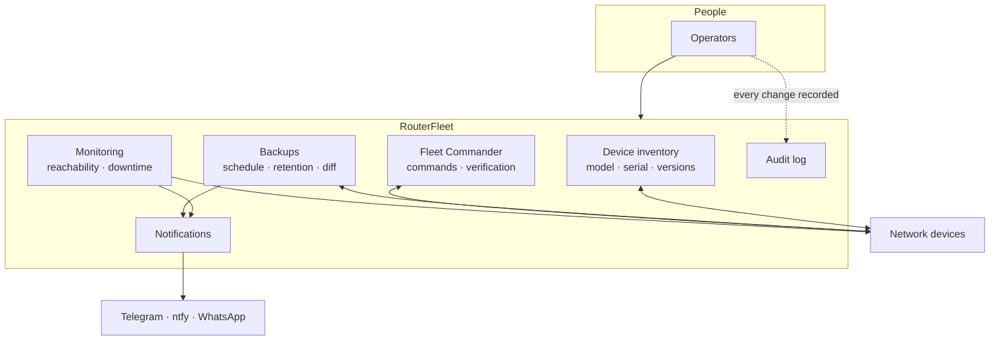

# RouterFleet Improved — documentation

RouterFleet keeps a configuration history for a fleet of network devices, runs
commands across that fleet on a schedule, watches whether the devices are
reachable, and records who changed what.

## Pages

**Running it**

| Page | What it covers |
|---|---|
| [Architecture](architecture.md) | The five containers, the scheduler, startup, the data model |
| [Installation](installation.md) | Deployment, compose files, environment variables, TLS, volumes |
| [Upgrading](upgrading.md) | Upgrade paths — including from the earlier RouterFleet projects |
| [Operations](operations.md) | Management commands, housekeeping, troubleshooting, local development, tests |
| [Security](security.md) | Secrets at rest, the scheduler endpoints, hosts and CSRF, outbound calls |

**Using it**

| Page | What it covers |
|---|---|
| [Devices](devices.md) | Device types, inventory, version colours, list filtering, bulk operations |
| [Backups](backups.md) | Profiles, the two-phase pipeline, retention, change detection, diffs |
| [Fleet Commander](fleet-commander.md) | Commands, variants, verified results, jobs, schedules, aborting |
| [Monitoring](monitoring.md) | Reachability checks, downtime records, how it gates other work |
| [Notifications](notifications.md) | Channels, concatenation, retries, daily reports |
| [Audit log](audit-log.md) | Login history, change log, what is deliberately not recorded |
| [Users and permissions](users.md) | The five levels and what each one reaches |
| [Import tool](import-tool.md) | CSV format, validation rules, missing groups |

## Three things worth knowing up front

**The application has no internal scheduler.** A separate cron container calls
HTTP endpoints on a fixed timetable, and that is the only clock in the system.
Stop it and all background work stops while the web interface keeps working.
See [Architecture](architecture.md#the-scheduler).

**A command is judged by what the device shows afterwards, not by an exit
code.** A variant can define verification commands and the result they must
produce; the payload runs once and verification is retried until it passes or
times out. This is what makes updating a device that reboots mid-run reliable.
See [Fleet Commander](fleet-commander.md#verified-results).

**`app_secrets` is not optional backup material.** It holds the key your device
passwords are encrypted with. A database backup without it cannot restore those
passwords. See [Security](security.md#the-key).
