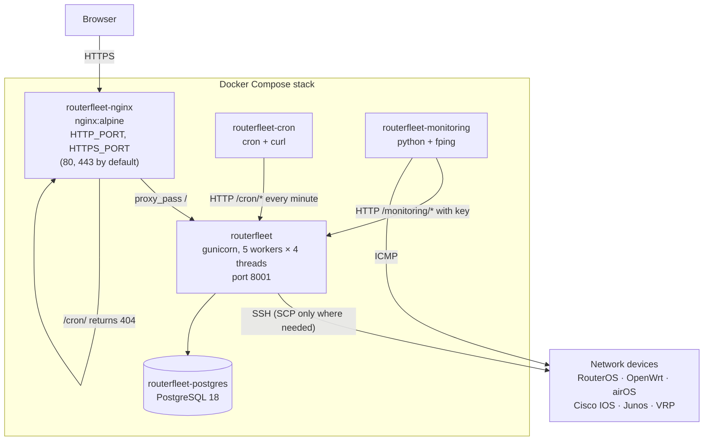
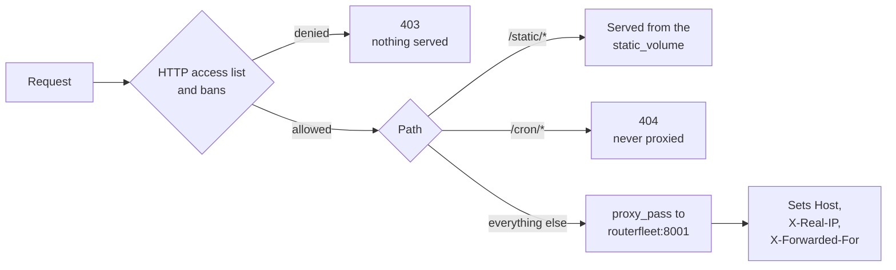
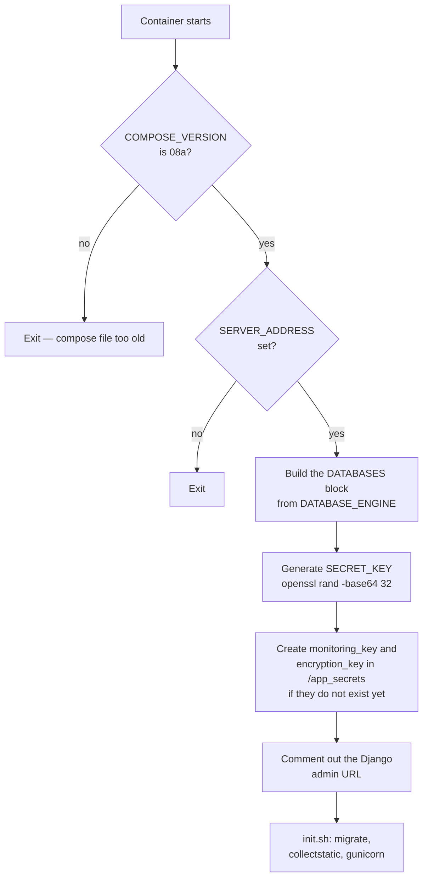
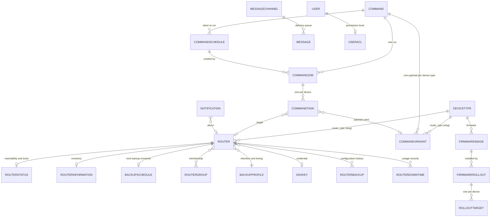

# Architecture

RouterFleet runs as five containers. Only nginx is published to the network;
the application's port 8001 is published on the host's loopback only
(`127.0.0.1` and `::1`), for the monitoring container. Everything else talks
over RouterFleet's own Compose network, which is dual stack: every container
has an IPv4 and an IPv6 address, and every service listens on both.

## What each container does

| Container | Role |
|---|---|
| `routerfleet-nginx` | TLS termination, serves `/static/`, refuses `/cron/`, proxies everything else to the app. Generates a self-signed certificate on first start if none is present. |
| `routerfleet` | The Django application under gunicorn. Everything that touches a device over SSH happens here, including work triggered by the scheduler. |
| `routerfleet-cron` | Has no application code. It calls the app's `/cron/` endpoints with `curl` on a fixed schedule — this is the only clock in the system. |
| `routerfleet-monitoring` | Independent reachability loop. Pings devices with `fping` and reports status changes back over HTTP. Kept separate so a slow backup cannot delay a ping. Runs on the host's network (every right dropped but the raw socket) for the [discovery listener](discovery.md) inside it, dormant until asked; reaches the application on the host's loopback, port 8001. |
| `routerfleet-postgres` | The database. Optional — SQLite or an external Postgres work too, via `docker-compose-no-postgres.yml`. |

## The request path

nginx first checks the address against the bans and the
[HTTP access list](security.md#http-access-lists-and-banning), then does three
distinct things with an incoming request:

`X-Real-IP` carries the address of the connection itself, which matters twice:
the audit log reads it to record where a sign-in came from, and the `/cron/`
endpoints refuse any request that carries it — see [Security](security.md).

## The scheduler

The cron container holds one crontab. Each entry sleeps a fixed number of
seconds before firing, which spreads the work across the minute instead of
starting all its jobs at once.

| Offset | Every | Endpoint | Purpose |
|---|---|---|---|
| +0s | 5 min | `/cron/generate_backup_schedule/` | Work out each device's next daily/weekly/monthly backup moment |
| +5s | 1 min | `/cron/create_backup_tasks/` | Turn due moments into backup rows |
| +10s | 1 min | `/cron/update_router_information/` | Refresh the device inventory |
| +10s | 1 min | `/cron/concatenate_notifications/` | Fold pending notifications into messages |
| +15s | 10 min | `/cron/daily_reports/` | Send the daily status and backup reports |
| +20s | 10 min | `/cron/housekeeping/` | Expire stale locks and tasks, apply retention |
| +30s | 1 min | `/cron/send_messages/` | Deliver queued messages |
| +40s | 1 min | `/cron/perform_backup_tasks/` | Run backups, up to ~45 s per pass |
| +40s | 1 min | `/cron/create_command_jobs/` | Turn due command schedules into jobs |
| +50s | 1 min | `/cron/check_updates/` | Update check — asks GitHub at most hourly; off with `UPDATE_CHECK=off` |
| +50s | 1 min | `/cron/perform_command_tasks/` | Run command tasks |
| +25s | 1 min | `/cron/firmware_rollouts/` | Advance [firmware rollouts](firmware.md): one step per device |

Two consequences worth knowing:

- **The application does nothing on its own.** Stop the cron container and
  backups, commands, notifications and inventory refreshes all stop, while the
  web interface keeps working normally.
- **A missed minute is a missed minute.** Nothing catches up on restart. Backups
  are picked up as soon as they are due again; command schedules deliberately
  do *not* run late — see [Fleet Commander](fleet-commander.md#a-run-that-was-missed).

## Startup

`entrypoint.sh` runs before anything else and writes
`routerfleet/production_settings.py` from the environment. That file is
generated on every container start and is not in version control.

`SECRET_KEY` is regenerated on every start, so sessions do not survive a
restart — everyone is signed out. The two keys in `/app_secrets` are created
once and kept, because they must not change: `encryption_key` decrypts the
stored device passwords, and `monitoring_key` authenticates the monitoring
container. **Back that volume up.**

The Django admin is switched off by commenting its URL out of `urls.py` at
startup. The audit log registers its models as read-only there as a second
layer, in case the admin is ever re-enabled.

## Data model

Two details in that model are deliberate and worth knowing:

- **`CommandTask` keeps `router_uuid` and `router_name` as its own columns.** A
  task outlives the device it ran on: delete the device and the task row keeps
  the name it was executed under, so the history stays readable.
- **`RouterBackup.backup_text_hash` is stored, not computed.** It is written by
  `save()` from the configuration text, and `config_change_detected` is derived
  from it at the same moment, so the backup list can filter and sort on both
  without reading every configuration.

## Where files live

| Path | Contents | Volume |
|---|---|---|
| `/var/lib/routerfleet/` | Binary backups and firmware images (`MEDIA_ROOT`) | `media_root` |
| `/app_static_files/` | Collected static files | `static_volume` |
| `/app_secrets/` | `encryption_key`, `monitoring_key` | `app_secrets` |
| `/certificate/` | `nginx.pem`, `nginx.key` | `https_cert` |
| `/var/lib/routerfleet_sqlite/` | SQLite database, when used | `sqlite_volume` |

Configuration *text* is stored in the database, not on disk. Only the binary
backup files land in `MEDIA_ROOT`.
