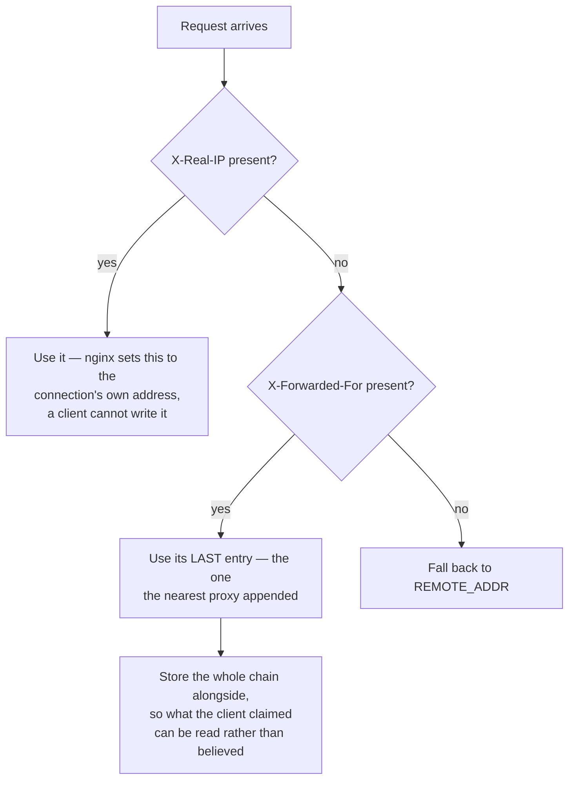

# Audit log

**Audit Log** in the sidebar holds two read-only histories, one tab each. Both
require permission level 50 — the same level as the User Manager.

## Login history

Every attempt to sign in, successful or not.

| Recorded | Notes |
|---|---|
| Username | **As it was typed**, not as a reference — an attempt with a name belonging to nobody is exactly what is worth reading later |
| Outcome | Signed in, or refused |
| Account and permission level | The level as it stood at the time |
| Moment | |
| Address | See below |
| Forwarded chain | The full `X-Forwarded-For` value, shown on hover |
| User agent | Operating system and browser |
| Session | Marked while still open; closed when the account signs out |

A run of refused attempts against a name that does not exist is therefore
visible, which is the point.

### Where the address comes from



The last entry of `X-Forwarded-For` is used because every earlier entry was
written by whoever came before — the first one is whatever the client felt like
claiming. The chain is kept beside the address so a claim can be inspected
instead of trusted.

Addresses are stored as text, not as an IP field: a header is written by whoever
sends it, and a malformed one must be recorded rather than cause an error in the
middle of somebody's sign-in.

### What a browser cannot tell you

**There is no device hostname in the log, because nothing sends one.** Neither
HTTP, TLS nor TCP carries the client's hostname, and JavaScript cannot read it.
The log records the address and the `User-Agent` line — an operating system and
a browser, not a machine name.

There is deliberately no reverse-DNS lookup either: a PTR record says what DNS
claims about an address, is frequently absent on a local network, and can hang.

## Change log

What was changed in the configuration, by whom, field by field.

Watched objects:

| Area | Objects |
|---|---|
| Devices | Router, RouterGroup (including membership), SSHKey |
| Backups | BackupProfile |
| Fleet Commander | Command, CommandVariant, CommandSchedule (including its four membership lists), ScheduleDefaults |
| Notifications | MessageChannel, MessageSettings |
| Integrations | ExternalIntegration |
| Accounts | User, UserAcl with its permission level |

Each entry opens field by field — before and after — in a popup, without
leaving the page.

### What is deliberately not recorded

- **A save that changed nothing writes nothing.** A save that names the fields
  it writes, none of which are watched, is not even read back for comparison —
  so a job writing its own progress does not fill the log.
- **Work that is not a person's doing is summarised, not itemised.** A retention
  sweep, a bulk edit, adding many devices to a group: **one entry** naming what
  it was about and how many rows it touched. A block that changed nothing writes
  nothing, which is why housekeeping every ten minutes stays quiet.
- **Things the application makes for itself are not recorded at all** — the
  default commands seeded when Fleet Commander is first opened, for instance.
- **A schedule's `last_run` and `next_run` are not watched.** The cron writes
  them; nobody edited them.
- **A user's address-link preference is not watched.** It is a self-service
  display setting, not a permission.

### Secrets in the log

Passwords, private keys and tokens are **compared on their real value and
written as `(set)` or `(empty)`**. The log therefore proves that a secret
changed without holding a second copy of it.

### Who did it

| `actor_kind` | Meaning |
|---|---|
| user | A signed-in person, recorded with their account, level, address and user agent |
| cron | A request with no user — the scheduler container calling a `/cron/` endpoint |
| command line | No request at all — a management command or a shell |

The distinction is explicit: no request is not the same as a request without a
user, and neither is mistaken for a person.

The actor is stored **twice**, as the account and as the name it had at the
time, so closing an account later does not blank out what it did. Values are
likewise stored as they read at the time rather than as references to something
that may be renamed or deleted.

## The trail is append-only

Entries cannot be removed from the interface:

- there is no button,
- the Django admin registers both models read-only,
- and deleting a row any other way — including from a shell — raises an error
  naming the one command that is allowed to.

That is deliberate: an audit trail the audited party can clear is not one.

Old entries are kept until you remove them yourself:

```bash
python manage.py prune_audit_log --older-than 365 [--dry-run] [--login-history | --change-log]
```

`--older-than` is a number of days and is **required**, so the command cannot
wipe the history by accident. With neither flag, both logs are pruned.
