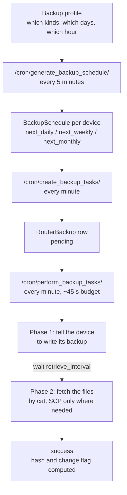
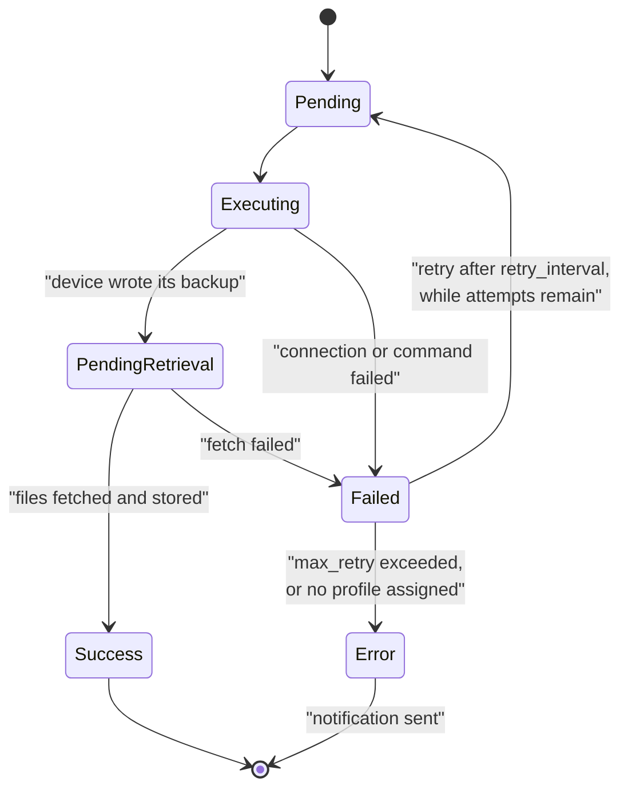
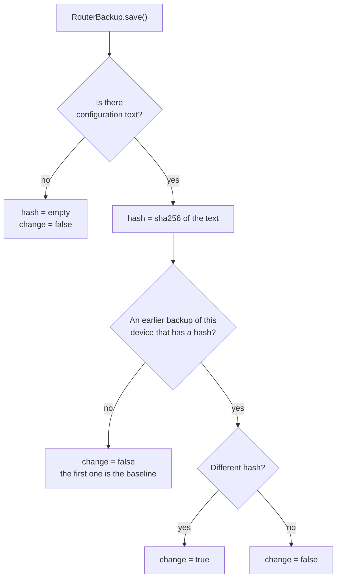
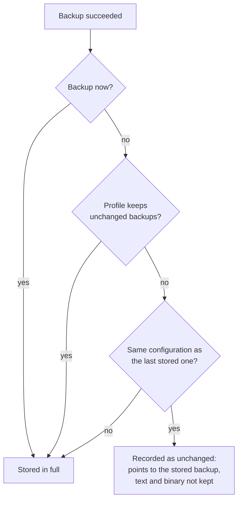

# Backups

Every device is assigned a **backup profile**, which decides when it is backed
up and how long each backup is kept. Backups come in four kinds — `daily`,
`weekly`, `monthly` and `instant` (taken by hand) — and each kind has its own
retention.

## What a backup contains

| Device type | Configuration text | Binary image |
|---|---|---|
| RouterOS | `/export` output → `.rsc` | none (until 0.22: `/system backup save` → `.backup`) |
| OpenWrt | `uci export` output → `.txt` | `sysupgrade --create-backup` → `.tar.gz` |
| Ubiquiti airOS | `cat /tmp/system.cfg` output → `.cfg` (until 0.37.2: the file downloaded) | none |
| Cisco IOS | `show running-config` → `.cfg` | none |
| Juniper Junos | `show configuration` and `show configuration \| display set` → `.conf` | none |
| Huawei VRP | `display current-configuration` → `.cfg` | none |

Files are named `routerfleet-backup-<id>-<kind>-<YYYY-MM-DD_HH-MM>`.

The **text** comes from command output (*backup - text*), nothing written on
the device; a device type can have several **named texts** (Juniper: the
configuration and its set format), each shown, compared and downloaded on its
own, all counted for change detection. Files made on the device (*backup -
create*) are downloaded (*files to download*) and removed. All of it is set
per [device type](device-types.md).

### How files are downloaded

A file is read over the **command channel** first (`cat`), byte for byte:
that works on OpenWrt, airOS and any device with a shell. Only where that is
impossible - a device without `cat` (RouterOS) or one driven through an
interactive shell (Cisco and the like) - is **SCP** used. Success needs a
marker that only a real shell prints after `cat` worked, so a device's error
message is never stored as a backup.

Either way a download is **one file, at the path RouterFleet chose**: an SCP
sender can not create directories, send more files, or name a path - all
refused - and a file over 256 MB (`BACKUP_DOWNLOAD_MAX_BYTES`) is refused. A
backup keeps one binary file; a second binary download is skipped, not
stored over the first. Command output is read before its exit status and
limited to 64 MB, so a large export can not stall a backup.

The configuration **text** is stored in the database, which is what makes
diffing and change detection possible. The **binary** image is stored as a file
under `MEDIA_ROOT`. Lines the device type marks as noise - RouterOS comment
lines, Cisco's `! Last configuration change` - are dropped before storing, so a
timestamp does not register as a configuration change.

Two export options are profile settings, for device types that have them:
*Include passwords and keys* and *One line per item* (`terse`). The device type
holds the words for them, and can hold other words for older OS versions,
chosen from the version the device last reported. RouterOS needs that:

| RouterOS | Passwords and keys included | Left out |
|---|---|---|
| 7 | `show-sensitive` | nothing (the default) |
| 6 | nothing (the default) | `hide-sensitive` |

A device whose version has not been read yet gets the RouterOS 7 words; if it
is a RouterOS 6 device, that first backup fails and is retried once the version
is known (*Update device information* reads it at once).

A device that refuses a backup command - an unknown word, a syntax error -
makes the backup fail with the device's message, and it is retried. What the
device printed is never stored as a configuration.

## The backup list

The devices with a backup in the chosen view (successful, queue, errors) are
on the left, **All devices** first; on the right, the backups of the device
chosen - or of every device, newest first - with when it finished, the
schedule, the result (*Changed*, a click showing what changed; *No change*;
*Stored*; or why it failed, or what it waits for) and, for one device, the
configuration's hash. Each row's menu opens the backup, downloads its
configuration or shows what changed. **Back up now** takes an instant backup
of the chosen device.

It shows the newest 500 backups of the view and says how many there are; older
ones are reached by day - a bar of the status page's chart - or with *show
all*; a day or *the last 24 hours* from the status page stays applied while
you choose devices. It reads only the fields it shows, so it stays fast with
any number of backups.

## From a profile to a stored backup

### Scheduling

`generate_backup_schedule` fills in each device's next moment per kind, and
clears a moment when that kind is switched off in the profile. The next moment
is always in the future:

- **Daily** — the next enabled weekday at `daily_hour`. Weekdays are individually
  switchable, so "weekdays only" is a profile setting.
- **Weekly** — the next `weekly_day` at `weekly_hour`.
- **Monthly** — `monthly_day` (1st, 7th, 14th, 21st or 28th) at `monthly_hour`,
  rolling into next month if that moment has passed.

If a moment cannot be computed, the profile records
`profile_error_information`, which the profile list shows.

### Creating the task

`create_backup_tasks` turns due moments into rows, **monthly first, then weekly,
then daily**, so a device whose moments coincide gets the longest-retained kind.
A device is skipped unless all of these hold:

- the device is enabled,
- it has no `backup_lock` — no other backup is in flight for it,
- and either monitoring is off for it, or monitoring is on **and it is currently
  online**.

That last condition means an unreachable monitored device is not attempted at
all, rather than failing and consuming retries.

### Performing the backup

Backups run in **two phases**, because a device needs time to write its own
backup file before it can be fetched:

1. **Execute** — the device is told to write its configuration. On success the
   row is marked `backup_pending_retrieval` and `next_retry` is set to
   `retrieve_interval` seconds ahead (default 60 s).
2. **Retrieve** — the files are fetched (see above), the text is stored, the binary
   is saved, local temporary files are removed and the leftovers on the device
   are deleted. Only then is the backup `success`.

For OpenWrt the configuration text is captured from `uci export` in phase 1
(it comes back on stdout), while the binary archive is fetched in phase 2
(by `cat`). airOS too takes its text in phase 1, from `cat /tmp/system.cfg`
- nothing to download. Text is decoded as UTF-8, with a Latin-1 fallback.

Each pass works for up to **45 seconds** and then stops, leaving the rest for
the next minute. `backup_interval` inserts a pause between devices: at `60`
seconds the pass does exactly one device per minute, which is how a fleet is
throttled on a slow link.

A `task_lock` on the row stops two passes from working on the same backup.

### When a backup fails

`retry_interval` is in **minutes** (1, 15, 30 or 60) and `max_retry` is 1–5. A
device with no backup profile fails immediately with
`No backup profile assigned`.

Housekeeping provides the backstop:

| Condition | Action |
|---|---|
| `task_lock` older than 6 hours | Lock cleared, a warning written to the task console, notification sent |
| Row unfinished for more than 18 hours | Marked `error` with `Backup task expired`, notification sent |
| Device `backup_lock` older than 18 hours with nothing pending | Lock cleared, device marked as last-backup-failed |

## What a backup changed

Every backup records whether it brought a different configuration than the one
before it.

Two rules make this trustworthy:

- **A failed backup is looked past.** Backups with no configuration text are
  skipped when searching for the one to compare against, so the comparison
  always reaches the last configuration that was really seen.
- **The first backup of a device is not a change.** It has nothing to be
  compared with; it is the baseline the later ones are measured against.

The comparison only ever looks *backwards* — at backups written before this one
— so a retry that finishes late is not compared against something that came
after it.

Where this shows up:

- The **backup overview** marks the backups that changed something.
- The device list shows the chosen device's **last change**, or `—` if its
  configuration never changed; the CSV export carries it for every device.
- Clicking either opens the change **in place**, without leaving the page, as a
  line-by-line diff against the previous backup, with a button to open the full
  comparison when the change is longer than the three lines of context.

Backups that already existed before this was introduced are filled in by a data
migration that walks each device's history applying the same rule.

## Unchanged backups

Each backup's configuration text is fingerprinted (SHA-256). A profile that
**keeps only changes** - the default for a new profile - handles each scheduled
backup like this: when its configuration is the
same as the device's last stored one, the backup is recorded - it succeeded, at
that time, and counts for everything that measures backup age - but its text and
binary are not stored again. It points to the stored backup instead, and is
marked *No change* in the backup list; opening, downloading or comparing it
shows the stored configuration it is the same as.

**Keep unchanged backups** in the profile stores every scheduled backup in full,
changed or not. Profiles that existed before this setting did keep it on: an
upgrade does not change how an installation stores its backups. Backups started with *Backup now* are always stored in full:
someone asked for that copy.

### A contract for integrations

Monitoring that reads backup health from the database - the
[Zabbix kit](zabbix.md) does - can rely on this, and the test suite enforces
it:

| Row in `backup_data_routerbackup` | `success` | `error` | `finish_time` | `same_as_id` |
|---|---|---|---|---|
| Succeeded, stored in full | true | false | set | empty |
| Succeeded, **unchanged** (not stored again) | true | false | set | the stored backup |
| Failed, will be retried | false | false | empty | empty |
| Failed for good | false | true | empty | empty |

- **Every attempt is a row.** An unchanged backup is a row like any other; only
  its content is not stored again.
- **The latest attempt of a device is its row with the highest `id`** - never
  the one with the latest `finish_time`, which is empty exactly when an attempt
  failed.
- **The age of a device's backups** is measured from the latest `finish_time`
  of its successful rows.

A release that changes any of this, or the columns the Zabbix kit reads, says
so in the changelog under **Monitoring**.

## Retention

Housekeeping deletes backups older than their kind's retention, per profile:

| Kind | Default retention |
|---|---|
| `daily` | 7 days |
| `weekly` | 30 days |
| `monthly` | 365 days |
| `instant` | 3650 days |

Two details:

- The profile named `default` also covers devices with **no** profile assigned.
- `retain_backups_on_error` (on by default) **suspends deletion for a device
  whose last backup failed**, so a device that stopped backing up does not
  quietly lose the history it still has while nobody is looking.
- **A device's newest stored configuration is never deleted**, however old: a
  device that has been offline for weeks - and so was not even attempted - or
  whose configuration has not changed in months keeps its last known one. A
  stored backup that kept *unchanged* backups still point to also stays, until
  they expire.

The whole sweep is recorded as a single audit-log entry naming how many rows it
removed, and a pass that deletes nothing writes nothing — so housekeeping every
ten minutes stays quiet.

Messages older than 30 days are deleted in the same pass.

## The backup page

A backup's page shows its state - *Queued*, *Creating*, *Downloading*,
*Stored*, *Unchanged* or *Failed* - with a ring for its phase, four tiles
(configuration size and lines, binary size, whether the configuration changed,
retries), and a timeline built from its console log: when it was queued, each
step sent to the device, and the result. It updates itself until the backup is
done.

## Comparing backups

Any two backups can be compared from the backup list: tick two and **Compare
these two** shows the older against the newer. The diff is computed on the
stored configuration text. Binary images are downloadable but
not comparable.

## Permissions

| Action | Minimum level |
|---|---|
| Backup list and backup profile list | signed in — no level needed |
| Backup details, compare, download | 20 — Backup Operator |
| Take an instant backup | 20 — Backup Operator |
| Delete a backup | 30 — Host Manager |
| Create or edit backup profiles | 40 — Configuration Manager |
