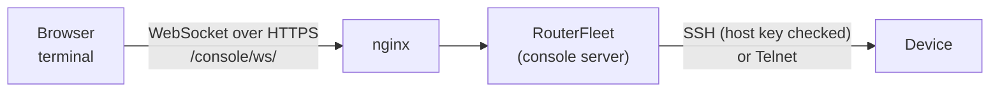

# Device console

**A terminal on any device, in the browser.** Open the console of a router and
work on its command line - over SSH, or Telnet where a device has nothing else
- with its backup account or any other account, without leaving RouterFleet
Improved and without an SSH client on your computer. It works on a phone too,
with a bar of the keys a phone keyboard lacks (Esc, Tab, Ctrl-C, Ctrl-D,
arrows).

The connection to the device starts at the RouterFleet server, as backups do:
no firewall rule is needed for your computer, and the browser never talks to
the device itself.

## Opening a console

**Console** on a device's page, or the keyboard icon in the device list, for
**Host Manager (level 30) and above**. The form asks:

- **Connection** - **SSH** (encrypted; the device's stored host key is checked
  before anything is sent), or **Telnet**, only on a device where it was
  switched on, after confirming that it is unencrypted.
- **Account** - the device's **backup account** (its password or key is used
  on the server and never reaches the browser), or **another account**: you
  type its password on the console page, and it goes once, over the encrypted
  connection, straight to the device's login. It is never stored or logged.
  Over Telnet RouterFleet sends no stored credential: you log in at the
  device's own prompt.

If a backup or a command is running on the device at that moment, the form
says so. A monitoring-only device has no console.

## When a console closes

A console never stays open behind your back. It closes:

| When | How fast |
|---|---|
| You close the page or the tab, reload it, or go to another page | at once |
| You press **Disconnect** | at once |
| The device ends the session (`exit`, a reboot) | at once |
| You sign out, your sign-in session expires, or your user level drops below Host Manager | within 5 seconds |
| The browser disappears without a word (network lost, laptop asleep) | within about 40 seconds (the server pings it every 20) |
| No input for 15 minutes | at 15 minutes |
| The session has lasted 4 hours | at 4 hours |

Each time, the device connection is closed too, and the reason is recorded.
The page then shows *Connection closed* over the terminal, with the reason and
a button back to the devices list (or to the device); *Keep the output on
screen* hides it to read or copy what the session printed. A session left open by a server restart is closed by the housekeeping (every 10 minutes), with that reason; tickets never used are removed after a week.

## Security

- **Who** - Host Manager and above; the level is checked when the console
  opens and again every few seconds while it is open.
- **One-time ticket** - the console form creates a ticket valid for 60 seconds
  that opens one connection, for the user who asked for it only. It travels
  inside the encrypted connection, never in a URL, so it is never in a log; the
  database holds only its SHA-256.
- **Same site only** - the WebSocket is refused unless it comes from a page of
  this installation, with your signed-in session.
- **Host keys** - SSH refuses a device whose host key changed, exactly as
  backups do ([Device host keys](security.md#device-host-keys)).
- **Devices only** - the console resolves the device's address and refuses
  loopback and link-local addresses, RouterFleet's service names, and the
  internal networks its container is attached to, then connects to the address
  it checked. A device address can therefore not be turned into a connection
  to the database or the application itself. Devices on your networks, reached
  through the gateway, are not affected.
- **Links printed by a device** open only after a confirmation, only for
  http(s), and in a separate tab.
- **Limits** - one console per user per device, at most three at once.
- **Telnet** - off for every device until switched on in its settings
  (*Allow a Telnet console (unencrypted)*, with its port).
- **Audit** - opening a console is recorded in the [change log](audit-log.md)
  with who, the device, the account and the transport; the device's timeline
  shows when it opened and closed and why. What is typed or shown is never
  recorded.

## How it runs

The console's WebSocket is served by uvicorn (port 8002 inside the application
container, `routerfleet/asgi.py`) beside gunicorn, which serves every page;
nginx passes `/console/ws/` to it in every [HTTPS](https.md) mode. Behind a
reverse proxy of your own, that proxy must pass WebSocket upgrades on
`/console/ws/` too.
