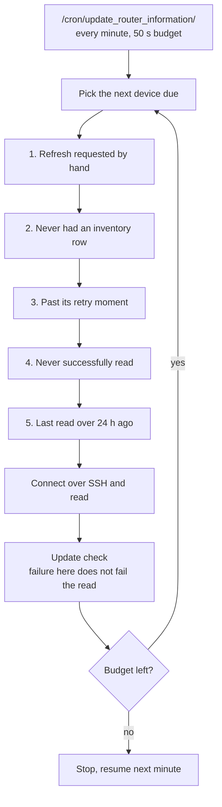
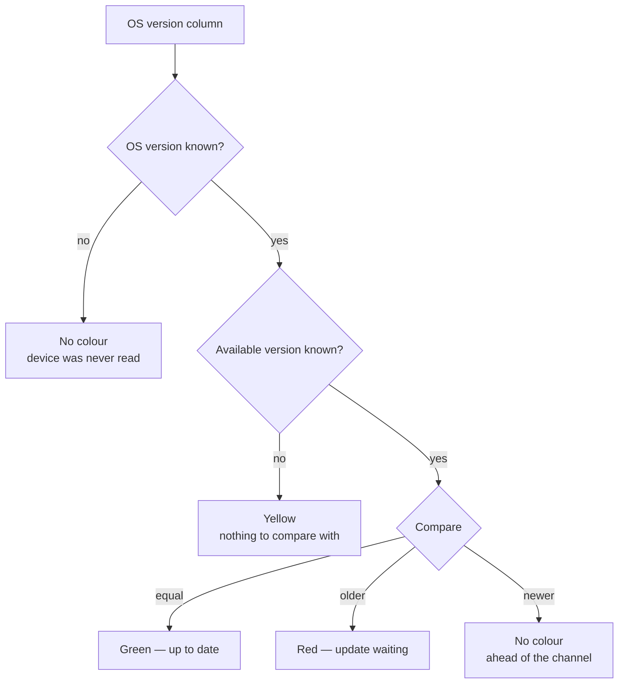

# Devices

A device in RouterFleet is a name, an address, credentials and a type. The type
decides what RouterFleet can do with it.

## Device types

The type decides how RouterFleet talks to a device, what it backs up and how it
learns its version. Types are configuration, in *System settings → Device
types* - see [Device types](device-types.md) for the shipped ones (RouterOS,
OpenWrt, airOS, Cisco IOS, Juniper Junos, Huawei VRP) and for adding your own.

Use *Monitoring only* for anything that only needs to be pinged. It carries no
credentials and never appears in version statistics.

## Credentials

A device authenticates with either a **password** or an **SSH key**, on a
configurable port (22 by default). Passwords are encrypted at rest — see
[Security](security.md). SSH keys are stored once under a name and shared by as
many devices as you like; RSA, ECDSA and Ed25519 keys are accepted.

**Saving a device never connects to it.** A device that does not answer - not
installed yet, unreachable, being replaced - can still be added, imported,
disabled or have its monitoring switched off, all in one save. The address must
be a valid IP address or hostname; the name does not have to resolve yet.

**Test connection** checks the credentials on request: on the device form, with
the values typed in (nothing is saved), and on the device's page, with its
saved settings. The stored password is only used for the stored address and
port: to test a new address, type the password again. The test is the [system
command](fleet-commander.md#system-commands) *connection test*, and confirms
the type matches reality:

The check is the type's recognition pattern - RouterOS must show
`platform: MikroTik`, OpenWrt must name OpenWrt, and so on - so a device of
another type is rejected with the reason rather than half-working.

A Cisco device whose account does not land in privileged mode takes an **enable
password**, stored encrypted and sent only to the stored address.

The first connection to a device - a test, an inventory read or a backup -
also stores its **SSH host key**. From then on
RouterFleet refuses to talk to anything at that address and port presenting a
different key, before sending any credential. After resetting or replacing a
device, use **Forget host key** on its page — see [Device host
keys](security.md#device-host-keys).

## The device page

A device's page opens with its state (online, offline, disabled, not
monitored), a ring with its availability over the last 7 days, and four tiles:
the last successful backup, failed backups in 7 days, the OS version it runs
(with whether it is up to date, or which version is available) and downtime in
7 days. The actions are **Edit** and, for operators,
**Execute command**. A timeline brings together its recent backups, commands,
and the moments it went offline and came back; the full details follow below.
The page updates itself while a backup, a command or an information read runs.

## Inventory

RouterFleet reads each device and stores model, serial number, OS version,
firmware version, architecture and CPU, plus the raw command output as JSON for
reference. What it sends is the [system
command](fleet-commander.md#system-commands) *inventory and versions*; where
each field is found in its output is set by the [device
type](device-types.md#inventory-sources) - `key: value` lines or patterns.

Devices that are disabled, of a type that is not reached over SSH (*Monitoring
only*), or currently known to be offline are skipped entirely.

Each pass works for up to **50 seconds**, so a batch of hand-requested
refreshes is not spread across one device per minute. A manual request is
cleared *before* the read runs, so a crash cannot leave it pending forever. The
regular refresh cycle is **24 hours**; a failed read retries after 5 minutes,
up to 3 times, before the device is marked as errored.

### What each device type reports

The shipped types read these fields; the full definitions, and the Cisco,
Juniper and Huawei ones, are in [Device types](device-types.md):

| Field | RouterOS | OpenWrt | airOS |
|---|---|---|---|
| Model name | `board-name` | `OPENWRT_DEVICE_MODEL` | `board.name` |
| Model version | RouterBOARD `model` | `VERSION_ID` | `board.model` |
| Serial number | RouterBOARD `serial-number` | MAC of `eth0` | `board.device_id` |
| OS version | `/system resource` `version` | `VERSION` | kernel, `uname -r` |
| Firmware | `current-firmware` | `OPENWRT_RELEASE` | `/etc/version` |
| Architecture | `architecture-name` | `uname -m` | from `/proc/cpuinfo` |

### Available version

Where the version a device could run comes from is set per device type - see
[Update checks](device-types.md#update-checks). The shipped types:

- **RouterOS** asks the device to query MikroTik's update server
  (`check-for-updates`, then `print` every 3 seconds, for up to 15, until the
  device has the answer) and compares the offered version with the installed
  one as numbers. The answer depends on the channel the device is set to, and
  needs the device itself to reach MikroTik's server.
- **OpenWrt** is compared against the public release list. Only releases newer
  than the installed one **and that still ship images for the device's board**
  are offered. The list is cached for 6 hours, so a large fleet does not hammer
  the download server. When nothing newer is offered, the installed release is
  stored as the available one: the device counts as up to date. A snapshot
  build, or a release list that could not be downloaded, stays unknown.
- **airOS, Cisco, Juniper and Huawei** have no check configured: their version
  is shown without a colour, and they are left out of the status page's update
  counts - until you switch on a check for the type, such as the [firmware
  repository](firmware.md).

Versions are read when a device is added, every 24 hours after that (online,
enabled devices), and on request with *Update router information* in the
device list.

A failed update check never fails the inventory read — the device facts are
stored and the version is simply left unknown.

## Version colours

A device with a newer version available also carries an **amber arrow** after
its operations (edit, console, command) in the device list, whichever columns
are shown; hovering it names the running and the available version. It follows
the same rule as the colours below. The operations keep their place on every
row, so the arrows line up.

The device list colours two columns, and the status page counts the same rule,
so the overview and the list cannot tell different stories.

- **Firmware** is green while it matches the OS version and red while it stayed
  behind it — a firmware left behind is what stops a device booting a new OS.
- **OS version** follows the diagram above. Yellow covers a device whose update
  check failed or has not run. airOS, which has no update check, has no
  colour.
- Versions are compared on their leading numbers, padded with zeros, so `7.16`
  and `7.16.0` are the same version. Trailing text like `(stable)` or an OpenWrt
  build hash is ignored.
- Every colour carries its reason in a tooltip.

The **status page** counts devices as *up to date*, *missing an update*, or *no
information*, excluding monitoring-only and airOS devices.

## The device list

### Filtering

**Filter** opens a row of text boxes under the column headings, one per column,
each filtering its own column as you type. **Show/Hide Columns** works
alongside it. Hiding the filter row clears the filters, so the list is never
filtered without a visible reason.

The filter row and its contents are remembered in the browser, and a filter is
remembered **by its column's name, not its position** — so it survives showing
and hiding columns, and is picked up again when a hidden column returns.

### Search terms

Both the column filters and the search box understand the same terms, all
matched case-insensitively:

| Term | Meaning |
|---|---|
| `text` | The cell contains it |
| `!text` | The cell does not contain it. `!7.16` shows every device not on 7.16. Taken literally, so `.` and `[` stay characters. A bare `!` clears the search |
| `^pattern` | A regular expression. In a column filter it matches the cell, so `^7\.1[67]` finds versions starting 7.16 or 7.17. In the search box it matches anywhere in the row |
| `!^pattern` | Devices that do **not** match the pattern |
| `(empty)` | Column filters only: rows where this column has no value — an empty cell or the `---` the list writes. `(empty)` in *Groups* finds devices in no group |
| `!(empty)` | Rows that do have a value |

A pattern that does not compile yet — `^(` on the way to `^(a|b)` — leaves the
list as it stands and marks the box until the pattern is finished.

### Address links

What a click on a device's address does is a **per-user** setting under *My
Settings* (the gear icon, top right):

| Setting | Behaviour |
|---|---|
| No links | The address is plain text |
| Open with SSH | `ssh://user@address:port` |
| Open with Winbox | `winbox://address` — RouterOS devices only |
| Show a menu | Hovering opens a small menu with both |

Devices that cannot offer an action stay plain text: a monitoring device, a
device with no username for SSH, anything that is not RouterOS for Winbox.
**Passwords are never part of a link.**

### Export and selection

**Select All** selects what the search currently shows, not every device in the
list. Rows filtered out remain in the page but hidden, so without this they
would be selected too.

**CSV export** writes the rows the current search shows — search box, column
filters and group all respected — across all pages, in the current sort order,
with the currently visible columns. The file carries a byte order mark so Excel
opens accented characters correctly, and its name carries the date.

## Bulk operations

Select devices in the list and act on all of them:

| Operation | Minimum level |
|---|---|
| Add to or remove from groups | 20 — Backup Operator |
| Take an instant backup | 20 — Backup Operator |
| Refresh inventory | 30 — Host Manager |
| Edit | 30 — Host Manager |

**Edit** changes port, username, password, SSH key, backup profile, monitoring,
enabled state and internal notes for every selected device at once. **A blank
field leaves the current value alone.**

The selection is handed over in a POST request and held in the session rather
than passed in the URL, so editing several hundred devices does not overflow the
URL length limit. Groups and Run Command use the same mechanism.

## Groups

A group is a named set of devices, used by command schedules and to filter the
list. One group may be marked as the **default group**: it is the group the
device list is filtered to when you open it (pick *All* to see every device).
Marking a group as the default takes the mark off whichever group had it. It
does not add new devices to the group. Groups are also what schedule exclusions
operate on — see
[Fleet Commander](fleet-commander.md#which-devices-a-schedule-runs-on).

## Permissions

| Action | Minimum level |
|---|---|
| View the device list, device details, groups and SSH key names | signed in — no level needed |
| Instant backup, group membership | 20 — Backup Operator |
| Create or edit a device, bulk edit, refresh inventory, test connection | 30 — Host Manager |
| Create or edit groups and SSH keys | 40 — Configuration Manager |
