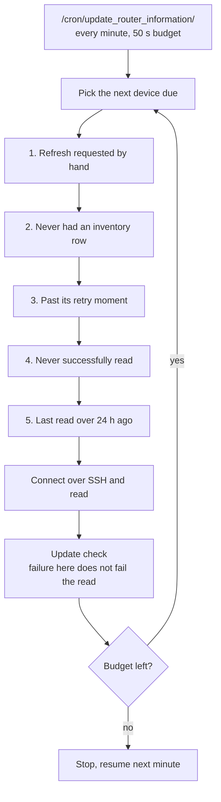
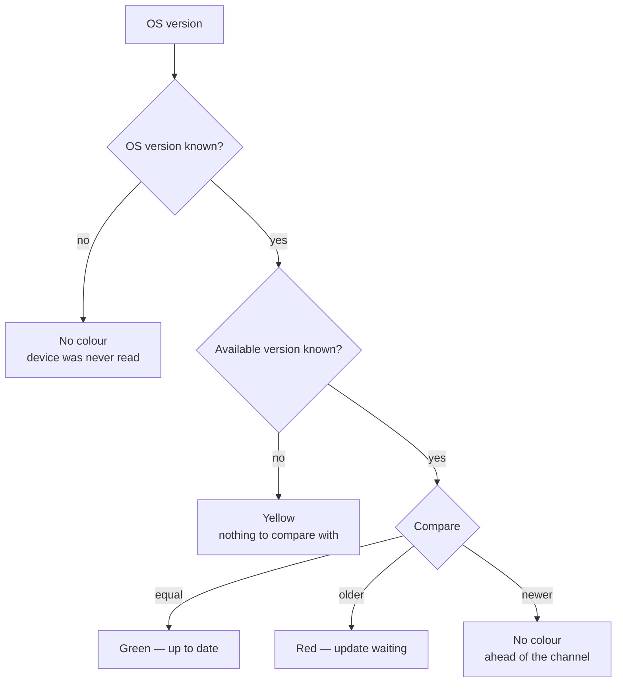

# Devices

A device in RouterFleet is a name, an address, credentials and a type. The type
decides what RouterFleet can do with it.

## Device types

The type decides how RouterFleet talks to a device, what it backs up and how it
learns its version. Types are configuration, in *System settings → Device
types* - see [Device types](device-types.md) for the shipped ones (RouterOS,
OpenWrt, airOS, Cisco IOS, Juniper Junos, Huawei VRP) and for adding your own.

Use *Monitoring only* for anything that only needs to be pinged. It carries no
credentials and never appears in version statistics.

## Credentials

A device authenticates with either a **password** or an **SSH key**, on a
configurable port (22 by default). Passwords are encrypted at rest — see
[Security](security.md). SSH keys are stored once under a name and shared by as
many devices as you like; RSA, ECDSA and Ed25519 keys are accepted. They have
a menu item of their own, **SSH Keys** (the key icon, below User Manager);
the addresses they had under Devices Manager lead there.

**A new SSH key is generated or pasted.** *Generate a new key* makes the key
pair on the server, as the type you choose:

| Type | What it is |
|---|---|
| Ed25519 (the default) | Elliptic curve, 256 bits: short, fast, the modern choice |
| ECDSA P-256, P-384, P-521 | Elliptic curves NIST P-256, P-384, P-521 |
| RSA 2048, 3072, 4096 | RSA of that size |

Pick the type your devices accept. The private key never leaves the server
except for the devices' SSH logins; its page then shows the **public key**,
with *Copy the public key*, ending with the key's name so a device lists it
recognisably - put it on each device that should accept the key (RouterOS:
`/user ssh-keys import`; Linux-based systems: `~/.ssh/authorized_keys`). A
passphrase given while generating protects the key from the start. DSA and
RSA below 2048 bits are not offered: no longer considered safe.

**SSH keys** are checked when saved: the key must open, with its passphrase if
it has one. The public key is derived from the private one when left empty.
A key can have an optional **passphrase**: a protected key is given with it,
and an unprotected key given together with a passphrase is stored protected by
it (OpenSSH format). Both are encrypted at rest. A red lock in the list marks
a key protected by a passphrase.

The stored private key and passphrase are for **administrators** only, in the
key's own page. The private-key box shows *Reveal / edit*: after a small sum
(checked by the server; a wrong answer gives a new one) the key appears in the
box and can be edited; every reveal is recorded in the
[change log](audit-log.md) as *Secret shown*. Saving a replaced key, a new
passphrase or its removal asks for another sum; *Hide / Protect* puts the stored
key back, hidden. A protected key gets its new passphrase - or loses it - without
being pasted again. Others see the box locked: they can rename a key and edit
its public key, never see or replace the private key.

**Saving a device never connects to it.** A device that does not answer - not
installed yet, unreachable, being replaced - can still be added, imported,
disabled or have its monitoring switched off, all in one save. The address must
be a valid IP address or hostname; the name does not have to resolve yet.

**Test connection** checks the credentials on request: on the device form, with
the values typed in (nothing is saved), and on the device's page, with its
saved settings. The stored password is only used for the stored address and
port: to test a new address, type the password again. The test is the [system
command](fleet-commander.md#system-commands) *connection test*, and confirms
the type matches reality:

The check is the type's recognition pattern - RouterOS must show
`platform: MikroTik`, OpenWrt must name OpenWrt, and so on - so a device of
another type is rejected with the reason rather than half-working.

A Cisco device whose account does not land in privileged mode takes an **enable
password**, stored encrypted and sent only to the stored address.

### A dedicated account

Give RouterFleet **its own account, not the administrator's**, with only the
rights it uses. A stolen or leaked credential then reaches no further than
those rights, and the device's own log tells RouterFleet's actions apart.

| What RouterFleet does | What the account needs |
|---|---|
| Backups, device information, connection test | Read the whole configuration - secrets included if the backups should hold them |
| Firmware and bootloader updates | Install software and reboot |
| Fleet Commander commands | What the commands do |
| Console | What the person typing needs: the console signs in with this account |

One account serves a device for everything, so a read-only account suits a
device that is only backed up and watched. Updates and commands then fail with
the device's own "not permitted" message - nothing else is affected.

**RouterOS** - read-only, with secrets in the export:

```text
/user group add name=routerfleet-read policy=ssh,read,sensitive
/user add name=routerfleet group=routerfleet-read password=<a long random password>
```

Without `sensitive` the export leaves passwords and keys out. What each
RouterFleet feature needs from the group's policies:

| Feature | RouterOS policies |
|---|---|
| Connection test, device information, text backups | `ssh,read` |
| Passwords and keys in the backups | adds `sensitive` |
| Update check (*Available version*) | `read` |
| System update from the firmware repository | adds `ftp` (the file is uploaded with SCP), `write`, `reboot` |
| System update online (the device downloads it) | adds `write` (the channel is set), `reboot` |
| RouterBOOT upgrade | adds `write`, `reboot` |
| Fleet Commander, console | whatever the commands - or the person typing - do |

**Limitations of a read-only account**, in short: backups, information, the
connection test and the update check work. Firmware and RouterBOOT updates
can not be installed: RouterFleet **reads the account's own rights** with
every device information read (RouterOS: the policies of its group) and shows
an update it may not install **crossed out** - the arrow in the device list
and on the device page, *Update system* and *Update bootloader* greyed, the
missing rights in the tooltip - and the update pages offer such a device
nothing. Commands that change something fail with the device's own "not
permitted" message, which RouterFleet shows; nothing else is affected. The
device form and the add-device wizard say the same under the username.

Which command reads the rights and which rights an update needs are settings
of the device type (System settings → Device types → Update checks); the
shipped RouterOS type reads its group's policies and needs `write,reboot`. A
type without them is not checked, and an answer that is not a list of rights
(an error message) blocks nothing.

**Juniper Junos** - read-only:

```text
set system login class routerfleet-read permissions [ view view-configuration ]
set system login user routerfleet class routerfleet-read authentication plain-text-password
```

`view-configuration` shows the configuration without secrets; add `secret` to
include them, and `maintenance` for software updates and reboots.

**Others.** Cisco shows the complete `show running-config` only at privilege
level 15 (or in a parser view that includes it): at a lower level it lists only
what that level may configure, so the backup would be incomplete. Huawei VRP
has user levels and command groups to the same end. OpenWrt and airOS
generally need `root` for complete backups and updates. Check your vendor's
documentation for a role that can display the full configuration.

The first connection to a device - a test, an inventory read or a backup -
also stores its **SSH host key**. From then on
RouterFleet refuses to talk to anything at that address and port presenting a
different key, before sending any credential. After resetting or replacing a
device, use **Forget host key** on its page — see [Device host
keys](security.md#device-host-keys).

## The device page

A device's page opens with its state (online, offline, disabled, not
monitored), a ring with its availability over the last 7 days, and four tiles:
the last successful backup, failed backups in 7 days, the OS version it runs
(with whether it is up to date, or which version is available) and downtime in
7 days. The actions are **Edit** and, for operators,
**Execute command**. A timeline brings together its recent backups, commands,
and the moments it went offline and came back; the full details follow below.
The page updates itself while a backup, a command or an information read runs.

## Inventory

RouterFleet reads each device and stores model, serial number, OS version,
firmware version, architecture and CPU, plus the raw output of every command
for reference - *Source data* on the device page, each command with its output,
scrollable. A value the device does not report shows as *not reported by the
device* (RouterOS on x86 or CHR has no model, serial or firmware). What it sends is the [system
command](fleet-commander.md#system-commands) *inventory and versions*; where
each field is found in its output is set by the [device
type](device-types.md#inventory-sources) - `key: value` lines or patterns.



Devices that are disabled, of a type that is not reached over SSH (*Monitoring
only*), or currently known to be offline are skipped entirely.

Each pass works for up to **50 seconds**, so a batch of hand-requested
refreshes is not spread across one device per minute. A manual request is
cleared *before* the read runs, so a crash cannot leave it pending forever. The
regular refresh cycle is **24 hours**; a failed read retries after 5 minutes,
up to 3 times, before the device is marked as errored.

### What each device type reports

The shipped types read these fields; the full definitions, and the Cisco,
Juniper and Huawei ones, are in [Device types](device-types.md):

| Field | RouterOS | OpenWrt | airOS |
|---|---|---|---|
| Model name | `board-name` | `OPENWRT_DEVICE_MODEL` | `board.name` |
| Model version | RouterBOARD `model` | `VERSION_ID` | `board.model` |
| Serial number | RouterBOARD `serial-number` | MAC of `eth0` | `board.device_id` |
| OS version | `/system resource` `version` | `VERSION` | kernel, `uname -r` |
| Firmware | `current-firmware` | `OPENWRT_RELEASE` | `/etc/version` |
| Architecture | `architecture-name` | `uname -m` | from `/proc/cpuinfo` |

### Available version

Where the version a device could run comes from is set per device type - see
[Update checks](device-types.md#update-checks). The shipped types:

- **RouterOS** asks the device to query MikroTik's update server
  (`check-for-updates`, then `print` every 3 seconds, for up to 15, until the
  device has the answer) and compares the offered version with the installed
  one as numbers. The answer depends on the channel the device is set to, and
  needs the device itself to reach MikroTik's server.
- **OpenWrt** is compared against the public release list. Only releases newer
  than the installed one **and that still ship images for the device's board**
  are offered. The list is cached for 6 hours, so a large fleet does not hammer
  the download server. When nothing newer is offered, the installed release is
  stored as the available one: the device counts as up to date. A snapshot
  build, or a release list that could not be downloaded, stays unknown.
- **airOS, Cisco, Juniper and Huawei** have no check configured: their version
  is shown without a colour, and they are left out of the status page's update
  counts - until you switch on a check for the type, such as the [firmware
  repository](firmware.md).

Versions are read when a device is added, every 24 hours after that (online,
enabled devices), and on request with *Update device information* in the
device list.

A failed update check never fails the inventory read — the device facts are
stored and the version is left unknown: *update not checked*. What the device
said is kept and shown - for RouterOS the status of its own check, such as
`ERROR: could not resolve dns name` or `finding out latest version...` (no
answer within 15 seconds) - in the version's tooltip and on the device page.
Such a device is read again **after an hour**, not a day; *Update device
information* reads it at once.

## Version colours

A device with a newer system version available carries a **green arrow** at
the right of its row in the device list, and a **purple** one when a newer
bootloader firmware can be installed; hovering it names the running and the
available version. It
follows the same rule as the colours below, and the status page counts the
same rule, so the overview and the list cannot tell different stories.



- **Firmware** is green while it matches the OS version and red while it stayed
  behind it — a firmware left behind is what stops a device booting a new OS.
- **OS version** follows the diagram above. Yellow covers a device whose update
  check failed or has not run. airOS, which has no update check, has no
  colour.
- Versions are compared on their leading numbers, padded with zeros, so `7.16`
  and `7.16.0` are the same version. Trailing text like `(stable)` or an OpenWrt
  build hash is ignored.
- Every colour carries its reason in a tooltip.

The **status page** counts devices as *up to date*, *missing an update*, or *no
information*, excluding monitoring-only and airOS devices.

## The device list

The list of devices is on the left, the chosen device on the right: its state,
address, system and version, model, bootloader, last backup and backup
profile, last configuration change (a click shows the change), next backup,
login and any lock, then its recent activity as a timeline - and the actions
you may take:
**Console**, **Execute command**, **Back up now** (level 20, enabled devices),
**Update system** / **Update bootloader** when one is waiting, **Edit** and
**Open** (the device's own page). The address bar keeps the chosen device, so
a link or a reload opens it again. **↑** and **↓** move through the list.

Each device in the list shows its name, address and type, and a dot for its
state: green online, red offline, grey disabled or not monitored. At the right
of the row, a green arrow marks a system update waiting (rightmost) and a
purple one, to its left, a bootloader update; a red lock after the name a backup or command lock.

On a phone the list is shown alone and a device opens its own page.

### Search and filters

The search box looks at the name, address, type, version, model and groups,
case-insensitively; **/** jumps to it:

| Term | Meaning |
|---|---|
| `text` | Devices whose details contain it |
| `!text` | Devices whose details do not contain it. `!7.16` shows every device not on 7.16. A bare `!` shows all |
| `^pattern` | A regular expression, matched anywhere: `^7\.1[67]` finds 7.16 and 7.17 |
| `!^pattern` | Devices that do **not** match the pattern |

A pattern that does not compile yet - `^(` on the way to `^(a|b)` - leaves the
list as it stands and marks the box until the pattern is finished.

Beside it, the **group** (the list opens on the default group, if one is
marked) and the **state**: online, offline, disabled, not monitored, last
backup failed, update available. A card of the status page opens the list on
exactly the devices it counted, and says so.

### Address links

What a click on a device's address does - in the panel on the right - is a
**per-user** setting under *My Settings* (the gear icon, top right):

| Setting | Behaviour |
|---|---|
| No links | The address is plain text |
| Open with SSH | `ssh://user@address:port` |
| Open with Winbox | `winbox://address` — RouterOS devices only |
| Show a menu | SSH on the address, the device type's other links beside it |

Devices that cannot offer an action stay plain text: a monitoring device, a
device with no username for SSH, anything that is not RouterOS for Winbox.
**Passwords are never part of a link.**

### Selection and export

Tick devices - or the box above the list, for every device the search and
filters show - and **Actions** offers what can be done to all of them (below).

**Export CSV** writes the devices the list shows, with every field (name,
type, address, state, groups, backup profile, last backup, last configuration
change, OS and available version, model, serial number, bootloader,
architecture). The file carries a byte order mark so Excel opens accented
characters correctly, and its name carries the date.

## Bulk operations

Select devices in the list and act on all of them:

| Operation | Minimum level |
|---|---|
| Add to or remove from groups | 20 — Backup Operator |
| Take an instant backup | 20 — Backup Operator |
| Refresh inventory | 30 — Host Manager |
| Edit | 30 — Host Manager |
| Enable / Disable | 30 — Host Manager |

**Edit** changes port, username, password, SSH key, backup profile, monitoring,
enabled state and internal notes for every selected device at once. **A blank
field leaves the current value alone.**

The selection is handed over in a POST request and held in the session rather
than passed in the URL, so editing several hundred devices does not overflow the
URL length limit. Groups and Run Command use the same mechanism.

**Disable** asks first. A disabled device is neither backed up nor monitored: the
monitoring loop skips it, a status report still on its way is ignored, and an
outage that was open ends when it is disabled - so it does not count as
downtime. Switching monitoring off for a device does the same. **Enable** brings
both back; the change log records each change and its time.

## Groups

A group is a named set of devices, used by command schedules and to filter the
list. *Device Groups* lists them on the left (a star marks the default group);
the chosen group on the right shows how many of its devices are online, the
command schedules that run on it or leave it out, its notes and its devices -
a click opens one in the device list - with *Show in the device list* and
*Edit*. One group may be marked as the **default group**: it is the group the
device list is filtered to when you open it (pick *All* to see every device).
Marking a group as the default takes the mark off whichever group had it. It
does not add new devices to the group. Groups are also what schedule exclusions
operate on — see
[Fleet Commander](fleet-commander.md#which-devices-a-schedule-runs-on).

## Permissions

| Action | Minimum level |
|---|---|
| View the device list, device details, groups and SSH key names | 10 — Viewer |
| Instant backup, group membership | 20 — Backup Operator |
| Create or edit a device, bulk edit, refresh inventory, test connection | 30 — Host Manager |
| Create or edit groups and SSH keys | 40 — Configuration Manager |
| Forget a device's host key (confirmed with a small sum) | 50 — Administrator |
