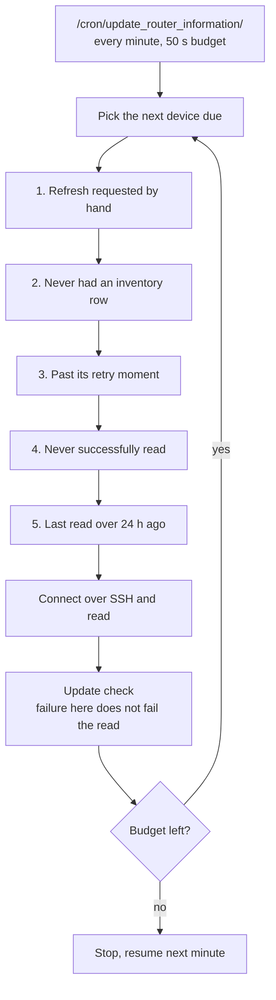
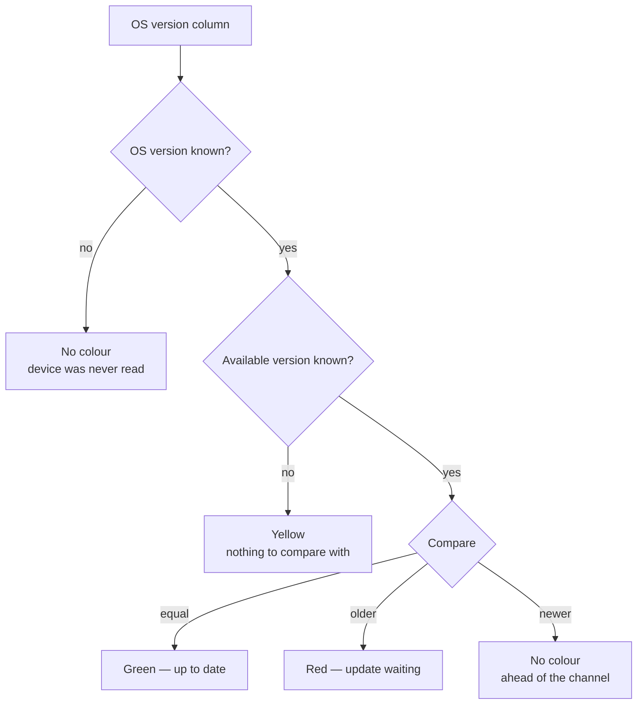

# Devices

A device in RouterFleet is a name, an address, credentials and a type. The type
decides what RouterFleet can do with it.

## Device types

| Type | Backups | Inventory | Reachability | Update check |
|---|---|---|---|---|
| `routeros` — MikroTik RouterOS | yes | yes | yes | yes, from the device's channel |
| `routeros-branded` — MikroTik branded | yes | yes | yes | yes, from the device's channel |
| `openwrt` — OpenWrt | yes | yes | yes | yes, against the release index |
| `ubiquiti-airos` — Ubiquiti airOS | yes | yes | yes | no |
| `monitoring` — monitoring only | no | no | yes | no |

Use `monitoring` for anything that only needs to be pinged. It carries no
credentials and never appears in version statistics.

## Credentials

A device authenticates with either a **password** or an **SSH key**, on a
configurable port (22 by default). Passwords are encrypted at rest — see
[Security](security.md). SSH keys are stored once under a name and shared by as
many devices as you like; RSA, ECDSA and Ed25519 keys are accepted.

When a device is saved, RouterFleet connects and confirms the type matches
reality:

| Type | Check | Must show |
|---|---|---|
| `routeros` | `/system resource print` | `platform: MikroTik` |
| `routeros-branded` | `/system resource print` | a `platform:` line that is **not** MikroTik |
| `openwrt` | `ubus call system board` | `OpenWrt` |
| `ubiquiti-airos` | `cat /etc/version` | a version like `XW.v6...` |

A branded unit declared as `routeros` is rejected with the reason, and so is the
reverse — the two need different handling, so the distinction is enforced rather
than trusted.

## Inventory

RouterFleet reads each device and stores model, serial number, OS version,
firmware version, architecture and CPU, plus the raw command output as JSON for
reference.

Devices that are disabled, of type `monitoring`, or currently known to be
offline are skipped entirely.

Each pass works for up to **50 seconds**, so a batch of hand-requested
refreshes is not spread across one device per minute. A manual request is
cleared *before* the read runs, so a crash cannot leave it pending forever. The
regular refresh cycle is **24 hours**; a failed read retries after 5 minutes,
up to 3 times, before the device is marked as errored.

### What each device type reports

| Field | RouterOS | OpenWrt | airOS |
|---|---|---|---|
| Model name | `board-name` | `OPENWRT_DEVICE_MODEL` | `board.name` |
| Model version | RouterBOARD `model` | `VERSION_ID` | `board.model` |
| Serial number | RouterBOARD `serial-number` | MAC of `eth0` | `board.device_id` |
| OS version | `/system resource` `version` | `VERSION` | kernel, `uname -r` |
| Firmware | `current-firmware` | `OPENWRT_RELEASE` | `/etc/version` |
| Architecture | `architecture-name` | `uname -m` | from `/proc/cpuinfo` |

### Available version

- **RouterOS** asks the device to query MikroTik's update server
  (`check-for-updates`, then read the result 5 seconds later) and compares
  `latest-version` against `installed-version`. The answer depends on the
  channel the device is set to.
- **OpenWrt** is compared against the public release index. Only releases newer
  than the installed one **and that still ship images for the device's board**
  are offered — there is no point offering an upgrade with no image for the
  hardware. The release list is cached for 6 hours and per-board availability
  for the process lifetime, so a large fleet does not hammer the download
  server.
- **airOS** has no reliable update check over SSH, so it stays empty.

A failed update check never fails the inventory read — the device facts are
stored and the version is simply left unknown.

## Version colours

The device list colours two columns, and the status page counts the same rule,
so the overview and the list cannot tell different stories.

- **Firmware** is green while it matches the OS version and red while it stayed
  behind it — a firmware left behind is what stops a device booting a new OS.
- **OS version** follows the diagram above. Yellow covers a device whose update
  check failed and an airOS device, which has none.
- Versions are compared on their leading numbers, padded with zeros, so `7.16`
  and `7.16.0` are the same version. Trailing text like `(stable)` or an OpenWrt
  build hash is ignored.
- Every colour carries its reason in a tooltip.

The **status page** counts devices as *up to date*, *missing an update*, or *no
information*, excluding monitoring-only devices.

## The device list

### Filtering

**Filter** opens a row of text boxes under the column headings, one per column,
each filtering its own column as you type. **Show/Hide Columns** works
alongside it. Hiding the filter row clears the filters, so the list is never
filtered without a visible reason.

The filter row and its contents are remembered in the browser, and a filter is
remembered **by its column's name, not its position** — so it survives showing
and hiding columns, and is picked up again when a hidden column returns.

### Search terms

Both the column filters and the search box understand the same terms, all
matched case-insensitively:

| Term | Meaning |
|---|---|
| `text` | The cell contains it |
| `!text` | The cell does not contain it. `!7.16` shows every device not on 7.16. Taken literally, so `.` and `[` stay characters. A bare `!` clears the search |
| `^pattern` | A regular expression. In a column filter it matches the cell, so `^7\.1[67]` finds versions starting 7.16 or 7.17. In the search box it matches anywhere in the row |
| `!^pattern` | Devices that do **not** match the pattern |
| `(empty)` | Column filters only: rows where this column has no value — an empty cell or the `---` the list writes. `(empty)` in *Groups* finds devices in no group |
| `!(empty)` | Rows that do have a value |

A pattern that does not compile yet — `^(` on the way to `^(a|b)` — leaves the
list as it stands and marks the box until the pattern is finished.

### Address links

What a click on a device's address does is a **per-user** setting under *My
Settings* (the gear icon, top right):

| Setting | Behaviour |
|---|---|
| No links | The address is plain text |
| Open with SSH | `ssh://user@address:port` |
| Open with Winbox | `winbox://address` — RouterOS devices only |
| Show a menu | Hovering opens a small menu with both |

Devices that cannot offer an action stay plain text: a monitoring device, a
device with no username for SSH, anything that is not RouterOS for Winbox.
**Passwords are never part of a link.**

### Export and selection

**Select All** selects what the search currently shows, not every device in the
list. Rows filtered out remain in the page but hidden, so without this they
would be selected too.

**CSV export** writes the rows the current search shows — search box, column
filters and group all respected — across all pages, in the current sort order,
with the currently visible columns. The file carries a byte order mark so Excel
opens accented characters correctly, and its name carries the date.

## Bulk operations

Select devices in the list and act on all of them:

| Operation | Minimum level |
|---|---|
| Add to or remove from groups | 20 — Backup Operator |
| Take an instant backup | 20 — Backup Operator |
| Refresh inventory | 30 — Host Manager |
| Edit | 30 — Host Manager |

**Edit** changes port, username, password, SSH key, backup profile, monitoring,
enabled state and internal notes for every selected device at once. **A blank
field leaves the current value alone.**

The selection is handed over in a POST request and held in the session rather
than passed in the URL, so editing several hundred devices does not overflow the
URL length limit. Groups and Run Command use the same mechanism.

## Groups

A group is a named set of devices, used by command schedules and to filter the
list. A group may be marked as the **default group**, which new devices join
automatically. Groups are also what schedule exclusions operate on — see
[Fleet Commander](fleet-commander.md#which-devices-a-schedule-runs-on).

## Permissions

| Action | Minimum level |
|---|---|
| View devices and groups | 10 — Viewer |
| Instant backup, group membership | 20 — Backup Operator |
| Create or edit a device, bulk edit, refresh inventory | 30 — Host Manager |
| Create or edit groups and SSH keys | 40 — Configuration Manager |
