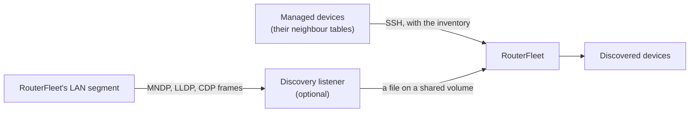

# Discovery

RouterFleet lists the devices that neighbour protocols reveal - **LLDP**,
**CDP** and MikroTik's **MNDP** - so a device not managed yet is added in one
click: the device form filled in with its name and address, and its device
type guessed from the platform it announces.

Two sources feed the list, **Router Manager → Discovered**:



## Neighbour tables of managed devices

Every managed device already hears these protocols on all its ports. With
each router information update - every 24 hours, and on request - RouterFleet
also runs the [system command](fleet-commander.md#system-commands)
**neighbours** of the device type and reads the table it prints. This reaches
every network a managed device touches, and needs nothing installed.

| Device type | Command shipped |
|---|---|
| RouterOS | `/ip neighbor print terse` - MNDP, CDP and LLDP together |
| Cisco IOS / IOS-XE, Cisco IOS (classic) | `show cdp neighbors detail`, `show lldp neighbors detail` |
| Juniper Junos | `show lldp neighbors` |
| Huawei VRP | `display lldp neighbor` |
| OpenWrt | `lldpcli -f keyvalue show neighbors details` - only where lldpd is installed |

RouterFleet recognises each output by its own markers, so another device type
needs only its command. A command that fails, or prints nothing it recognises,
finds nothing - the inventory read is never affected. The parsers follow the
vendors' documented output; check the list against what your devices report.

## The listener on RouterFleet's LAN (optional)

A small container hears the protocols on the LAN segment of the host
RouterFleet runs on - useful for devices no managed device is connected to.
It is **off unless started with its profile**:

```bash
docker compose --profile discovery up -d
```

It needs **host networking** (the protocols do not cross Docker's network)
and, to read LLDP and CDP frames, the **raw-socket right** (`CAP_NET_RAW`) -
every other right is dropped and its file system is read-only. It sends
nothing. What it hears goes into a file on a shared volume that the
application reads every two minutes (read-only); there is no network path
between them and no credential. Without the raw-socket right it still hears
MNDP. A device not heard for a day is left out of the file.

Only the host's own segment is heard: switches do not forward these
protocols.

## The list

- **Not in RouterFleet yet**: name, address, platform, model and version as
  announced, the protocols, and which device (and port) saw it. **Add** opens
  the device form filled in - name, address, the device type guessed (RouterOS,
  Cisco, Junos, Huawei, OpenWrt, airOS) - to be completed with the credentials.
  A device without a management address can not be added from here. The eye
  hides a device that is of no interest; hidden ones can be shown again.
- **Already in RouterFleet**: matched by address or name, with a link to the
  device.

A device is one row: merged by its MAC address when known, else by address
and name, whichever source saw it.

## Permissions

| Action | Minimum level |
|---|---|
| See discovered devices, add, hide | 30 - Host Manager |
| Edit the neighbours system command | 50 - Administrator |
