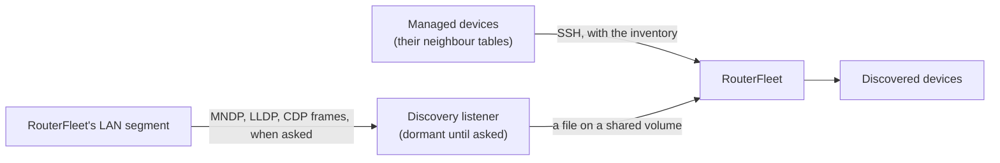

# Discovery

RouterFleet lists the devices that neighbour protocols reveal - **LLDP**,
**CDP** and MikroTik's **MNDP** - so a device not managed yet is added in one
click: the device form filled in with its name and address, and its device
type guessed from the platform it announces.

Two sources feed the list, **Router Manager → Discovered**:

## Neighbour tables of managed devices

Every managed device already hears these protocols on all its ports. With
each router information update - every 24 hours, and on request - RouterFleet
also runs the [system command](fleet-commander.md#system-commands)
**neighbours** of the device type and reads the table it prints. This reaches
every network a managed device touches, and needs nothing installed.

| Device type | Command shipped |
|---|---|
| RouterOS | `/ip neighbor print terse` - MNDP, CDP and LLDP together |
| Cisco IOS / IOS-XE, Cisco IOS (classic) | `show cdp neighbors detail`, `show lldp neighbors detail` |
| Juniper Junos | `show lldp neighbors detail` (Junos 19.1R2 and later), and the `show lldp neighbors` table for older releases - Junos has no CDP |
| Huawei VRP | `display lldp neighbor`, `display cdp neighbor` - CDP is received where `lldp compliance cdp receive` is set on the port |
| OpenWrt | `lldpcli -f keyvalue show neighbors details` - where the `lldpd` package is installed; it hears CDP too (`enable_cdp`, on by default) |
| Ubiquiti airOS | none: airOS documents no command listing its neighbours. It *sends* CDP, so airOS devices appear in the neighbour tables of Cisco and MikroTik devices, and the listener hears Ubiquiti's own discovery |

RouterFleet recognises each output by its own markers, so another device type
needs only its command. A command that fails, or prints nothing it recognises,
finds nothing - the inventory read is never affected. The parsers follow the
vendors' documented output; check the list against what your devices report.

## Discover adjacent devices (RouterFleet's LAN)

For devices no managed device is connected to, **Discover adjacent devices**
on the same page listens on the LAN segment of the host RouterFleet runs on -
MNDP, LLDP, CDP and Ubiquiti's own discovery announcements:
for three minutes - long enough for several LLDP (every 30 s), CDP and MNDP
(every minute) announcements - then it goes quiet again. Devices appear as
they announce themselves; the page refreshes by itself meanwhile.

The listening is done inside the **monitoring container**, by a listener
that is **dormant**: it opens no socket and hears nothing until asked. For it,
the monitoring container runs on the **host's network** (the protocols do not
cross Docker's network) with every right dropped but the **raw socket**
(`CAP_NET_RAW`), which ping needs as well. It sends nothing. The request, its
state and what it hears pass through a file on a shared volume.

On the host's network, monitoring reaches the application on the host's
**loopback**: the application's port 8001 is published on `127.0.0.1` only
(`MONITORING_PORT` in `.env` changes it). Nothing outside the host can reach
it; a program running on the host itself can, scheduler endpoints included -
that is the price of keeping the listener in the monitoring container. Without the raw-socket right it still hears MNDP and Ubiquiti
discovery. Ubiquiti devices are heard only where they announce themselves
(airOS broadcasts to UDP 10002, others to 10001) - nothing is asked, and
Ubiquiti does not document those announcements. A device not
heard for a day is left out.

The page shows the listener's state: *ready* (dormant), *listening* with the
time left, or *not running* - when the monitoring container does not run the
listener (a compose file from before 0.36.0 keeps monitoring on Docker's
network, without it: take the current one). Only the host's
own segment is heard: switches do not forward these protocols.

## The list

- **Not in RouterFleet yet**: name, address, platform, model and version as
  announced, the protocols, and which device (and port) saw it. **Add** opens
  the device form filled in - name, address, the device type guessed (RouterOS,
  Cisco, Junos, Huawei, OpenWrt, airOS) - to be completed with the credentials.
  A device without a management address can not be added from here. The eye
  hides a device that is of no interest; hidden ones can be shown again.
- **Already in RouterFleet**: matched by address or name, with a link to the
  device.

A device is one row: merged by its MAC address when known, else by address
and name, whichever source saw it.

## Permissions

| Action | Minimum level |
|---|---|
| See discovered devices, add, hide, discover adjacent devices | 30 - Host Manager |
| Edit the neighbours system command | 50 - Administrator |
