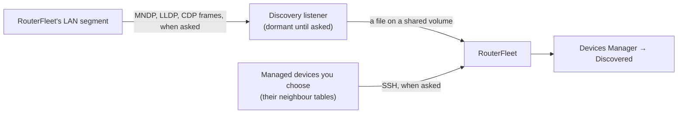

# Discovery

RouterFleet lists the devices that neighbour protocols reveal - **LLDP**,
**CDP** and MikroTik's **MNDP** - so a device not managed yet is added in one
click: the device form filled in with its name and address, and its device
type guessed from the platform it announces.

Discovering is done in **Device Discovery** (in the menu), in one of two
ways, one discovery at a time, each followed step by step:

- **Adjacent devices** - the default: listen on RouterFleet's own LAN segment;
- **From managed devices** - read the neighbour tables of the devices you
  choose, and only those.

What is found is listed in **Devices Manager → Discovered**: the devices
only, updating by itself while a discovery runs.

## Neighbour tables of managed devices

Every managed device already hears these protocols on all its ports. In
**Device Discovery → From managed devices**, tick the devices to ask in the
list - each with its address, device type, version and model; a filter
narrows it - up to 10, among those whose device type has a neighbours
command, and **Read their neighbours**: RouterFleet connects to each in turn over SSH, runs the
[system command](fleet-commander.md#system-commands) **neighbours** of its
device type and reads the table it prints. Nothing is read unless asked, and
only from the devices chosen. This reaches every network a managed device
touches, and needs nothing installed.

The timeline shows each step: connecting to a device, every neighbour it
reports - new, or already in RouterFleet - with SSH reachability for a new
one, a device that could not be read and why, then a summary.

| Device type | Command shipped |
|---|---|
| RouterOS | `/ip neighbor print terse` - MNDP, CDP and LLDP together |
| Cisco IOS / IOS-XE, Cisco IOS (classic) | `show cdp neighbors detail`, `show lldp neighbors detail` |
| Juniper Junos | `show lldp neighbors detail` (Junos 19.1R2 and later), and the `show lldp neighbors` table for older releases - Junos has no CDP |
| Huawei VRP | `display lldp neighbor`, `display cdp neighbor` - CDP is received where `lldp compliance cdp receive` is set on the port |
| OpenWrt | `lldpcli -f keyvalue show neighbors details` - where the `lldpd` package is installed; it hears CDP too (`enable_cdp`, on by default) |
| Ubiquiti airOS | none: airOS documents no command listing its neighbours. It *sends* CDP, so airOS devices appear in the neighbour tables of Cisco and MikroTik devices, and the listener hears Ubiquiti's own discovery |

RouterFleet recognises each output by its own markers, so another device type
needs only its command. A command that fails, or prints nothing it recognises,
finds nothing, and the timeline says so. The parsers follow the
vendors' documented output; check the list against what your devices report.

## Discover adjacent devices (RouterFleet's LAN)

The default way, and the one that needs no managed device: **Discover
adjacent devices** listens on the LAN segment of the host RouterFleet runs on -
MNDP, LLDP, CDP and Ubiquiti's own discovery announcements:
for three minutes - long enough for several LLDP (every 30 s), CDP and MNDP
(every minute) announcements - then it goes quiet again.

### Following a discovery

From the click on, Device Discovery follows it under **This discovery**
and refreshes itself every few seconds - there is nothing to click again:

1. **Asked** - the listener picks the request up within seconds;
2. **Listener started** - it confirms it is listening;
3. **Listening 3 min** - a countdown and a progress bar, with the number of
   devices heard so far. Devices announce themselves on their own clock, so
   some appear only after a minute or two;
4. **Finished** - with a summary: how many devices were heard, how many new.

The timeline below the steps says what happened when: the request, the
listener starting, **every device heard** - over which protocol, and whether
it is *already in RouterFleet* (as which device) or **new** - and, for a new
one, whether SSH answers from RouterFleet's host, so it can be added. A
listener that does not start within 30 seconds, or a window in which nothing
was heard, is said so, with the likely reason.

Above the timeline, **what the discovery found** - so far, while it runs - is
listed first, new devices first, one row per device however many protocols
heard it: a reachable one is added right there with **Add
device**; an unreachable one says why. Devices Manager → Discovered keeps
everything found by every discovery. The last discovery stays on the page for
an hour. The
scheduler moves a discovery on too, so its timeline is complete even when
nobody watched.

The listening is done inside the **monitoring container**, by a listener
that is **dormant**: it opens no socket and hears nothing until asked. For it,
the monitoring container runs on the **host's network** (the protocols do not
cross Docker's network) with every right dropped but the **raw socket**
(`CAP_NET_RAW`), which ping needs as well. It sends nothing. The request, its
state and what it hears pass through a file on a shared volume.

On the host's network, monitoring reaches the application on the host's
**loopback**: the application's port 8001 is published on `127.0.0.1` and `::1` only
(`MONITORING_PORT` in `.env` changes it). Nothing outside the host can reach
it; a program running on the host itself can, scheduler endpoints included -
that is the price of keeping the listener in the monitoring container. Without the raw-socket right it still hears MNDP and Ubiquiti
discovery. Ubiquiti devices are heard only where they announce themselves
(airOS broadcasts to UDP 10002, others to 10001) - nothing is asked, and
Ubiquiti does not document those announcements. A device not
heard for a day is left out.

Device Discovery shows the listener's state: *ready* (dormant), *listening* with the
time left, or *not running* - when the monitoring container does not run the
listener (a compose file from before 0.36.0 keeps monitoring on Docker's
network, without it: take the current one). Only the host's
own segment is heard: switches do not forward these protocols.

## The list

**Devices Manager → Discovered** lists the discovered devices on the left and
shows the chosen one on the right; while a discovery runs, it updates by
itself. A switch above the list picks which ones:

- **New** (not in RouterFleet yet): a dot says whether RouterFleet's host
  reaches it on SSH - green yes, red no, grey not checked yet. On the right:
  address, MAC, identity, version, the protocols that heard it, which device
  (and port) saw it, first and last seen. **Add device** opens a wizard filled
  in - name, address, the device type guessed (RouterOS, Cisco, Junos, Huawei,
  OpenWrt, airOS) - to be completed with the credentials, the backup profile
  and monitoring, and the **groups** it joins: tick existing ones (the device
  list's default group is ticked to begin with) or name a new one, created
  with the device. A device without a management address can not be added
  from here. One RouterFleet's host can not reach on SSH is framed in yellow,
  saying why, with **Check again**. **Hide** puts a device of no interest
  aside.
- **In RouterFleet**: matched by address or name, with a link to the device -
  one row per device, however many protocols heard it.
- **Hidden**: the devices put aside; **Show again** makes one new again.

A device is one row: merged by its MAC address when known, else by address
and name, whichever source saw it.

## Permissions

| Action | Minimum level |
|---|---|
| See discovered devices, hide them, discover adjacent devices, read chosen devices' neighbours | 30 - Host Manager |
| Add a discovered device (the wizard, groups included) | 50 - Administrator |
| Edit the neighbours system command | 50 - Administrator |
