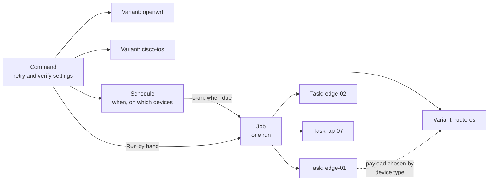
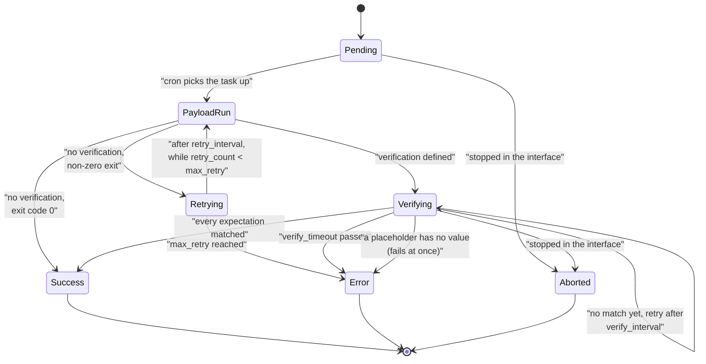
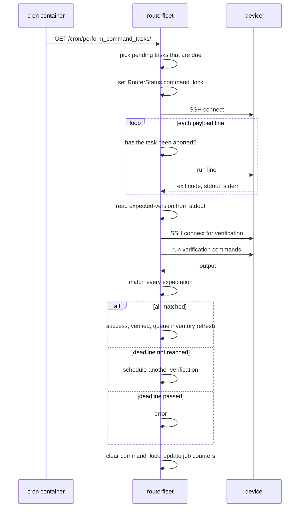
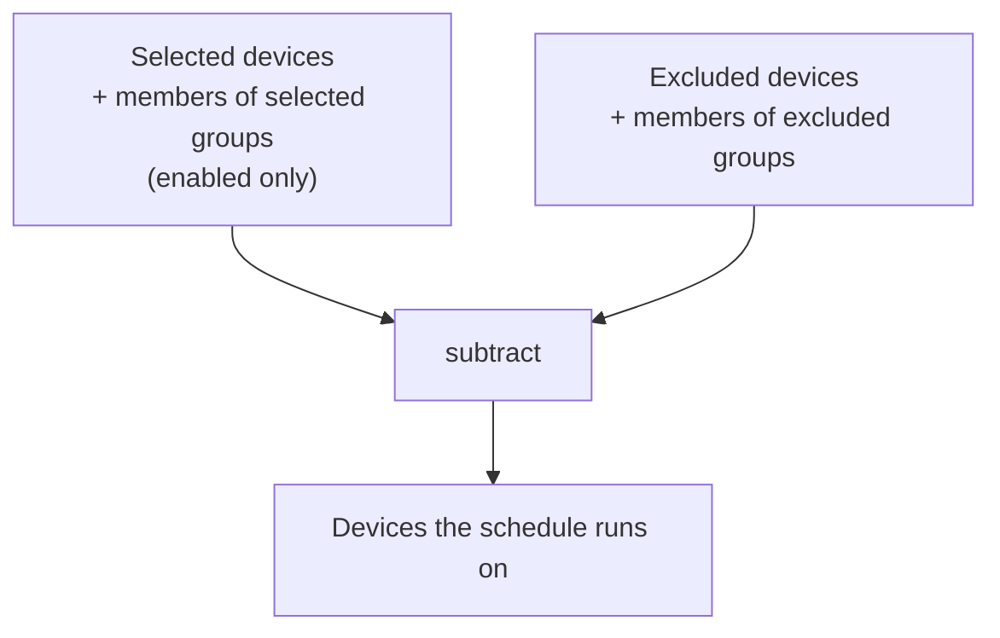
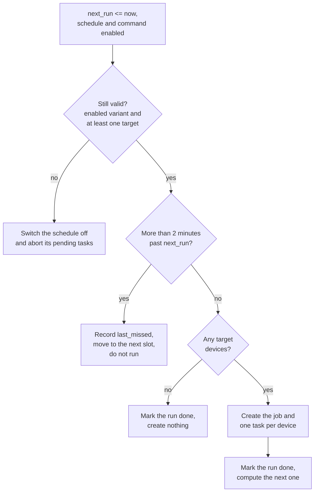

# Fleet Commander

Fleet Commander runs commands across the fleet — by hand or on a schedule — and
judges the result by what the device shows afterwards rather than by an exit
code.

## The objects involved



- A **Command** holds the settings that apply however it runs: `max_retry`
  (default 3, *including* the first attempt), `retry_interval` (30 s),
  `verify_timeout` (300 s), `verify_interval` (30 s) and `capture_output`.
- A **Variant** is the payload for one device type. There can be at most one
  variant per `(command, device type)` — a database constraint enforces it. A
  device whose type has no enabled variant is not run.
- A **Job** is one execution of a command. It carries counters
  (`task_count`, `success_count`, `error_count`, `aborted_count`) and completes
  when no task is pending any more.
- A **Task** is one device within a job. `(job, router_uuid)` is unique, so a
  device cannot appear twice in the same job.

## Verified results

An exit code says little about whether a command worked. A device that reboots
while it is being updated never returns one at all, and on RouterOS a failed
download does not necessarily make the subsequent install fail.

So a variant may define a **verification**: commands to run afterwards, and the
result they have to show. Verification is active only when *both*
`verify_payload` and `verify_expect` are non-empty.



The rules that follow from this:

- **The payload runs exactly once.** `payload_executed` is set before the
  payload's first line is sent, so a later attempt only verifies again. A device
  that reboots mid-update is never updated twice.
- **Retries and verification attempts are counted separately.**
  `retry_count` only advances when the payload runs; verification attempts are
  bounded by `verify_timeout`, not by `max_retry`. Before this distinction
  existed, a task with `max_retry 3` could report a run count of 8.
- **`max_retry` is the total number of attempts**, the first one included.
- **Every line of `verify_expect` must be found** in the combined output of the
  verification commands. Each line is tried as a regular expression; if it does
  not compile, it is compared as plain text. So
  `installed-version: 7\.1[67]\..*` is a valid expectation.
- **Verification output is kept** on the task, one block per attempt with a
  timestamp, truncated to the last 20 000 characters.
- **A verified task queues an inventory refresh**, so the new version appears in
  the device list without waiting for the regular cycle.

### Placeholders

Three placeholders may appear in `verify_expect`:

| Placeholder | Filled from |
|---|---|
| `{{ current_version }}` | `RouterInformation.os_version`, falling back to `model_version` |
| `{{ available_version }}` | `RouterInformation.available_version` — what the device's update channel offers |
| `{{ expected_version }}` | A line the payload itself printed: `expected-version=<value>` |

A placeholder with **no value fails immediately** with a hint, rather than
sitting in the queue until `verify_timeout` expires. An expectation using
`{{ current_version }}` or `{{ available_version }}` therefore cannot pass on a
device that was never read out; `{{ expected_version }}` needs no stored
inventory because it comes from the payload's own output.

### Why updates report their own expected version

The shipped RouterOS update command changes the update channel:

```
/system/package/update/set channel=long-term
/system/package/update/check-for-updates
:delay 5s
:put ("expected-version=" . [/system/package/update/get latest-version])
/system/package/update/download
/system/package/update/install
```

with the expectation `installed-version: {{ expected_version }}`.

The version RouterFleet has stored was read while the device was still on its
*old* channel. Comparing the installed version against that stored value
reported a perfectly successful update as failed. Asking the device what it is
about to install — after the channel is set — is the only reliable answer. A
payload that uses `{{ expected_version }}` but never prints the line fails at
once with a hint showing how to add it.

Because an update reboots the device, these commands ship with
`verify_timeout` of 600 s, giving the device time to come back before the
verification gives up.

## Running a command

A command runs by hand from three places, for operators (level 40):

- **one device** - the terminal icon next to edit in the device list, or
  *Execute command* on the device's page; only commands with a variant for its
  type are offered;
- **a selection** from the device list;
- **devices and groups** from a command's page.

Each goes through a **confirmation page** first: per device type, the exact
commands that will be sent, the verification that follows, and the devices they
go to, with devices that have no variant for their type listed as left out.
Nothing runs until *Confirm and execute*. The confirmation carries a
fingerprint of what was shown; if a variant was edited in between, the page is
shown again with the new commands instead of running them. Each device's page
lists its last 25 tasks.



A task is only picked up while its device is free: `command_lock` keeps two
command tasks off the same device at once, and a device with a backup in flight
(`backup_lock`) is left alone until the backup has finished. Housekeeping clears
a command lock older than 2 hours.

## Stopping a job or a task

The job list, job details and task details pages all offer a stop button,
confirmed by answering a small sum. Tasks that have not finished are set to
**aborted**.

The executor checks for an abort **before each payload line and before each
verification**, reading the status back from the database — the abort comes
from the web process while the task runs in the cron process, so the in-memory
object cannot be trusted. An update stopped during the download therefore does
not go on to install. A command already executing *on the device* cannot be
interrupted from outside; the abort takes effect at the next line.

Only a task that is still `pending` can be aborted; one that already finished
keeps its result.

## Schedules

A schedule has a start moment, an optional end moment, and a repeat interval in
minutes where `0` means a single run. Intervals are typed as `7d`, `24h` or
`30m`; empty, `0`, `none`, `off` and `one time` all mean "run once".

### Which devices a schedule runs on



**An exclusion always wins.** A device selected on its own, or brought in by a
selected group, is still skipped if it is excluded itself or sits in an excluded
group. That is how a device in both a *Location* group that should run and a
*Type* group that should not is left out — exclude the *Type* group, and the
device stops being run without being removed from any group.

The schedule list shows what each one covers (`3 devices, 1 excluded`), and a
schedule whose every device is excluded is **refused when saved** rather than
left in place doing nothing.

### What the scheduler does when a schedule is due



### A run that was missed

The scheduler asks every minute whether a schedule is due, and `next_run` is
always a moment in the future when it is written. So a `next_run` in the past
means **nothing was running when that moment came** — the application was down,
the cron container was stopped, a tick never arrived.

That run does not happen afterwards. A command is meant for a moment of the
day: one set for three in the morning is not the same thing sent at nine, with
the devices in use. The missed moment is recorded on the schedule, shown in the
schedule list, and the schedule carries on with its next run **on its own
grid** — a daily schedule missed this morning runs tomorrow morning, not
twenty-four hours after something next looked. A schedule with no repeat left
that was missed has no next run at all.

The window is two minutes. An installation whose scheduler runs less often can
widen it with `SCHEDULE_LATE_LIMIT_MINUTES`.

Backups are deliberately **not** treated this way: a nightly backup that did
not happen is wanted as soon as possible, a command is not.

### Switching a schedule off, and deleting it

Both stop the work already dispatched. A schedule hands out a *job*, and the
job's tasks are executed one by one by the cron — so cancelling a schedule has
to reach into that job, or the command still goes out after the schedule is
gone from every page. Pending tasks are set to aborted with the reason recorded,
their job is completed, and the executor skips a pending task whose schedule is
switched off.

A schedule also switches **itself** off, with the same effect, when its command
has no enabled variant left or no device left to run on.

**Stopping a job does not stop the schedule.** A schedule runs again, so a
stopped job is only one stopped run. The job details page says so while that is
the case, showing the next run and linking to the page where the schedule can be
switched off.

## Schedule defaults

A schedule needs a start moment and a repeat interval, and both are usually the
same across an installation — the hour the maintenance window opens, the week it
comes back. **Schedule Defaults**, reachable from the Fleet Commander page, sets
them once:

- **Default Start Time** — a time of day. A new schedule starts at the *next*
  occurrence, so it never begins in the past.
- **Default Repeat Interval** — `7d`, `24h`, `30m`, or empty/`0` for a single run.

Only a **new** schedule's form is filled from these. Schedules that already
exist keep what they were saved with, so changing a default never moves a job
that is already set up.

The same values are settable from the command line, which is how a scripted or
containerised installation configures them:

```bash
python manage.py schedule_defaults                           # show what is in use
python manage.py schedule_defaults --start-time 03:00 --repeat 7d
python manage.py schedule_defaults --repeat 0                # new schedules run once
python manage.py schedule_defaults --reset                   # back to 03:00 / 7d
```

In the container: `docker compose exec routerfleet python manage.py schedule_defaults --start-time 03:00 --repeat 7d`.

## Reading a job

A job's page shows a progress ring (tasks finished out of the total), its state
- *Running*, *Completed*, *Completed with failures*, *Aborted* - and four tiles:
succeeded, running, waiting and failed tasks. Each device is listed with its
state; a timeline records when the job was created, when each device started
and finished (a failure with its first line), and when the job completed. While
the job runs, the page updates itself
([Pages that update themselves](operations.md#pages-that-update-themselves)).

## Reading a task

The task details page shows the payload as stored, the lines actually executed,
the device's output, and — when a verification ran — every verification attempt
with its timestamp and output. Tasks whose result was *verified* are marked as
such in the job details and on the device page.

The device name in a task list links to that device's settings, the same page
the device list opens, because a command that went wrong is usually followed by
wanting to reach the device. A task outlives its device: the row keeps the name
it ran under, and a device that no longer exists stays plain text with no link.

## System commands

What RouterFleet itself sends to devices is defined as Fleet Commander
commands too, tagged **System**, in a section of their own on the Fleet
Commander page:

| System command | Used by | Placeholders |
|---|---|---|
| connection test | *Test connection* on a device | none |
| inventory and versions | the inventory read, every 24 h and on request | none |
| backup - text | phase 1: text backups from command output, `name: command` per line | `{{ export_parameters }}` |
| backup - create | phase 1: files made on the device | `{{ backup_name }}`, `{{ export_parameters }}` |
| backup - files to download | phase 2: paths fetched - by `cat` where the device has a shell, else SCP - one per line | `{{ backup_name }}` |
| backup - remove from device | after the download | `{{ backup_name }}` |
| backup - clean leftovers | after every successful backup | none |
| firmware - verify the upload | a [firmware rollout](firmware.md), after the upload | `{{ firmware_name }}`, `{{ firmware_path }}`, `{{ firmware_version }}` |
| firmware - install | a firmware rollout, after the verification | same |
| neighbours (discovery) | on request, in Device Discovery → From managed devices: the neighbour tables of the devices chosen ([Discovery](discovery.md)) | none |

Each has one variant per [device type](device-types.md). An empty variant means
nothing is run for that type (airOS creates nothing: its configuration is
already a file); the connection test and the inventory can not be empty.

**A command that asks a question.** End the line with `<<< ` and the answer:
`reboot fast <<< y` answers every question that command asks (*Continue?
[Y/N]*, *[confirm]*, *[yes/no]*) with `y`, at most three times. On a shell
device type (Cisco, Juniper, Huawei) the answer is typed when the question
appears; on an exec type it is sent to the command's input. Without it, a
question stops the command when no prompt follows.

They are **protected**: they can not be deleted, disabled, scheduled or run by
hand, and their variants can not be added or removed. An upgrade creates them
without touching anything that exists; a command of the installation's own with
the same name keeps its name, and the system command gets a number.

**Editing** a variant is for administrators (level 50) and takes three steps:

1. Change the payload. A placeholder that does not belong to the command is
   refused; *Restore default* puts the default back.
2. Review the change, line by line.
3. Press the red **Apply** button and solve the sum shown in the confirmation
   popup. The answer is checked on the server, once: a wrong result, an expired
   review (10 minutes) or a payload different from the reviewed one changes
   nothing.

The change is recorded in the change log. From then on, every device of that
type gets the new commands.

## Permissions

| Action | Minimum level |
|---|---|
| View commands, jobs and tasks | 20 — Backup Operator |
| Stop a running job or task | 20 — Backup Operator |
| Run a command, on one device or many | 40 — Configuration Manager |
| Create or edit commands, variants, schedules, defaults | 40 — Configuration Manager |

See [Users and permissions](users.md).
