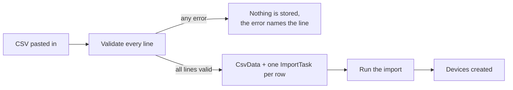

# Import tool

Bulk-create devices from a CSV. Requires permission level **50**.

The import happens in two steps: the CSV is **pasted and validated** into a set
of import tasks, then the tasks are **run** to create the devices. Nothing is
created until the whole CSV validates, so a malformed line cannot leave half a
fleet imported.



## CSV format

The header must match **exactly**, in this order:

```csv
name,username,password,ssh_key,address,port,router_type,backup_profile,router_group,monitoring
```

| Column | Required | Notes |
|---|---|---|
| `name` | yes | Must be unique within the file |
| `username` | yes | |
| `password` | either/or | Exactly one of `password` or `ssh_key` |
| `ssh_key` | either/or | The **name** of an SSH key that already exists |
| `address` | yes | IP address or hostname, validated |
| `port` | yes | 1–65535 |
| `router_type` | yes | One of the supported type keys |
| `backup_profile` | optional | Name of a profile that already exists |
| `router_group` | optional | Name of a group — may be created, see below |
| `monitoring` | yes | `true` or `false` |

Example:

```csv
name,username,password,ssh_key,address,port,router_type,backup_profile,router_group,monitoring
edge-01,admin,s3cret,,10.0.0.1,22,routeros,default,Branch offices,true
edge-02,admin,,fleet-key,10.0.0.2,2222,routeros,default,Branch offices,true
ap-07,admin,s3cret,,10.0.1.7,22,openwrt,,Access points,false
```

## Validation rules

Every line is checked before anything is stored:

- the header matches exactly
- no duplicate `name` within the file
- exactly one of `password` or `ssh_key` — **neither both nor neither**
- `router_type` is a supported type
- `monitoring` is `true` or `false`
- `address` is a valid IP address or hostname
- `port` is a number in range
- every referenced **SSH key** and **backup profile** already exists

Blank lines are skipped. Errors name the line number.

## Missing router groups

A group named in the CSV that does not exist used to abort the whole import with
a single `Router Group 'x' does not exist`. The form now collects **every**
missing group and asks about all of them at once:

- leave **Create missing Router Groups automatically** unticked, and the error
  lists each unknown group;
- tick it, and the groups are created as the CSV is saved.

They are created with `get_or_create`, so re-importing the same CSV cannot
produce duplicates.

## Passwords

Import passwords are encrypted at rest, like device passwords:

- `ImportTask.password` is an encrypted field.
- The stored copy of the uploaded CSV keeps the **password column masked**
  (`********`), so the raw text retained for reference is not a second copy of
  the credentials.
- The import details page shows bullets instead of the password.

See [Security](security.md).
