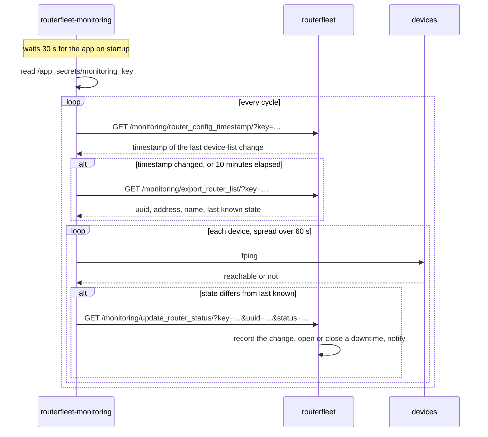

# Monitoring

Reachability is handled by its own container, so a slow backup or a long-running
command cannot delay a ping.

## How it behaves

- **The sweep always takes about a minute.** The container sleeps
  `60 / number of devices` between pings, so a fleet of 10 and a fleet of 500
  both complete a full pass in roughly 60 seconds — the per-device interval
  shrinks as the fleet grows.
- **Only changes are reported.** The container keeps the last known state per
  device and calls the application only when a ping disagrees with it.
- **At most 50 status updates per cycle.** Beyond that, further changes are
  skipped until the next cycle, so a site-wide outage cannot turn into hundreds
  of simultaneous requests and notifications.
- **The device list is re-fetched when it changes**, not on a timer alone. The
  application keeps a timestamp of the last device-list change; the container
  polls that cheap endpoint and only re-downloads the list when it moved, or
  every 10 minutes regardless.
- **It monitors enabled devices with monitoring switched on.** Everything else
  is absent from the exported list.
- **No key, no monitoring.** If `/app_secrets/monitoring_key` is missing or is
  not a valid UUID, the container logs the reason and exits rather than running
  blind.

## What the application records

On a state change the application:

1. sets `status_online` and `last_status_change` on the device,
2. opens a `RouterDownTime` row when it goes offline, or closes the open one
   when it comes back — `total_down_time` is computed on save,
3. removes any stray open downtime rows for that device, so a missed
   transition cannot leave two open at once,
4. raises a notification — see [Notifications](notifications.md).

## Why reachability gates other work

Monitoring state is not only informational. Both the backup scheduler and the
inventory refresh skip a monitored device that is currently offline:

- **Backups** are not even attempted, so an unreachable device does not burn
  through its retries while it is down.
- **Inventory reads** exclude devices known to be offline.

A device with monitoring switched **off** is never gated this way — it is always
attempted. That is the setting to use for a device behind a firewall that drops
ICMP but accepts SSH.

## Authentication

The `/monitoring/` endpoints accept either a signed-in session or
`?key=<MONITORING_KEY>`. The key is generated once on first container start and
kept in the `app_secrets` volume. See [Security](security.md).
