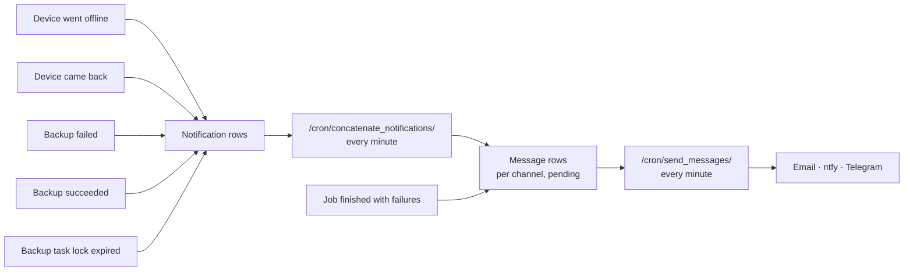
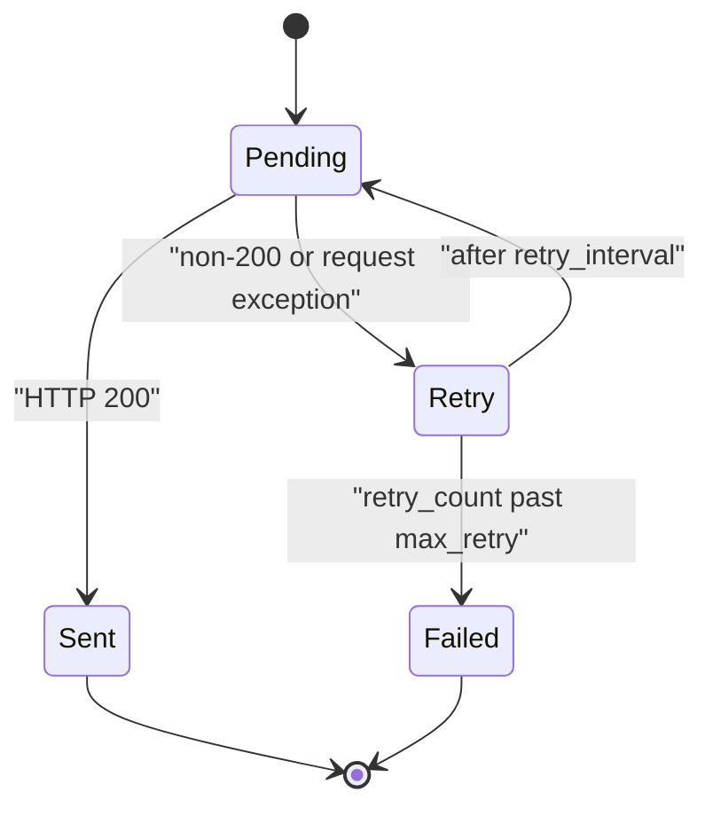

# Notifications

RouterFleet raises a **notification** when something happens, folds
notifications into **messages**, and delivers messages through **channels**.

## Channels

Channels are configured in **System Settings → Notifications** (Configuration
Manager and above); the message history stays in Message Center.

| Type | Transport | Needs |
|---|---|---|
| **Email** | the installation's SMTP server ([below](#email)) | an address: each user's own, or a shared mailbox |
| **ntfy** | `POST <server>/<topic>`, subject as `Title`, `Priority` header | server (default `https://ntfy.sh`, or your own), topic; optional access token and priority |
| **Telegram** | `GET api.telegram.org/bot<token>/sendMessage` | bot token (from `@BotFather`), chat id |

**ntfy** works with the public ntfy.sh or a server of your own. A protected
topic takes an access token, sent as `Authorization: Bearer` - only to an
`https://` server - and stored encrypted. Priority (1 to 5) decides how phones
announce a message. A server on RouterFleet's own internal networks is
refused, as for the [device console](console.md#security).

A stored token is never shown again in the editor; leaving the field empty
keeps it. An enabled channel sends a test message when it is saved, so a wrong
setting shows at once.

**CallMeBot (WhatsApp) is no longer supported.** Upgrading switches existing
CallMeBot channels off and keeps them, with their history; System Settings
lists them so they can be recreated as email, ntfy or Telegram.

Each channel independently selects which events it wants:

- status change to offline
- status change to online
- backup failure
- daily status report
- daily backup report
- backup succeeded - grouped like failures, so a night of backups is one message
- a Fleet Commander job that finished with failed tasks

The last two were added later: they start **off** on every channel that
existed, so an upgrade sends nothing new.

So an on-call channel can take outages only, while a mailbox-style channel takes
the daily reports.

One message ignores these choices: when a backup task's lock expires (see
[Backups](backups.md#when-a-backup-fails)), the warning goes to **every enabled
channel**, because it means a backup has been stuck for hours.

## Email

**Each user receives what they choose.** In *My Settings → Email
notifications* a user enters their address and switches on what they want:
backup failed, backup succeeded, the daily backup report, the daily status
report, device offline, device back online, and Fleet Commander jobs with
failures. RouterFleet keeps a personal email channel for them from those
choices - not listed among the shared channels - and delivers to the address
as it is at sending time. Administrators can also set the address in user
management.

**A shared mailbox** - a team address - is an ordinary channel of type
*Email* in Message Center, with the address as its destination.

**The mail server** is set once, by an administrator, in *System Settings →
Notifications → Mail server*: server and port, the connection's security (STARTTLS, SSL/TLS, or none
- with a warning), an optional username and password, and the sender's address
and name. The password is encrypted like device passwords and never shown
again; leaving the field empty keeps it. *Send a test email* sends one to your
own address. Until the server is set and switched on, users' choices are kept
and nothing is sent.

Messages go through the same queue as every channel - grouping, retries and
the message history included. Subjects are single lines, so a device name can
not add mail headers, and the password is taken out of any error the server
returns before it is stored or shown.

## Concatenation

A flapping link would otherwise send a message per transition. Two settings
prevent that:

- **Status changes** wait `status_change_delay` seconds (default 120) before
  being folded into one message.
- **Backup failures** wait `backup_fails_delay` seconds (default 600).

While `concatenate_status_change` is on, there is a second, sharper rule: if a
device currently reads as **online** but still has an unsent *offline*
notification pending, both its offline and online notifications are **deleted**
rather than sent. A device that dropped and recovered inside the delay window
produces no message at all, instead of two that cancel each other out.

Messages are capped at `max_length` characters (default 2000). Notifications
that do not fit stay queued and go into the next message a minute later, so
nothing is cut off — a large outage simply arrives as several messages.

## Delivery and retries

Defaults: `max_retry` 3, `retry_interval` 60 seconds. The failing status code
and response body are stored on the message, which is what the **Message
History** page shows — so a wrong token or a blocked outbound connection is
diagnosable without reading container logs.

Messages older than 30 days are deleted by housekeeping.

## Daily reports

Two reports are sent at `daily_report_time` (default `07:00`) to the channels
that asked for them:

- **Status report** — how the fleet currently stands.
- **Backup report** — what happened to backups.

The dispatcher runs every 10 minutes. A report goes out inside a window from
one hour before to one hour after the report time, at most once every 12 hours,
and one report per run — the backup report first, the status report on the next
run ten minutes later. The time is read in the installation's `TIMEZONE`; if it
cannot be worked out, midnight is used and both reports start with a warning
saying so.

## A note on secrets in URLs

Telegram and CallMeBot are called with `GET`, which puts the **token and the
message text in the query string**. That is how both services' APIs work. If
outbound traffic passes through a proxy that logs full URLs, those tokens and
messages will appear in its logs. ntfy.sh uses `POST` and does not have this
property.

## Permissions

| Action | Minimum level |
|---|---|
| View channels and message history | 20 — Backup Operator |
| Create or edit channels and message settings | 40 — Configuration Manager |
