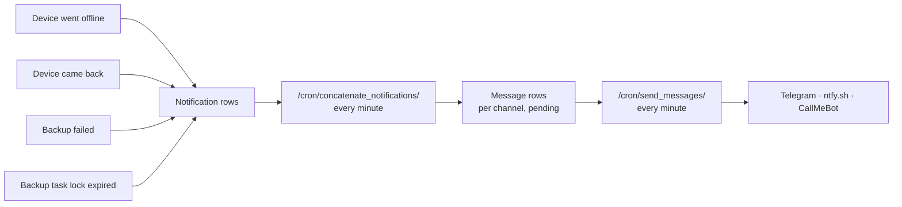
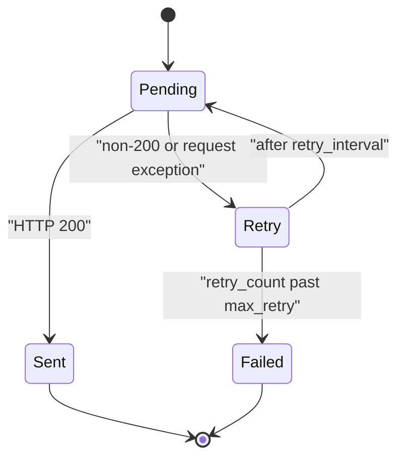

# Notifications

RouterFleet raises a **notification** when something happens, folds
notifications into **messages**, and delivers messages through **channels**.

## Channels

| Type | Transport | Needs |
|---|---|---|
| Telegram | `GET api.telegram.org/bot<token>/sendMessage` | Bot token, chat id |
| ntfy.sh | `POST ntfy.sh/<topic>`, subject as `Title` header | Topic name |
| CallMeBot (WhatsApp) | `GET api.callmebot.com/whatsapp.php` | Phone number, API key |

Each channel independently selects which events it wants:

- status change to offline
- status change to online
- backup failure
- daily status report
- daily backup report

So an on-call channel can take outages only, while a mailbox-style channel takes
the daily reports.

One message ignores these choices: when a backup task's lock expires (see
[Backups](backups.md#when-a-backup-fails)), the warning goes to **every enabled
channel**, because it means a backup has been stuck for hours.

## Concatenation

A flapping link would otherwise send a message per transition. Two settings
prevent that:

- **Status changes** wait `status_change_delay` seconds (default 120) before
  being folded into one message.
- **Backup failures** wait `backup_fails_delay` seconds (default 600).

While `concatenate_status_change` is on, there is a second, sharper rule: if a
device currently reads as **online** but still has an unsent *offline*
notification pending, both its offline and online notifications are **deleted**
rather than sent. A device that dropped and recovered inside the delay window
produces no message at all, instead of two that cancel each other out.

Messages are capped at `max_length` characters (default 2000). Notifications
that do not fit stay queued and go into the next message a minute later, so
nothing is cut off — a large outage simply arrives as several messages.

## Delivery and retries

Defaults: `max_retry` 3, `retry_interval` 60 seconds. The failing status code
and response body are stored on the message, which is what the **Message
History** page shows — so a wrong token or a blocked outbound connection is
diagnosable without reading container logs.

Messages older than 30 days are deleted by housekeeping.

## Daily reports

Two reports are sent at `daily_report_time` (default `07:00`) to the channels
that asked for them:

- **Status report** — how the fleet currently stands.
- **Backup report** — what happened to backups.

The dispatcher runs every 10 minutes. A report goes out inside a window from
one hour before to one hour after the report time, at most once every 12 hours,
and one report per run — the backup report first, the status report on the next
run ten minutes later. The time is read in the installation's `TIMEZONE`; if it
cannot be worked out, midnight is used and both reports start with a warning
saying so.

## A note on secrets in URLs

Telegram and CallMeBot are called with `GET`, which puts the **token and the
message text in the query string**. That is how both services' APIs work. If
outbound traffic passes through a proxy that logs full URLs, those tokens and
messages will appear in its logs. ntfy.sh uses `POST` and does not have this
property.

## Permissions

| Action | Minimum level |
|---|---|
| View channels and message history | 20 — Backup Operator |
| Create or edit channels and message settings | 40 — Configuration Manager |
