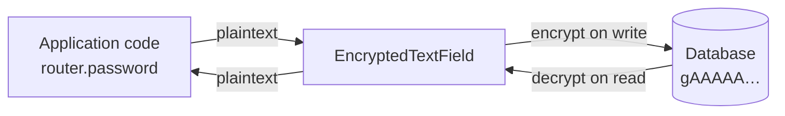
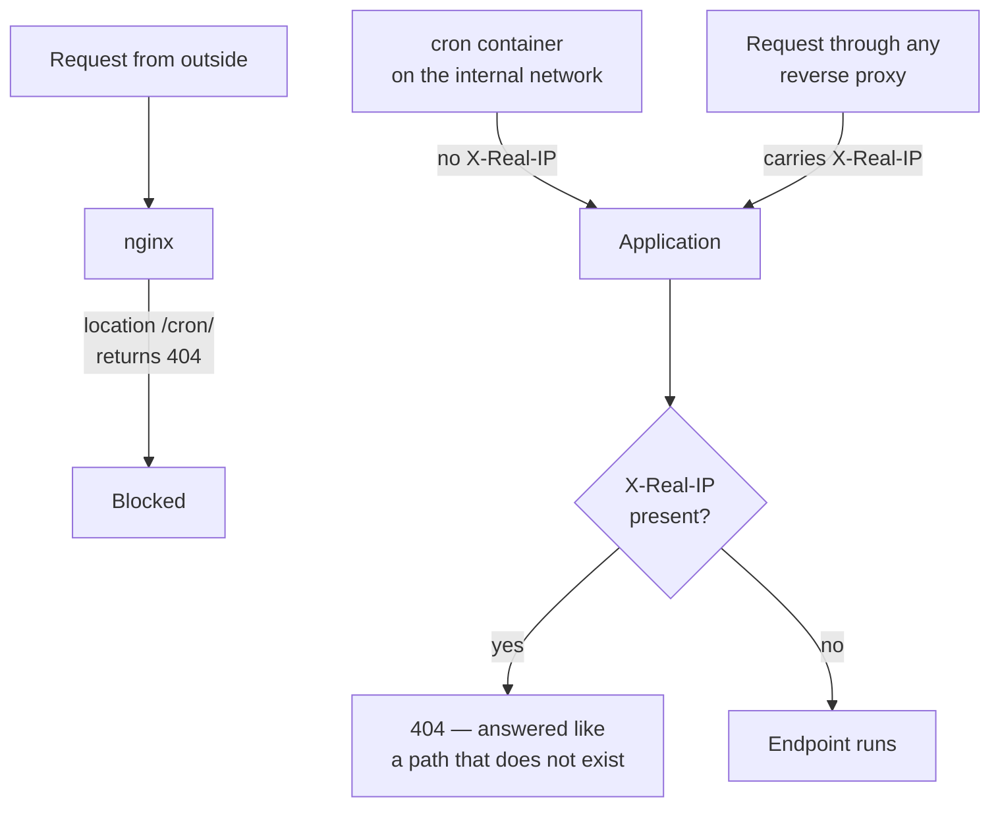

# Security

## Device passwords are encrypted at rest

`Router.password`, `ImportTask.password` and the passwords inside a stored
import CSV are encrypted with [Fernet](https://cryptography.io/en/latest/fernet/)
symmetric encryption.

Encryption lives in the field type, so it is transparent to everything else:
reads return the plaintext, and the code that connects to a device over SSH did
not have to change. Both `save()` and `queryset.update()` go through it, so
values are encrypted at rest either way.

### The key

The key is generated automatically the first time the container starts and kept
in the `app_secrets` volume at `/app_secrets/encryption_key`. There is nothing
to configure.

> **Keep a copy of that volume.** Without the key the stored passwords cannot be
> decrypted, and they would have to be entered again. A database backup without
> the key is not a complete backup.

Outside Docker, with no `ENCRYPTION_KEY` in settings, a key is derived from
`SECRET_KEY` so development works out of the box. Since the container
regenerates `SECRET_KEY` on every start, that fallback is for development only.

### If a value will not decrypt

The application logs a warning and hands the value back unchanged. Two different
situations produce this, and they cannot be told apart from the stored value
alone:

- **the value is not encrypted yet** — normal while the migration that encrypts
  the column is running, and harmless;
- **the value was encrypted with a different key** — the case worth worrying
  about, meaning `app_secrets` was lost or replaced.

The warning names both rather than asserting the alarming one, because it fires
on every upgrade for the ordinary reason.

### What encryption does not cover

- **SSH private keys** are stored as text, not encrypted.
- **Notification channel tokens** are stored as text.
- **Configuration backups** are stored as-is. A RouterOS export taken with
  `show-sensitive` contains the device's own secrets in cleartext in the
  database. Think about whether you need that option on.

In the audit log, by contrast, secrets are never stored at all — they are
compared on their real value and recorded as `(set)` or `(empty)`.

## The scheduler endpoints

The `/cron/` endpoints carry **no authentication of their own**. The cron
container calls them from inside the Docker network on a loop, and there is no
account behind that call.

That makes them worth protecting by other means, because whoever reaches them
drives the installation: the command endpoints send payloads to devices, one
sends messages, one deletes old backups.

Two locks, in series:

1. **The shipped nginx does not pass `/cron/` on** — it answers `404`.
2. **The application refuses a request that arrived through a proxy.** nginx
   writes the caller's address into `X-Real-IP` on the way in; the cron
   container talks to the application directly and sets no such header. A
   request carrying it therefore came from outside and is refused — answered the
   way a non-existent path is, so the reply reveals nothing.

This is **not** authentication. A deployment that puts its own reverse proxy in
front, or that publishes the application's port 8001 directly, is not covered by
it and must keep those paths to itself.

## The monitoring endpoints

`/monitoring/` accepts either a signed-in session or `?key=<MONITORING_KEY>`.
The key is a UUID generated on first container start and kept in
`app_secrets/monitoring_key`, shared with the monitoring container through that
volume.

Because it is passed as a query parameter, it will appear in the access logs of
anything that logs full URLs. On the internal Compose network that is nginx-free
and direct; if you expose the application port, treat the key as exposed too.

## Hosts and CSRF

The container writes `ALLOWED_HOSTS` and `CSRF_TRUSTED_ORIGINS` from
`SERVER_ADDRESS`, plus `localhost`, `127.0.0.1`, `[::1]` and `routerfleet`.

Both loopback names are always allowed, and both are trusted for forms. A
browser treats `https://localhost` and `https://127.0.0.1` as different hosts
even though they are the same installation, and without the CSRF half, signing
in from one of them fails with a CSRF error rather than anything informative.

An address that is not in the list is refused with a bare `400 Bad Request`,
which reads like the application being down rather than like a host that was not
configured — so if you reach the installation by a name you have not configured,
that is the symptom to expect.

## Secrets that rotate on restart

`SECRET_KEY` is regenerated every time the application container starts. The
practical consequence: **everyone is signed out by a restart**. Session data is
not recoverable across restarts.

The two keys in `app_secrets` are **not** rotated, because they must not be.

## The Django admin

The admin URL is commented out of `urls.py` by the entrypoint on every start, so
it is unreachable in a container deployment. The audit log additionally
registers its own models read-only there, as a second layer should the admin
ever be re-enabled.

## Transport

nginx terminates TLS and redirects port 80 to 443. Set
`HTTPS_REDIRECT_POLICY=never` to serve both — which sends passwords in
cleartext, and is not recommended.

The shipped certificate is self-signed and generated on first start. Replace
`nginx.pem` and `nginx.key` in the `https_cert` volume with your own. The config
also carries commented-out settings for Cloudflare authenticated origin pulls.

## Outbound connections

What the installation contacts, and why:

| Destination | Why | Avoidable |
|---|---|---|
| Your devices, port 22 | SSH and SCP for backups, inventory and commands | no |
| MikroTik's update servers | **The device** checks its own channel; RouterFleet only reads the result | Device-side |
| `downloads.openwrt.org` | OpenWrt release index and per-board image availability | Only by not using OpenWrt devices |
| Telegram / ntfy.sh / CallMeBot | Whichever notification channels you configure | Yes — configure none |
| `fonts.googleapis.com` | A web font referenced by the interface's stylesheet, loaded by the **browser** | Not currently configurable |
| Application update check | Disabled by default; off unless `UPDATE_CHECK_URL` is set | Yes, and it is off |

Note the last two rows. The update check makes **no outbound request at all**
unless you configure an endpoint. The Google Fonts reference is fetched by each
visitor's browser, not by the server, and is the one remaining third-party call
in a default install.
