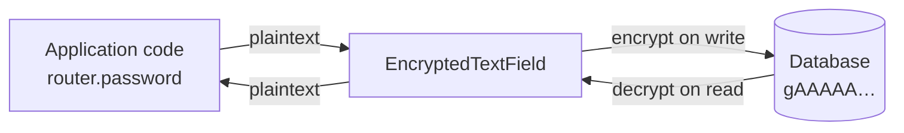
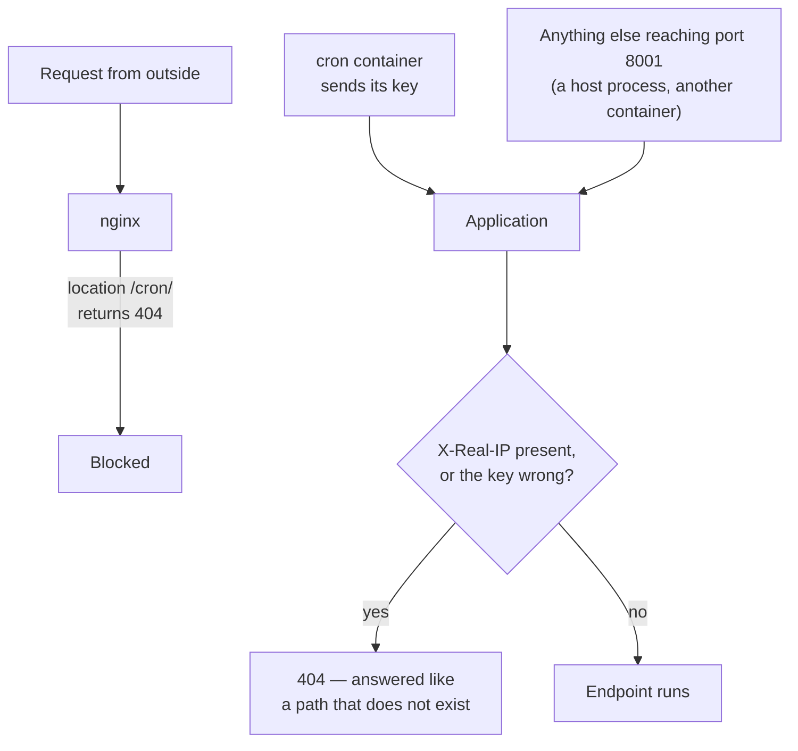
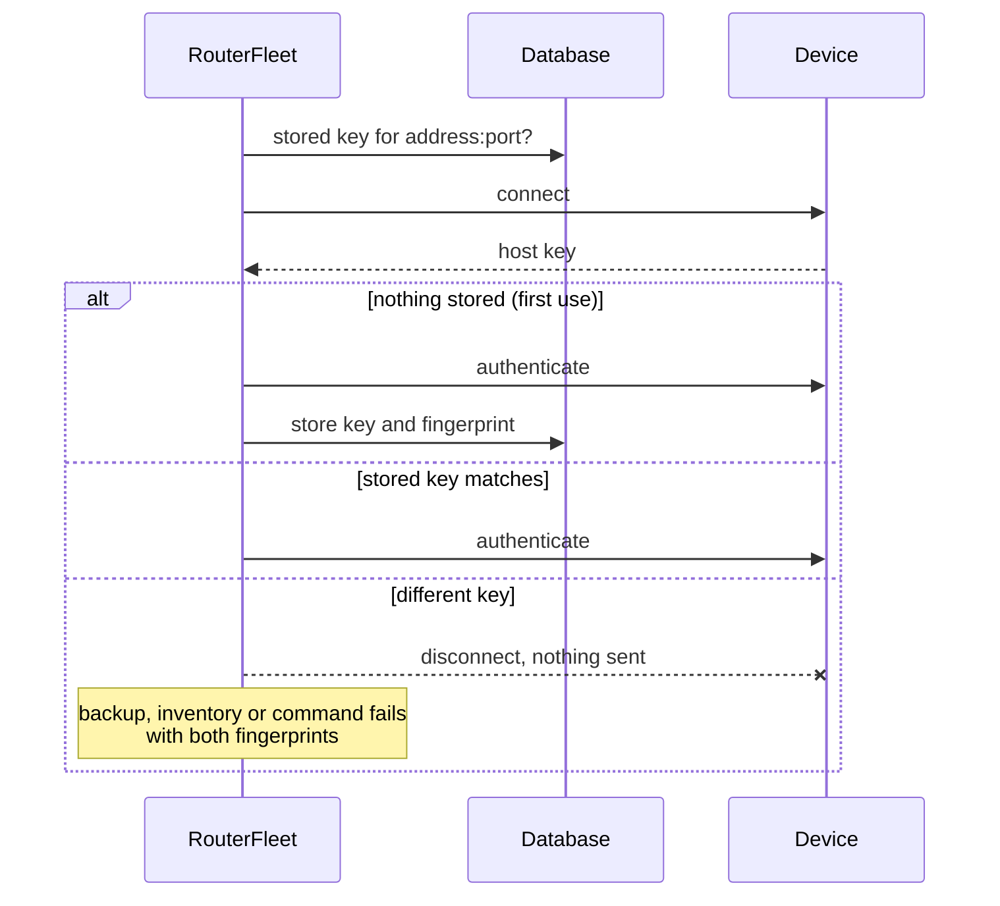
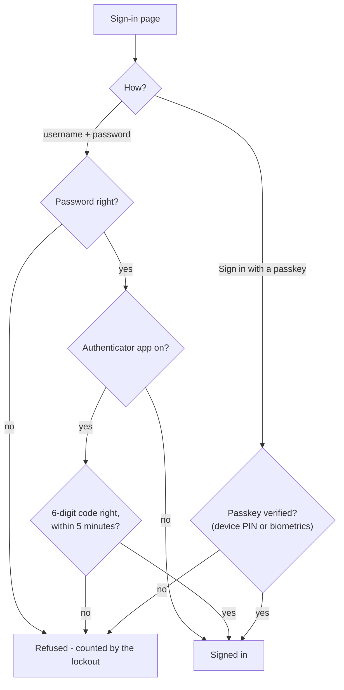
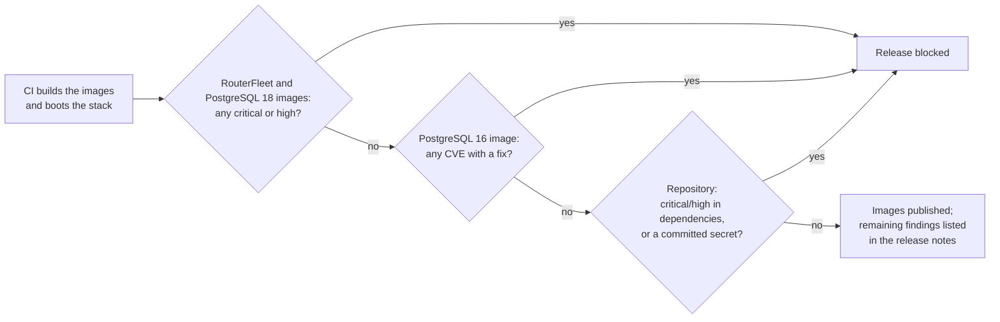

# Security

## Credentials are encrypted at rest

Every credential RouterFleet stores is encrypted with
[Fernet](https://cryptography.io/en/latest/fernet/) symmetric encryption:

| What | Where |
|---|---|
| Device passwords | `Router.password` |
| Device enable passwords (Cisco) | `Router.enable_password` |
| SSH private keys and their passphrases | `SSHKey.private_key`, `SSHKey.passphrase` |
| Notification channel tokens | `MessageChannel.token` |
| Import passwords | `ImportTask.password`, and the passwords inside a stored import CSV |

Encryption lives in the field type, so it is transparent to everything else:
reads return the plaintext, and the code that connects to a device over SSH did
not have to change. Both `save()` and `queryset.update()` go through it, so
values are encrypted at rest either way.



### The key

The key is generated automatically the first time the container starts and kept
in the `app_secrets` volume at `/app_secrets/encryption_key`. There is nothing
to configure.

> **Keep a copy of that volume.** Without the key the stored passwords cannot be
> decrypted, and they would have to be entered again. A database backup without
> the key is not a complete backup.

Outside Docker, with no `ENCRYPTION_KEY` in settings, a key is derived from
`SECRET_KEY` so development works out of the box. Since the container
regenerates `SECRET_KEY` on every start, that fallback is for development only.

### If a value will not decrypt

Two different situations, told apart by the value itself:

- **the value is not encrypted yet** — normal while the migration that encrypts
  the column is running, and harmless: it is handed back unchanged, with a
  warning in the log;
- **the value is encrypted, but with a different key** — `app_secrets` was lost
  or replaced, or does not belong to this database. The ciphertext is **never
  handed on**: not sent to a device as its password, not used as an
  authenticator secret. It reads as empty (a device then asks for its password
  again), it is never encrypted a second time (so it can still be read once
  the right key is back), and administrators see a red warning on the status
  page. Restore `app_secrets/encryption_key` from a backup, or enter the
  secrets again.

### What encryption does not cover

- **Configuration backups** are stored as-is. An export with *Include passwords
  and keys* on contains the device's own secrets in cleartext in the database.
  Think about whether you need that option on. With it off, RouterOS 6 is told
  `hide-sensitive` (it exports secrets unless told otherwise); before 0.24.2
  it was not, so RouterOS 6 backups from then contain secrets whatever the
  profile said.

In the audit log, by contrast, secrets are never stored at all — they are
compared on their real value and recorded as `(set)` or `(empty)`.

## The scheduler endpoints

The `/cron/` endpoints drive the installation - the command endpoints send
payloads to devices, one sends messages, one deletes old backups - so three
locks stand in front of them:



1. **The shipped nginx does not pass `/cron/` on** — it answers `404`.
2. **A request that came through a proxy is refused.** nginx writes the
   caller's address into `X-Real-IP`; the cron container talks to the
   application directly and sets no such header.
3. **The scheduler's key.** The cron container holds a key of its own - on
   the `cron_keys` volume, which only the scheduler mounts (compose files from
   0.40; `service_keys` in 0.38/0.39) - and sends it with every call
   (`X-RF-Cron-Key`); a call without it is refused, so no process on the host
   and no other container, monitoring included, can drive the installation
   through the application's loopback port. With a compose file from before
   0.38 (no key volume) the key is not required and the first two locks
   remain, as before.

A refusal is answered the way a non-existent path is, so it reveals nothing.

## The monitoring endpoints

`/monitoring/` accepts the monitoring key - a UUID generated on first start,
compared in constant time - and, for reading the device list, a signed-in
Viewer or above. **Only the monitoring key reports a status** (online, offline): a
signed-in user, or a link someone follows, can not mark devices offline,
open outages or send notifications.

The key travels in an `X-Monitoring-Key` header, never in a URL (a URL ends up
in logs and error messages); a key in the URL (`?key=`) is not accepted.

The monitoring container reads its key from the `monitoring_keys` volume,
mounted read-only - **not** from `app_secrets`, which also holds the key to
every device password, and not the scheduler's key: the container runs on the
host's network and parses announcements from the LAN, and must hold nothing
more than its own key. (A 0.38/0.39 compose file mounts `service_keys`, with
both keys; one from before 0.38 still mounts `app_secrets`.)

### Where the client's address comes from

nginx tells the application who the client is (`X-Real-IP`); a request that
reaches the application straight from the host - through its loopback port,
arriving from Docker's gateway - has no nginx in between, so those headers are
not believed there: a process on the host can neither dodge the sign-in
lockout nor get somebody else's address banned that way.

## Containers and privileges

- **The application runs unprivileged**, as the user `routerfleet` (uid 1000).
  Its start-up runs as root only to write its settings - readable by that user
  alone, as they hold the keys - and, once, to hand it the folders it writes
  (media, the SQLite database, static files, the certificate and discovery
  folders). `manage.py` started as root (`docker compose exec`) drops to that
  user too. `APP_USER=root` in `.env` runs it as root, should anything need
  it.
- **No container gains privileges**: every service runs with
  `no-new-privileges`.
- **Key files** are written whole or not at all (a temporary file, checked,
  then moved into place), and values from `.env` reach the settings as
  quoted strings - a quote in a password can neither break nor change them.

## Files downloaded from devices

A backup file is read over the **command channel** (`cat`), byte for byte,
where the device has a shell; **SCP** only where that is the only way. An SCP
sender describes what it sends, and a client that follows it writes where it
is told - so a download takes exactly **one file, at the path RouterFleet
chose**: a directory, a second file or a name with a path in it is refused,
as is a file over 256 MB. Command output is limited to 64 MB and read before
its exit status. See [Backups](backups.md#how-files-are-downloaded).

Values that come from devices or vendor pages are data: a version reported by
a device is matched as plain text in Fleet Commander's checks (never as a
pattern of its own), and a version read from a vendor channel goes into a
device's update command only when it is a plain version - letters, digits and
`. _ - +`.

## Notification channels

The token and destination of a channel must look like what the service issues
— a Telegram bot token, a chat id or @channel, a phone number, an ntfy topic —
before the channel is saved, and requests are built with encoded parameters and
quoted path segments, never by pasting text into a URL. The formats are checked
again whenever a message is sent, so a channel saved by an earlier version
cannot steer a request either. A device name is part of the messages sent, and
a `&` in it must not cut a message short or add a parameter to the request. The error text of a failed
send is stored with the channel's token removed: it names the request's URL,
and for Telegram the token is part of that URL.

## Device host keys

RouterFleet trusts a device's SSH host key **on first use**, as OpenSSH does.
The first successful connection to an address and port stores the key the
device presented, with its SHA256 fingerprint — shown on the device's page as
**SSH Host Key**. Every later connection must see that same key. paramiko
compares it before authenticating, so when it differs the connection is refused
with both fingerprints in the error, and **the device never receives the
password or a signature made with the SSH key**. A key of another algorithm is
refused just the same.



Keys are kept by address and port, not by device: the connection test runs
before a new device is saved, and that first connection is the one that is
trusted.

**A device that was reset or replaced** presents a new key on purpose. After
confirming that is what happened, use the eraser next to the fingerprint
(**Forget host key**, administrators only, confirmed with a small sum): the key
presented on the next connection is then trusted. A key change you cannot explain is what this exists
to catch — do not forget the key until you know why it changed.

**Every stored host key** is listed on the **SSH Keys** page, under *Device
host keys*, with the device at its address and port. A key no device uses - its
device was deleted or moved to another address, or only a connection test was
made - is marked **Unused**, listed first, and counted in the page's header;
remove it there (administrators, confirmed with a small sum). Until then a
device added later at that address and port would be held to the old key.
Removing a host key, here or on a device's page, is recorded in the Audit Log.

An installation upgraded from a release that did not check host keys has none
stored; each device's key is learned on its next connection.

## Sign-in attempts

Within **15 minutes**, further attempts are turned away without the password
being checked — even the right one — after:

- **5 refused attempts for one account from one address**: that account, from
  that address;
- **5 refused attempts from one address**, whatever the names: that address;
- **20 refused attempts for one account from all addresses together**: that
  account, everywhere (guessing spread over many addresses).

The lock lasts until the oldest of those attempts is more than 15 minutes old.
A successful sign-in clears the failures **of that account** from that
address - never anybody else's: holding one account and signing in between
guesses at others does not reset the count. The answer is the same whether
the account exists or not.

Attempts turned away are recorded in the [login history](audit-log.md#login-history)
with a lock icon. They do not count towards the limit: someone who keeps
trying while locked out gets back in 15 minutes after their last real attempt.

Two consequences to be aware of:

- Failing on purpose from one address locks only that address: the owner signs
  in from their own. Locking a known account everywhere takes 20 failures from
  at least five addresses within 15 minutes.
- The address is the one nginx sees (see [Where the address comes
  from](audit-log.md#where-the-address-comes-from)). Where every visitor
  arrives from one address - Docker's own gateway (`IPV6=false` with Docker's
  proxy, Docker Desktop, rootless Docker) - that address is never locked or
  banned as a whole: one person must not lock out everyone; the per-account
  limits still apply. Behind a reverse proxy of your own, use proxy mode (see
  [HTTPS](https.md#behind-a-reverse-proxy)) so the client's address is known.

The limits are `LOGIN_LOCKOUT_ATTEMPTS`, `LOGIN_LOCKOUT_ACCOUNT_ATTEMPTS` and
`LOGIN_LOCKOUT_MINUTES` in `routerfleet/settings.py`;
`LOGIN_LOCKOUT_ATTEMPTS = 0` turns it off.

The lockout turns attempts away; it does not ban. Addresses that keep
failing are also [banned at nginx](#banning-after-failed-sign-ins) - 5
failures in 10 minutes by default - and then get nothing at all.

### Password reset

When the [mail server](notifications.md#email) works, the sign-in page offers
**Forgot your password?**: the user gives their username or email address and
receives a link at the account's email address. The page answers the same
whether an account matches or not, so it tells nobody which names or addresses
exist. The link is valid for an hour and works once - it is bound to the
current password - and using it does not sign anybody in: a second factor
still applies at the next sign-in, and devices signed in with the old password
sign in again. An address asking more than five times in 15 minutes is turned
away for a while (counted per application worker). Without a working mail
server the page does not exist; an administrator sets a new password in User
Manager.

## HTTP access lists and banning

*System settings → Security → HTTP access* decides which addresses may reach
the web interface, over HTTP and HTTPS, in every HTTPS mode: **allow** and
**deny** entries - a single address or a network, IPv4 or IPv6 - checked **in
order, the first match deciding**, then a **final policy** for every other
address: **Allow** unless changed. nginx enforces it with its own `allow` and
`deny`, which work exactly that way; Let's Encrypt's validation path stays
open. Behind a reverse proxy the address is the client's, taken from the
trusted proxies. An IPv4 address written the IPv6 way (`::ffff:10.0.0.1`) is
stored as the IPv4 address it is - as nginx matches it; an IPv6 scope
(`fe80::1%eth0`) is refused.

A change that would shut out the administrator making it - by their address
as nginx sees it - is refused. Locked out anyway (a new address, say)? On the
host:

```bash
docker compose exec routerfleet python manage.py http_access          # shows the list
docker compose exec routerfleet python manage.py http_access --reset  # no entry, Allow
```

The scheduler and monitoring talk to the application directly and are not
affected; nor is SSH to the host.

### Banning after failed sign-ins

fail2ban's idea, built in - nothing to install on the host. On the same page:
when one address fails to sign in **5 times within 10 minutes** (since its
last successful sign-in; all three numbers can be changed), it is **banned for
60 minutes**: nginx serves it nothing at all - the ban is checked before the
access list - and the application refuses its sign-ins too. The ban ends by
itself; *Banned now* lists the current ones with **Unban**, and
`manage.py http_access --reset` lifts every ban.

**Never banned:** an address an **Allow** entry of the access list matches -
that is the whitelist - and loopback and the trusted proxies, since banning
those would shut out everybody behind them. Banning can be switched off; the
sign-in lockout (above) works beside it either way: it turns away the
attempts, the ban shuts the address out of everything.

## Second factors and passkeys

Each user can add a second step to signing in, in **My Settings → Security
settings**. The sign-in page offers passkeys only where the HTTPS settings
allow them - served over HTTPS, reached by a name (the one the browser used,
not an IP address), a certificate browsers trust; behind a reverse proxy,
whose certificate RouterFleet can not see, the browser decides.



**Authenticator app (TOTP).** Any app that supports TOTP codes works. Setting
it up shows a QR code and the key; it is turned on only once a correct code
is entered, so an abandoned setup changes nothing. From then on the password
alone signs nobody in: the session remembers for five minutes that the password
was right, and the code completes the sign-in. Codes follow RFC 6238 (SHA-1,
6 digits, 30 seconds, one step of clock drift either way), each code is
accepted **once** - the last step used is stored, and a code seen over someone's
shoulder is useless - and a wrong code is a refused sign-in, recorded in the
login history and counted by the [lockout](#sign-in-attempts). The key is
encrypted at rest like every other credential. Turning the app off needs a
current code.

**Passkeys.** A passkey signs in without a password, with the fingerprint,
face or PIN of the device that holds it. Because that already combines
something you have with something you are or know, a passkey does not also ask
for the authenticator code. Passkeys are bound to the name the installation is
reached by, and browsers impose two conditions: the installation must be opened
by a **name, not an IP address**, over HTTPS with a **certificate the browser
trusts** (not the self-signed one an installation starts with). Where that is
not the case, the passkey options are simply not offered; the authenticator app
works everywhere. Signing in with a passkey checks the origin, the challenge
(answerable once: a passkey takes only a challenge issued after its last use),
the device's signature and its signature counter. The challenge is kept in a
signed cookie that expires after five minutes, not in a session, so asking for
challenges stores nothing on the server.

**Adding a passkey asks for the account's password**: a passkey signs in on
its own, so a session left open is not enough to add one. That password - and
the current one when changing it - counts like a sign-in: a wrong one is
recorded in the login history, and the sign-in lockout stops the guessing.

**Losing a phone or a passkey.** An administrator resets a user's second
factors on the user's page (**Reset**, confirmed with the username), which
leaves the user with their password only. For the only administrator, there is
a command:

```bash
docker exec -it routerfleet python manage.py reset_mfa <username>
```

Turning second factors on and off, and adding or removing passkeys, is
recorded in the [change log](audit-log.md#change-log); the secrets never are.

## Actions are POSTs

Everything that changes something — deleting, aborting a task, starting a
backup, refreshing inventory, signing out — is a POST carrying the
installation's CSRF token. Loading an address, from a link, an image tag or
another site, changes nothing: the same request as a GET is ignored. In the
earlier RouterFleet projects these actions were GET requests, which Django's
CSRF protection does not check: another site could trigger them by navigating a
signed-in user's browser to the address.

## Hosts and CSRF

The container writes `ALLOWED_HOSTS` and `CSRF_TRUSTED_ORIGINS` from
`SERVER_ADDRESS`, plus `localhost`, `127.0.0.1`, `[::1]` and `routerfleet`.

Both loopback names are always allowed, and both are trusted for forms. A
browser treats `https://localhost` and `https://127.0.0.1` as different hosts
even though they are the same installation, and without the CSRF half, signing
in from one of them fails with a CSRF error rather than anything informative.

An address that is not in the list is refused with a bare `400 Bad Request`,
which reads like the application being down rather than like a host that was not
configured — so if you reach the installation by a name you have not configured,
that is the symptom to expect.

## Secrets that rotate on restart

`SECRET_KEY` is regenerated every time the application container starts. The
practical consequence: **everyone is signed out by a restart**. Session data is
not recoverable across restarts.

`settings.py` itself carries no key: start-up is refused with an explanation
when `production_settings.py` does not set one, rather than running on a key
anyone can read in the repository.

The two keys in `app_secrets` are **not** rotated, because they must not be.

## No container has Docker access

No RouterFleet container mounts the Docker socket, which is root on the host:
updating is done on the host with `docker compose` ([Updating](updating.md)).
The in-app updater of 0.21 to 0.23.0, which held it in the scheduler, was
removed in 0.23.1.

## Device types and firmware

- **A device type decides what is sent to devices**, so creating, editing and
  deleting types takes the Administrator level, and each change is in the
  change log. Commands of an existing type are edited one at a time with a
  review, as every system command.
- **Try it** (device type wizard) connects only with the credentials typed for
  it, stores nothing but the device's host key, and refuses RouterFleet's own
  addresses and internal networks.
- **Management links** of a type accept only `scheme://` links; `javascript:`,
  `data:` and `file:` are refused, and the values filled in are URL-encoded.
- **The enable password** is encrypted, never shown again, and - like the device
  password - only sent to the address it was stored for.
- **The mail server password and an ntfy access token** follow the same rule:
  never shown again, and only sent to the server they were typed for. Changing
  the mail server's address, port, security or login, or the ntfy server, asks
  for the password or token again.
- **Message Center errors** are read by every operator from level 20: a mail
  server's refusal names the recipient, so stored errors have email addresses
  replaced with `[address]` (and tokens and passwords removed, as before).
- **Backups and command output are shown as they are, from level 20.** A
  backup taken with sensitive values (a profile's *show sensitive*), a binary
  backup and a command's output can hold the device's passwords and keys;
  Backup Operators restore devices from them, so they see the real
  configuration. Give level 20 only to people who may see it. Stored as taken,
  not encrypted: protect the database and its backups accordingly.
- **An ntfy topic is stored and logged as it is.** On a public ntfy server the
  topic is what keeps a feed private; it is visible to administrators only (the
  channel page and the change log) - use an access token for a private feed.
- **Firmware uploads** are accepted on one page only, up to 1 GB (nginx keeps
  1 MB everywhere else). The SHA-256 is computed on upload and compared with the
  vendor's when given; the file name is reduced to letters, digits, `.`, `_`
  and `-` before it reaches a path or a command on a device.
- **A rollout** checks the uploaded file on the device (SHA-256 or size) before
  installing, starts with one device alone, stops at the first failure, and
  takes the Configuration Manager level and a confirmation.

## The Django admin

The admin URL is commented out of `urls.py` by the entrypoint on every start, so
it is unreachable in a container deployment. The audit log additionally
registers its own models read-only there, as a second layer should the admin
ever be re-enabled.

## Known vulnerabilities

Every release is scanned with [Trivy](https://trivy.dev) before it is
published, and a release that fails the scan is not published.



| What | Blocks a release | Reported in the release notes |
|---|---|---|
| The application, scheduler, monitoring and nginx images | any critical or high vulnerability, with or without a fix | medium and low |
| The PostgreSQL 18 database image | any critical or high vulnerability, with or without a fix | medium and low |
| The PostgreSQL 16 image (compose files before 0.24) | any vulnerability with a published fix | those its distribution has not fixed yet |
| Python dependencies and bundled browser libraries | any critical or high vulnerability | — |
| The repository | any committed secret (tokens, keys) | — |

How the images stay clean:

- **They are rebuilt for every release with every available update installed**
  (`apk upgrade` / `apt-get upgrade`), so a release never ships a vulnerability
  whose fix was already published.
- **`gosu` in the PostgreSQL 16 image is built from source** - a pinned release
  with the current Go and current libraries - rather than shipping the
  published binary that bundles vulnerable ones.
- **The four RouterFleet images are based on Alpine Linux.** On Alpine every
  known vulnerability in the base comes with a fix, so updating reaches zero.
  They carry nothing the application does not use: no editors, no network
  tools, and no `pip` after the dependencies are installed — the tools that
  were in them before brought most of the findings.
- **The database image is PostgreSQL 18 on Alpine** with every update, held to
  the same rule as RouterFleet's own images: no critical or high
  vulnerability. Its databases use PostgreSQL's built-in `C.UTF-8` ordering, so
  text ordering never depends on the C library. Installations from before 0.24
  keep the Debian-based PostgreSQL 16 image - still published, held to "nothing
  with a fix" - until they migrate by export and re-import
  ([Upgrading](upgrading.md#moving-to-postgresql-18)).
- **Browser libraries** are listed with their exact versions in
  `third_party/browser-libraries/` so the scan can check them; a test keeps that
  list equal to the files actually served. Only the files pages load are
  shipped — no demo pages, documentation or unused plugins of the theme.

A scan is a snapshot: a vulnerability disclosed after a release is not in it.
Updating to the newest release is how an installation picks up fixes.

### Code scanning

Besides the image scan, GitHub's CodeQL reads the Python code and the CI
workflows for security problems — injection, unsafe deserialisation, missing
escaping, workflows that trust untrusted input — on every push, on pull
requests and weekly (`.github/workflows/codeql.yml`, with the extended security
queries). Its findings are listed under the repository's **Security → Code
scanning**.

## Transport

nginx terminates TLS and redirects HTTP to HTTPS (to `HTTPS_PORT`, 443 by
default). It does not announce its
version.

### Response headers

Django sends, on every page it renders: `X-Content-Type-Options: nosniff`,
`X-Frame-Options: DENY` (no page can be framed by another site),
`Referrer-Policy: same-origin` and `Cross-Origin-Opener-Policy: same-origin`.
nginx adds the first and third to the static files it serves itself.

**Content-Security-Policy.** Every page carries a strict policy: scripts,
styles, fonts and data come from the installation itself, and no page carries an
inline script, inline handler (`onclick="..."`) or inline style. A `<script>` or
`onerror="..."` that ever got past the escaping of the templates would not run.

```
default-src 'self'; script-src 'self'; style-src 'self'; img-src 'self' data:;
font-src 'self'; connect-src 'self'; object-src 'none'; base-uri 'self';
form-action 'self'; frame-ancestors 'none'
```

`data:` images are Bootstrap's own: the arrow of a select and the knob of a
switch, drawn in its stylesheet. One page has one exception: the **device
console** allows inline `<style>` elements (`style-src-elem 'unsafe-inline'`),
because xterm.js draws the terminal with style elements of its own and offers
no way to mark them. Scripts and style attributes stay strict there too. A test
fails if a template, or markup built in Python, ever carries inline code again.
Every page was opened in a browser with the policy enforced, with no violation.

**HSTS only with a certificate browsers trust** - Let's Encrypt's once issued,
or an uploaded one browsers trust: nginx then sends
`Strict-Transport-Security` (one year). Never with the self-signed
certificate, nor an uploaded one browsers do not trust: a browser that has seen
HSTS refuses to let the user past the certificate warning. See
[HTTPS](https.md#hsts). `HTTPS_REDIRECT_POLICY=never` serves plain HTTP too -
which sends passwords in cleartext, and is not recommended.

### Device console

The [device console](console.md) gives a browser a terminal on a device, so it
is guarded more than anything else: Host Manager and above, checked again
every few seconds; a one-time ticket valid for 60 seconds, held only as a hash
and never put in a URL; WebSockets refused unless they come from a page of the
installation with a signed-in session; SSH host keys checked; the backup
account's secret never sent to the browser and a typed password never stored;
no stored credential ever sent over Telnet, which is off per device until
switched on; idle, length and per-user limits; closed at once when the page
closes and within seconds of signing out. Each session is in the change log;
what is typed is not recorded. CI drives a real console session through nginx
to an SSH server on every push.

### How long a sign-in lasts

Each user chooses in *My Settings → Security settings → Session expiration time*: from 1 hour to 2 weeks, **24 hours**
unless changed, counted from the last use. Pages refreshing by themselves - the
live parts, the half-minute check every open page makes for changes, the
device list's status dots - and the scheduler's calls do not count as use, so a
tab left open does not keep a sign-in alive. The expiry is renewed at most
every five minutes, so it may run up to five minutes longer. Before 0.31.0
every sign-in lasted two weeks from signing in.

**When a sign-in ends** - it expired, the user signed out in another tab, an
administrator switched the account off - an open page notices within half a
minute (or as soon as its tab is back in front) and goes to the sign-in page;
signing in again opens the page it was on. Only a page of this installation is
ever returned to: an address of another site, `//host` or the sign-in pages
themselves are refused, and the return address is used once.

### Browser cache

A page shown to a signed-in user is sent with `Cache-Control: no-store`: an
authenticator secret, a backup's text or the HTTPS settings are never brought
back from the browser's disk cache (or with Back) after signing out on a
shared workstation. Static files keep their caching.

### Cookies

With HTTPS enforced — `HTTPS_REDIRECT_POLICY` is anything but `never` — the
session and CSRF cookies are marked `Secure`: a browser only sends them over
HTTPS, so they cannot be read off a plain-HTTP request. With `never` they are
not, because signing in over plain HTTP has to keep working. A compose file of an
earlier RouterFleet project does not pass `HTTPS_REDIRECT_POLICY` to the
application at all, and then the cookies stay as they were; the current compose
file does.

When HTTPS is managed in [System settings](https.md) (any mode but *As
configured in .env*), the cookies are `Secure` exactly when the request
arrived over HTTPS. nginx sets `X-Forwarded-Proto` on every request and
overwrites whatever a client sends - behind a reverse proxy, only the listed
proxies are believed - so a client cannot claim HTTPS it did not use. CI checks
this on a running stack.

The shipped certificate is self-signed and generated on first start. Replace
`nginx.pem` and `nginx.key` in the `https_cert` volume with your own, or use
[System settings → HTTPS](https.md): Let's Encrypt, an uploaded certificate
(checked before use; its key never stored in the database), or a reverse
proxy. Switching HTTPS off there takes an explicit confirmation. The config
also carries commented-out settings for Cloudflare authenticated origin pulls.

## Outbound connections

What the installation contacts, and why:

| Destination | Why | Avoidable |
|---|---|---|
| Your devices, port 22 | SSH and SCP for backups, inventory and commands | no |
| MikroTik's update servers | **The device** checks its own channel; RouterFleet only reads the result | Device-side |
| Vendor release lists (`downloads.openwrt.org` for the OpenWrt type) | A device type's vendor update check: https only, never an address on RouterFleet's own networks, no redirects followed, cached six hours | Yes: switch the device type's vendor check off |
| Your mail server / ntfy (ntfy.sh or your own) / Telegram | Whichever notification channels you configure | Yes — configure none |
| `api.github.com` | The update check: the latest release of RouterFleet Improved, about once an hour. The request carries no information about the installation | Yes: `UPDATE_CHECK=off` |

With `UPDATE_CHECK=off`, the update check makes **no outbound request at all**;
the status page then says the check is off.

Every outbound HTTP request has a timeout, so a service that stops answering
cannot hold a worker of the application, or the monitoring loop, indefinitely.

### What the browser loads

Nothing from another host. Every font, script and stylesheet a page uses is
served by the installation itself, so a page view tells no third party who is
looking at what, and the interface renders completely on a network without
internet access:

- the **Source Sans Pro** font is bundled under `static/fonts/` — Adobe's
  release 3.006R, unmodified, under the SIL Open Font License 1.1;
- **Chart.js 4.6.1** (MIT), used by the status page, is bundled under
  `static/vendor/`, pinned to that version;
- the interface - **AdminLTE 4** on **Bootstrap 5.3**, DataTables, Tom Select,
  Font Awesome - is bundled under `static/vendor/`, each library the file of its
  npm release, checked against the registry's SHA-512 when it was added. There
  is no jQuery.

The test suite fails if a template ever references an external host again.
