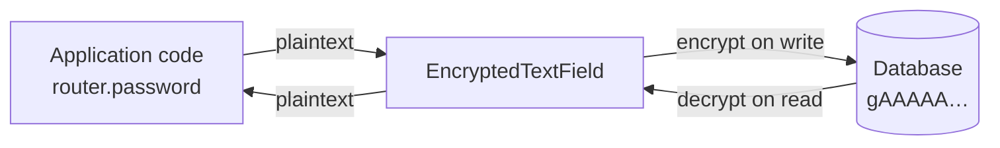
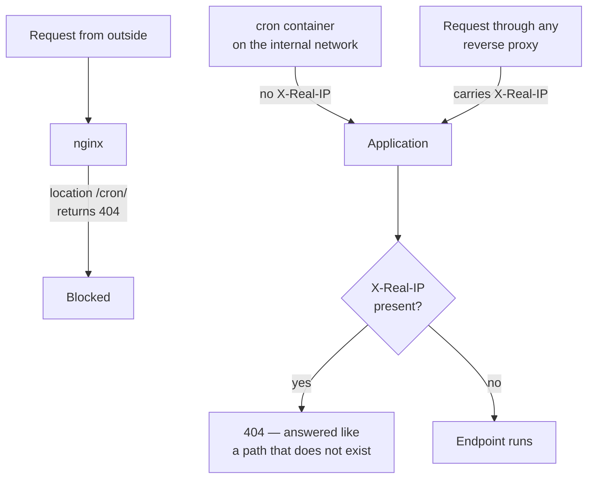
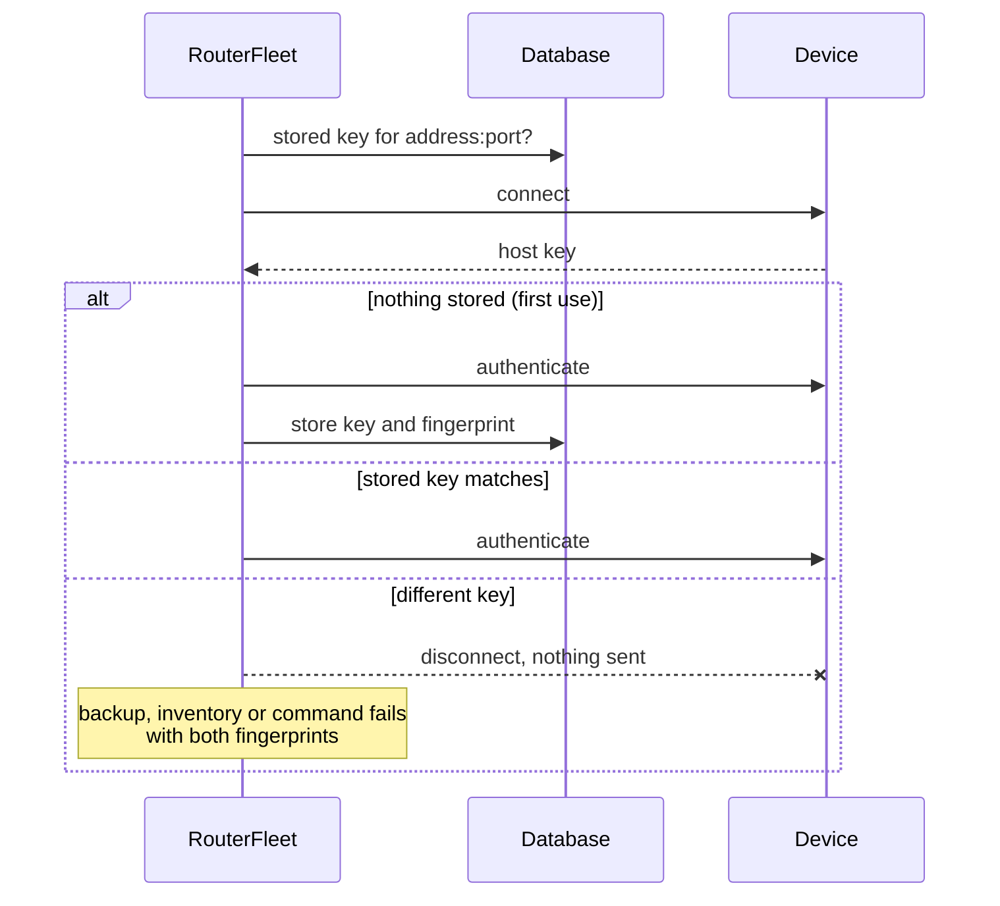
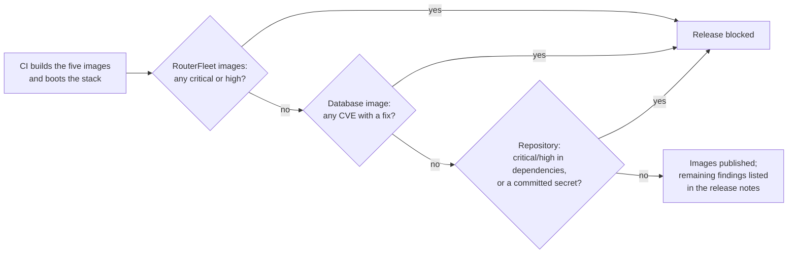

# Security

## Credentials are encrypted at rest

Every credential RouterFleet stores is encrypted with
[Fernet](https://cryptography.io/en/latest/fernet/) symmetric encryption:

| What | Where |
|---|---|
| Device passwords | `Router.password` |
| SSH private keys | `SSHKey.private_key` |
| Notification channel tokens | `MessageChannel.token` |
| The WireGuard integration's API key | `ExternalIntegration.token` |
| Import passwords | `ImportTask.password`, and the passwords inside a stored import CSV |

Encryption lives in the field type, so it is transparent to everything else:
reads return the plaintext, and the code that connects to a device over SSH did
not have to change. Both `save()` and `queryset.update()` go through it, so
values are encrypted at rest either way.

### The key

The key is generated automatically the first time the container starts and kept
in the `app_secrets` volume at `/app_secrets/encryption_key`. There is nothing
to configure.

> **Keep a copy of that volume.** Without the key the stored passwords cannot be
> decrypted, and they would have to be entered again. A database backup without
> the key is not a complete backup.

Outside Docker, with no `ENCRYPTION_KEY` in settings, a key is derived from
`SECRET_KEY` so development works out of the box. Since the container
regenerates `SECRET_KEY` on every start, that fallback is for development only.

### If a value will not decrypt

The application logs a warning and hands the value back unchanged. Two different
situations produce this, and they cannot be told apart from the stored value
alone:

- **the value is not encrypted yet** — normal while the migration that encrypts
  the column is running, and harmless;
- **the value was encrypted with a different key** — the case worth worrying
  about, meaning `app_secrets` was lost or replaced.

The warning names both rather than asserting the alarming one, because it fires
on every upgrade for the ordinary reason.

### What encryption does not cover

- **Configuration backups** are stored as-is. A RouterOS export taken with
  `show-sensitive` contains the device's own secrets in cleartext in the
  database. Think about whether you need that option on.

In the audit log, by contrast, secrets are never stored at all — they are
compared on their real value and recorded as `(set)` or `(empty)`.

## The scheduler endpoints

The `/cron/` endpoints carry **no authentication of their own**. The cron
container calls them from inside the Docker network on a loop, and there is no
account behind that call.

That makes them worth protecting by other means, because whoever reaches them
drives the installation: the command endpoints send payloads to devices, one
sends messages, one deletes old backups.

Two locks, in series:

1. **The shipped nginx does not pass `/cron/` on** — it answers `404`.
2. **The application refuses a request that arrived through a proxy.** nginx
   writes the caller's address into `X-Real-IP` on the way in; the cron
   container talks to the application directly and sets no such header. A
   request carrying it therefore came from outside and is refused — answered the
   way a non-existent path is, so the reply reveals nothing.

This is **not** authentication. A deployment that puts its own reverse proxy in
front, or that publishes the application's port 8001 directly, is not covered by
it and must keep those paths to itself.

## The monitoring endpoints

`/monitoring/` accepts either a signed-in session or the monitoring key. The
key is a UUID generated on first container start and kept in
`app_secrets/monitoring_key`, shared with the monitoring container through that
volume, and compared in constant time.

The monitoring container sends it in an `X-Monitoring-Key` header, never in a
URL: an address ends up in access logs and in the text of connection errors,
which the container prints. (Before 0.11.5 it was a `?key=` parameter, and an
unreachable application put the key into the monitoring log.) `?key=` is still
accepted, so a monitoring container that predates the header keeps working.

## Notification channels

The token and destination of a channel must look like what the service issues
— a Telegram bot token, a chat id or @channel, a phone number, an ntfy topic —
before the channel is saved, and requests are built with encoded parameters and
quoted path segments, never by pasting text into a URL. A device name is part
of the messages sent, so before 0.11.5 a name containing `&` could cut a
message short or add a parameter to the request. The error text of a failed
send is stored with the channel's token removed: it names the request's URL,
and for Telegram the token is part of that URL.

## Device host keys

RouterFleet trusts a device's SSH host key **on first use**, as OpenSSH does.
The first successful connection to an address and port stores the key the
device presented, with its SHA256 fingerprint — shown on the device's page as
**SSH Host Key**. Every later connection must see that same key. paramiko
compares it before authenticating, so when it differs the connection is refused
with both fingerprints in the error, and **the device never receives the
password or a signature made with the SSH key**. A key of another algorithm is
refused just the same.

Keys are kept by address and port, not by device: the connection test runs
before a new device is saved, and that first connection is the one that is
trusted.

**A device that was reset or replaced** presents a new key on purpose. After
confirming that is what happened, use the eraser next to the fingerprint
(**Forget host key**, level 30 or above): the key presented on the next
connection is then trusted. A key change you cannot explain is what this exists
to catch — do not forget the key until you know why it changed.

An installation upgraded from a release that did not check host keys has none
stored; each device's key is learned on its next connection.

## Sign-in attempts

After **5 refused sign-in attempts for one account, or from one address, within
15 minutes**, further attempts are turned away without the password being
checked — even the right one — until the oldest of those attempts is more than
15 minutes old. A successful sign-in starts the count again. The answer is the
same whether the account exists or not.

Attempts turned away are recorded in the [login history](audit-log.md#login-history)
with a lock icon. They do not count towards the limit: someone who keeps
trying while locked out gets back in 15 minutes after their last real attempt.

Two consequences to be aware of:

- Anyone who can reach the sign-in page can lock a known account for 15 minutes
  by failing on purpose. That is the price of limiting guesses per account.
- The address is the one nginx sees (see [Where the address comes
  from](audit-log.md#where-the-address-comes-from)). Behind another reverse
  proxy that does not pass the client's address on, every visitor shares the
  proxy's address and one person's failures lock out everyone.

The limits are `LOGIN_LOCKOUT_ATTEMPTS` and `LOGIN_LOCKOUT_MINUTES` in
`routerfleet/settings.py`; `LOGIN_LOCKOUT_ATTEMPTS = 0` turns it off.

## Actions are POSTs

Everything that changes something — deleting, aborting a task, starting a
backup, refreshing inventory, signing out — is a POST carrying the
installation's CSRF token. Loading an address, from a link, an image tag or
another site, changes nothing: the same request as a GET is ignored. Before
0.11.0 these actions were GET requests, which Django's CSRF protection does not
check: another site could trigger them by navigating a signed-in user's browser
to the address.

## Hosts and CSRF

The container writes `ALLOWED_HOSTS` and `CSRF_TRUSTED_ORIGINS` from
`SERVER_ADDRESS`, plus `localhost`, `127.0.0.1`, `[::1]` and `routerfleet`.

Both loopback names are always allowed, and both are trusted for forms. A
browser treats `https://localhost` and `https://127.0.0.1` as different hosts
even though they are the same installation, and without the CSRF half, signing
in from one of them fails with a CSRF error rather than anything informative.

An address that is not in the list is refused with a bare `400 Bad Request`,
which reads like the application being down rather than like a host that was not
configured — so if you reach the installation by a name you have not configured,
that is the symptom to expect.

## Secrets that rotate on restart

`SECRET_KEY` is regenerated every time the application container starts. The
practical consequence: **everyone is signed out by a restart**. Session data is
not recoverable across restarts.

`settings.py` itself carries no key: start-up is refused with an explanation
when `production_settings.py` does not set one, rather than running on a key
anyone can read in the repository.

The two keys in `app_secrets` are **not** rotated, because they must not be.

## The Django admin

The admin URL is commented out of `urls.py` by the entrypoint on every start, so
it is unreachable in a container deployment. The audit log additionally
registers its own models read-only there, as a second layer should the admin
ever be re-enabled.

## Known vulnerabilities

Every release is scanned with [Trivy](https://trivy.dev) before it is
published, and a release that fails the scan is not published.

| What | Blocks a release | Reported in the release notes |
|---|---|---|
| The application, scheduler, monitoring and nginx images | any critical or high vulnerability, with or without a fix | medium and low |
| The database image | any vulnerability with a published fix | those its distribution has not fixed yet |
| Python dependencies and bundled browser libraries | any critical or high vulnerability | — |
| The repository | any committed secret (tokens, keys) | — |

How the images stay clean:

- **They are rebuilt for every release with every available update installed**
  (`apk upgrade` / `apt-get upgrade`), so a release never ships a vulnerability
  whose fix was already published.
- **The four RouterFleet images are based on Alpine Linux.** On Alpine every
  known vulnerability in the base comes with a fix, so updating reaches zero.
  They carry nothing the application does not use: no editors, no network
  tools, and no `pip` after the dependencies are installed — the tools that
  were in them before brought most of the findings.
- **The database image stays on Debian** — the official `postgres:16` with all
  updates — because PostgreSQL's text ordering comes from the C library. Moving
  an existing database to an image with a different C library would leave its
  indexes ordered the old way and silently wrong; staying on Debian keeps every
  upgrade in place. The official image's `gosu` is rebuilt from source with the
  current Go, which removes the vulnerabilities its old Go runtime carried.
  Debian publishes fixes on its own schedule, which is why the database image is
  held to "nothing with a fix" and lists the rest.
- **Browser libraries** are listed with their exact versions in
  `third_party/browser-libraries/` so the scan can check them; a test keeps that
  list equal to the files actually served. Only the files pages load are
  shipped — no demo pages, documentation or unused plugins of the theme.

A scan is a snapshot: a vulnerability disclosed after a release is not in it.
Updating to the newest release is how an installation picks up fixes.

### Code scanning

Besides the image scan, GitHub's CodeQL reads the Python code and the CI
workflows for security problems — injection, unsafe deserialisation, missing
escaping, workflows that trust untrusted input — on every push, on pull
requests and weekly (`.github/workflows/codeql.yml`, with the extended security
queries). Its findings are listed under the repository's **Security → Code
scanning**.

## Transport

nginx terminates TLS and redirects port 80 to 443. It does not announce its
version.

### Response headers

Django sends, on every page it renders: `X-Content-Type-Options: nosniff`,
`X-Frame-Options: DENY` (no page can be framed by another site),
`Referrer-Policy: same-origin` and `Cross-Origin-Opener-Policy: same-origin`.
nginx adds the first and third to the static files it serves itself.

**HSTS is deliberately not sent.** With the self-signed certificate an
installation starts with, a browser that has seen HSTS refuses to let the user
past the certificate warning — the installation would lock itself out. If you
run a certificate browsers trust, you can add
`add_header Strict-Transport-Security "max-age=31536000" always;` to the HTTPS
server block of your nginx configuration. Set
`HTTPS_REDIRECT_POLICY=never` to serve both — which sends passwords in
cleartext, and is not recommended.

### Cookies

With HTTPS enforced — `HTTPS_REDIRECT_POLICY` is anything but `never` — the
session and CSRF cookies are marked `Secure`: a browser only sends them over
HTTPS, so they cannot be read off a plain-HTTP request. With `never` they are
not, because signing in over plain HTTP has to keep working. A compose file from
before 0.11.0 does not pass `HTTPS_REDIRECT_POLICY` to the application at all,
and then the cookies stay as they were; the current compose file does.

The shipped certificate is self-signed and generated on first start. Replace
`nginx.pem` and `nginx.key` in the `https_cert` volume with your own. The config
also carries commented-out settings for Cloudflare authenticated origin pulls.

## Outbound connections

What the installation contacts, and why:

| Destination | Why | Avoidable |
|---|---|---|
| Your devices, port 22 | SSH and SCP for backups, inventory and commands | no |
| MikroTik's update servers | **The device** checks its own channel; RouterFleet only reads the result | Device-side |
| `downloads.openwrt.org` | OpenWrt release index and per-board image availability | Only by not using OpenWrt devices |
| Telegram / ntfy.sh / CallMeBot | Whichever notification channels you configure | Yes — configure none |
| Application update check | Disabled by default; off unless `UPDATE_CHECK_URL` is set | Yes, and it is off |

The update check makes **no outbound request at all** unless you configure an
endpoint.

Every outbound HTTP request has a timeout, so a service that stops answering
cannot hold a worker of the application, or the monitoring loop, indefinitely.

### What the browser loads

Nothing from another host. Every font, script and stylesheet a page uses is
served by the installation itself, so a page view tells no third party who is
looking at what, and the interface renders completely on a network without
internet access:

- the **Source Sans Pro** font is bundled under `static/fonts/` — Adobe's
  release 3.006R, unmodified, under the SIL Open Font License 1.1;
- **Chart.js 4.6.1** (MIT), used by the status page, is bundled under
  `static/vendor/`, pinned to that version;
- the AdminLTE theme and its plugins were already bundled.

The test suite fails if a template ever references an external host again.
