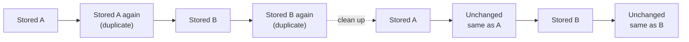

# Tools

Maintenance an administrator (level 50) runs by hand, under **Tools** in the
menu. Each tool shows what it will do before it does anything, and what it does
is recorded in the [change log](audit-log.md#change-log).

## Backup clean-up

Frees the space taken by backups stored more than once, and reconciles the
files on disk with the database.

**Audit** - opening the tool changes nothing. Per device, it counts the stored
backups, the *unchanged* ones and the **duplicates**: stored backups whose
configuration is the same as the stored backup before them, with the space
they take. It also lists the binary files no backup refers to, the backups
whose file is missing, and the unchanged backups that lost the link to their
stored configuration.

**Clean up** - after a small sum to confirm, it:

- turns each duplicate into an *unchanged* backup, exactly as
  [keeping only changes](backups.md#unchanged-backups) does for new backups: it
  stays in the history, succeeded at its time, and opens, downloads and compares
  as the configuration it repeats - its own copy of the text and the binary is
  freed;
- deletes the files no backup refers to;
- clears the reference of a backup whose file is missing;
- links a lost unchanged backup again to a stored backup with the same
  configuration, where there is one.



By default only devices whose profile **keeps only changes** are cleaned - the
profile says what is wanted for them. After an upgrade, existing profiles keep
every backup: switch a profile to keeping only changes first, then clean. *Also devices whose profile keeps
unchanged backups* includes the others. Backups made with *Backup now* are
never touched.

The database reuses the freed space for new backups. PostgreSQL returns it to
the disk only after a `VACUUM FULL`, which locks the tables while it runs.

## Export latest backups

Downloads a zip with the latest stored configuration of each device - of all
devices, or of one group:

```
routerfleet-latest-backups-20261122-1530.zip
├── manifest.csv
├── core-01/
│   ├── routerfleet-backup-812-daily-2026-11-22_03-00.rsc
│   └── routerfleet-backup-812.backup
└── ap-03/
    └── routerfleet-backup-799-daily-2026-11-22_03-05.cfg
```

One folder per device, one file per backup - the configuration text, and the
binary unless *Include binary backups* is switched off. `manifest.csv` lists
each device's name, address, type, backup time, the time of the stored backup
when the latest one was unchanged, and the configuration's SHA-256. For a
device whose latest backup was unchanged, the export holds the configuration
it repeats.

The archive holds every configuration at once, passwords and keys included
where the devices store them: keep it safe. Each export is recorded in the
change log with the number of devices.

## Database

The Tools page shows the database's size and offers **Optimize the database**
(confirmed with a sum):

- **PostgreSQL**: `VACUUM (ANALYZE)` - the space of deleted data becomes
  reusable at once and the statistics queries rely on are refreshed, without
  locking anyone out. With *Give the space back to the disk*, `VACUUM FULL`
  rewrites each table to shrink the files - it locks each table while it runs.
  The bundled PostgreSQL also does the first on its own over time (autovacuum).
- **SQLite**: `VACUUM` rewrites the file at its real size. The database is
  locked while it runs, and it needs free disk space as large as itself.

Best right after a backup clean-up, which empties large texts. The same from
the command line: `docker compose exec routerfleet python manage.py
optimize_database` (add `--full` for VACUUM FULL on PostgreSQL).
