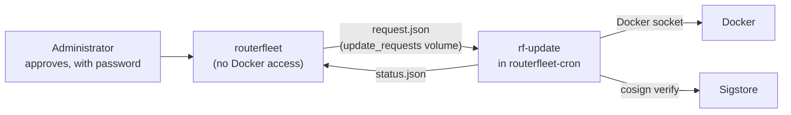

# Updating from System settings

An administrator can install a new release from *System settings → Updates*,
confirming with their password. RouterFleet then updates itself: download,
signature check, database backup, restart, and - if the new version does not
come up - the way back.

RouterFleet asks for a new release about once an hour (`UPDATE_CHECK`, or your
own `UPDATE_CHECK_URL`). **Check now** on the Updates page asks at once and
shows the answer; the page says when the last check ran. It is limited to once
every 30 seconds, and absent when the check is turned off.

Updating by command keeps working as always:

```bash
docker compose pull && docker compose up -d
```

## How it works



1. The application writes one small request - release, who approved it, when -
   into a volume it shares with the scheduler. It has no Docker access at all.
2. The updater in the scheduler container reads it every minute and trusts
   nothing in it beyond its strict format. It refuses anything that is not
   newer than the running release.
3. It downloads every RouterFleet image of exactly that release and refuses
   unless each one is **signed by this project's release workflow** (Sigstore
   keyless signature, built from `main` of this repository, checked with
   cosign) and labelled with that release number. A refusal changes nothing.
4. It backs up the database (PostgreSQL: `pg_dump`; SQLite: a copy) into a
   volume only the scheduler mounts.
5. It starts the new images and waits up to 15 minutes for the application to
   report healthy on the new release - migrations run in that time.
6. If it does not, it stops it, restores the database backup and starts the
   previous images again. The Updates page says what happened.
7. The scheduler itself is restarted last, by a short-lived copy of the new
   scheduler image, so the updater is never stopped halfway.

Every approval and its outcome is in the change log.

## Setting it up

The current `docker-compose.yml` (and `docker-compose-no-postgres.yml`) gives
the scheduler what the updater needs:

```yaml
  routerfleet-cron:
    volumes:
      - /var/run/docker.sock:/var/run/docker.sock
      - .:/compose:ro
      - update_requests:/update
      - update_private:/update-private
```

and the application the request volume (`update_requests:/update`). Take the
new compose file once, then `docker compose up -d`. Within a minute the
Updates page shows the updater as *Ready*.

An installation that keeps its older compose file is not affected: the page
shows the command to update instead.

## Security

- **The web application never gets Docker access.** A compromised application
  can at most ask for a newer, genuinely signed release of RouterFleet
  Improved.
- **The scheduler becomes a privileged container**: whoever controls the
  Docker socket controls the host. It runs only cron, the `/cron/` calls -
  whose replies are written to a log and never executed - and the updater,
  whose only inputs are the request file and signed images. It has no open
  port.
- The compose folder, including `.env`, is mounted **read-only** into the
  scheduler, so the update uses the same configuration.
- Approving takes the Administrator level and the administrator's password.
- To turn the feature off, remove the four `volumes` lines of
  `routerfleet-cron` and run `docker compose up -d`.
