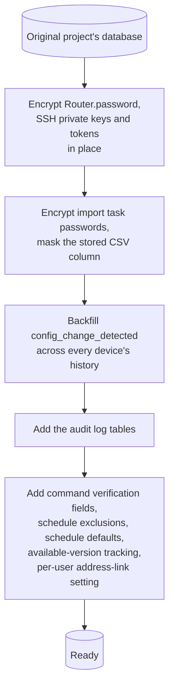

# Upgrading

## Before you start

Back up **two** things. The database alone is not enough.

```bash
# 1. The database
docker exec -e PGPASSWORD=your_password routerfleet-postgres \
  pg_dump -U routerfleet -d routerfleet > routerfleet-$(date +%Y-%m-%d-%H%M%S).sql

# 2. The app_secrets volume — holds the key your device passwords are
#    encrypted with. Compose prefixes the volume with the project name, which
#    is the name of your directory; `docker volume ls` shows the real name.
docker run --rm -v <project>_app_secrets:/secrets -v "$PWD":/backup alpine \
  tar czf /backup/app_secrets-$(date +%Y-%m-%d-%H%M%S).tar.gz -C /secrets .
```

A database backup without `app_secrets` cannot restore the stored passwords.

## The upgrade

```bash
cd path/to/routerfleet
docker compose down
wget -O docker-compose.yml https://raw.githubusercontent.com/alessiobravi/routerfleet_improved/main/docker-compose.yml
docker compose pull
docker compose up -d
```

Migrations run automatically on start. Watch them:

```bash
docker compose logs routerfleet --tail 100
```

Then check the web interface and the status page.

## Coming from an earlier RouterFleet

RouterFleet Improved descends from two earlier projects, and a database from
either upgrades in place. Point this version at your existing database and the
migrations carry it forward — there is no export or re-import step.

| Your current installation | Path | What happens |
|---|---|---|
| **RouterFleet Improved** (this project) | In place | Only new migrations apply |
| **RouterFleet Extended** | In place | 3 migrations apply: they encrypt the SSH keys and tokens it stored as text |
| **RouterFleet** (the original project) | In place | 16 additional migrations apply; the ones that touch data are described below |

This holds because the migration history is a strict superset: all 67 of the
original project's migrations and all 80 of RouterFleet Extended's are present
here, byte-identical. Nothing was renumbered, squashed or rewritten, which is
what makes the upgrade a no-drama `migrate`.

### What the 16 migrations do when coming from the original



These touch existing data:

- **Credentials are encrypted.** Device passwords, SSH private keys,
  notification channel tokens and the WireGuard integration's API key are read, encrypted
  with the key generated in `app_secrets` on this version's first start, and
  written back. The encryption function is idempotent, so a migration that is
  interrupted and re-run cannot double-encrypt a value.
- **Import passwords are encrypted** and the password column of any stored
  import CSV is replaced with `********`.
- **`config_change_detected` is backfilled** for every existing backup, walking
  each device's history in order and applying the same rule the application
  applies going forward: the first backup of a device is not a change, a backup
  with no configuration text is skipped without resetting the comparison, and a
  differing hash is a change.

You will see this in the log while the password migrations run:

```
Could not decrypt a stored value. Either it is not encrypted yet (normal while
the upgrade that encrypts it is running), or it was encrypted with a different
key than the configured ENCRYPTION_KEY.
```

**On an upgrade from the original project this is expected and harmless** — the
values genuinely are not encrypted yet, which is precisely what the migration
is about to fix. It is only worth investigating if you see it *after* the
upgrade, during normal operation, which would mean `app_secrets` was replaced.

### Afterwards

Existing data is adopted rather than reset, so after the upgrade:

- Every backup has its change flag filled in, so the **Last Config Change**
  column and the change markers in the backup list are immediately populated
  from your existing history.
- Commands that already existed are upgraded by data migrations. Every RouterOS
  command whose payload uses the package update gains a verification and a 600 s
  verify timeout; a payload that installs a package also gains the
  `expected-version` line and the matching expectation. **A payload you wrote
  yourself is never replaced** — the missing line is inserted into it — and a
  variant that already defines its own verification is left alone.
- Device inventory has no *available version* until each device is next read,
  so version columns show as "no information" until the inventory cycle comes
  round. Use **Update Information** on the device list to force it.

## Moving the bundled PostgreSQL to a newer major version

The default compose file runs `postgres:16`, and stays on it: the files a
PostgreSQL major version writes cannot be opened by the next one, so changing
the image of an existing installation would leave it unable to start. Patch
releases of 16 arrive with `docker compose pull`. To move to a newer major
version, carry the data across with a dump:

```bash
# 1. Dump everything from the running 16
docker exec -e PGPASSWORD=your_password routerfleet-postgres \
  pg_dump -U routerfleet -d routerfleet --format=custom > routerfleet.dump

# 2. Stop the stack and set the old data aside (rename, do not delete, until
#    the new one is confirmed to work)
docker compose down
docker volume create routerfleet_postgres_data_16_old
docker run --rm -v routerfleet_postgres_data:/from -v routerfleet_postgres_data_16_old:/to alpine \
  sh -c 'cp -a /from/. /to/'
docker volume rm routerfleet_postgres_data

# 3. Change "image: postgres:16" in docker-compose.yml to the new version, then
#    start only the database and restore into it
docker compose up -d routerfleet-postgres
docker exec -i -e PGPASSWORD=your_password routerfleet-postgres \
  pg_restore -U routerfleet -d routerfleet --no-owner < routerfleet.dump

# 4. Start the rest
docker compose up -d
```

From PostgreSQL 18 on, the official image keeps its data under
`/var/lib/postgresql` rather than `/var/lib/postgresql/data`: change the volume
line of the database service accordingly, or the new server writes into a
directory that is not on the volume. Read the image's notes for the version you
move to.

Once the installation has run on the new version for a while, remove
`routerfleet_postgres_data_16_old`. Substitute your project name for
`routerfleet` in the volume names — `docker volume ls` lists them.

## Version requirements

The entrypoint refuses to start if `COMPOSE_VERSION` in your compose file is not
`08a`. That is the guard against running a new image with an old compose file
that lacks a required volume or variable — if you see

```
ERROR: Please upgrade your docker compose file. Exiting.
```

download the current compose file as shown above.

## Rolling back

Every release keeps its own image tag, so going back means naming the version
you came from. Stop the stack, restore the database dump and the `app_secrets`
archive, set the four `image:` lines of `docker-compose.yml` to that version —
for example `ghcr.io/alessiobravi/routerfleet:0.8.0` — and start it again.
The versions are listed on the repository's Releases page and in the
[changelog](../CHANGELOG.md). Note that migrations are **not** automatically
reversed by downgrading the image — restore the database rather than relying on
reverse migrations.

The two data migrations that encrypt passwords define a no-op reverse, which
means reversing them leaves the values encrypted. This is another reason to roll
back by restoring the dump rather than by migrating backwards.
