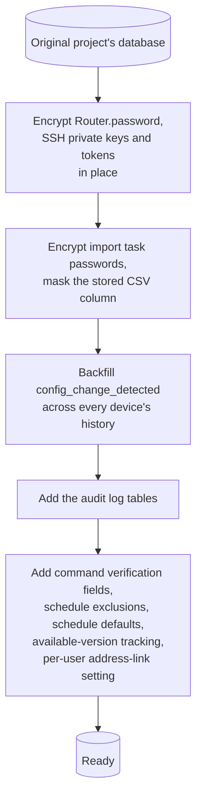

# Upgrading

## Before you start

Back up **two** things. The database alone is not enough.

```bash
# 1. The database
docker exec -e PGPASSWORD=your_password routerfleet-postgres \
  pg_dump -U routerfleet -d routerfleet > routerfleet-$(date +%Y-%m-%d-%H%M%S).sql

# 2. The app_secrets volume — holds the key your device passwords are
#    encrypted with. Compose prefixes the volume with the project name, which
#    is the name of your directory; `docker volume ls` shows the real name.
docker run --rm -v <project>_app_secrets:/secrets -v "$PWD":/backup alpine \
  tar czf /backup/app_secrets-$(date +%Y-%m-%d-%H%M%S).tar.gz -C /secrets .
```

A database backup without `app_secrets` cannot restore the stored passwords.

If you may want to go back, also keep the images you are running now — only
the newest release is published, so the one you have will not be downloadable
again (see [Rolling back](#rolling-back)):

```bash
docker save $(docker compose config --images) | gzip > routerfleet-images-$(date +%F).tar.gz
```

## The upgrade

Choose one of the two ways; both keep your data.

**Keep your compose file** - nothing changes but the images. Works for every
compose file of RouterFleet Improved and of RouterFleet Extended, whose
database stays on PostgreSQL 16. What an older file does not have - and the
current one adds - is listed under [What you may notice after
upgrading](#what-you-may-notice-after-upgrading): the discovery listener and
IPv6 (0.36), monitoring without the encryption key and the scheduler's key
(0.38), a key volume each (0.40):

```bash
cd path/to/routerfleet
docker compose pull
docker compose up -d
```

**Take the current compose file** - new settings and PostgreSQL 18. An
installation still on PostgreSQL 16 (every one from before 0.24) moves its
database by itself at the first start
([Moving to PostgreSQL 18](#moving-to-postgresql-18)):

```bash
cd path/to/routerfleet
cp docker-compose.yml docker-compose.yml.before   # the way back
wget -O docker-compose.yml https://raw.githubusercontent.com/alessiobravi/routerfleet_improved/main/docker-compose.yml
docker compose pull && docker compose up -d
```

**Changed the ports in your old compose file** (another web server on 80 or
443)? The current compose file reads them from `.env`: add `HTTP_PORT` and
`HTTPS_PORT` there first ([Ports](installation.md#ports)).

Migrations run automatically on start. Watch them:

```bash
docker compose logs routerfleet --tail 100
```

Then check the web interface and the status page.

## Coming from an earlier RouterFleet

RouterFleet Improved descends from two earlier projects, and a database from
either upgrades in place. Point this version at your existing database and the
migrations carry it forward — there is no export or re-import step.

| Your current installation | Path | What happens |
|---|---|---|
| **RouterFleet Improved** (this project) | In place | Only new migrations apply |
| **RouterFleet Extended** | In place | 67 migrations apply: three encrypt the SSH keys and tokens it stored as text; the others add the table of device host keys, the tables of second factors, the setting and link for keeping only changed backups, widen the schedule defaults column, add the system commands (two: the tag, then the commands), add the table of HTTPS settings, add the console's sessions table and the devices' Telnet switch and port, correct the spelling of the Configuration Manager level, add email notifications (the mail server settings and email channels, with two new events off for existing channels), add the ntfy server and priority to channels, switch off CallMeBot channels (no longer supported; kept with their history), record when each device was last enabled or disabled (filled in from the change log), add the display settings (tables keep opening with 10 rows) and the record of updates approved in System settings, let each device decide about unchanged backups (every device keeps following its profile), turn device types into configuration (the shipped types, Cisco, Juniper and Huawei added; Mikrotik (Branded) devices become RouterOS), take RouterOS and OpenWrt text backups from command output where their commands were not edited, add named text backups, the enable password, and the firmware repository, add indexes for the backup list, the message queue and history, notifications, the change log, sign-ins, downtime and console sessions, add an optional phone number to users, make unedited RouterOS backups text only (no binary .backup), remove the WireGuard WebAdmin integration, give the RouterOS type its export words for RouterOS 6, turn backups that stored a device's refusal instead of a configuration into failed ones (by their text, then by the exit code their console recorded), end outages still open for hosts that are disabled or not monitored, and add online firmware updates (the release channels of the RouterOS type, the online update command, the rollout's source), and the bootloader firmware, the rollout's timeline, the firmware notification (off for existing channels) and the firmware settings of the other shipped types where still empty, record what a device says about its own update check, give the Huawei type its firmware procedures and read its OS version as the release (where still unset), add two preferences per user (how long a sign-in lasts, 24 hours unless changed; how lists look, as before), record when the mail server last accepted the connection and the login (a server already switched on counts as checked), add an optional passphrase to SSH keys, let the change log record a secret shown, add discovery (the table of discovered devices and the system command reading neighbour tables), and add the HTTP access list (empty, every address allowed) and banning after failed sign-ins (on: 5 failures in 10 minutes, a 60-minute ban), record discovery runs (their timeline), say "device" rather than "router" in two field labels, and read the airOS configuration over the command channel instead of downloading it (where its backup commands are the shipped ones), and keep a daily sample of the backup disk's use (empty until the first housekeeping run) |
| **RouterFleet** (the original project) | In place | 80 additional migrations apply; the ones that touch data are described below |

This holds because the migration history is a strict superset: all 67 of the
original project's migrations and all 80 of RouterFleet Extended's are present
here, byte-identical. Nothing was renumbered, squashed or rewritten, which is
what makes the upgrade a no-drama `migrate`. The test suite holds a fingerprint of every
released migration and fails if one is ever edited, renamed or removed; it also
checks the counts in this table against the real migration plan.

### What the 80 migrations do when coming from the original



These touch existing data:

- **Credentials are encrypted.** Device passwords, SSH private keys and
  notification channel tokens are read, encrypted with the key generated in
  `app_secrets` on this version's first start, and written back. The encryption function is idempotent, so a migration that is
  interrupted and re-run cannot double-encrypt a value.
- **Import passwords are encrypted** and the password column of any stored
  import CSV is replaced with `********`.
- **`config_change_detected` is backfilled** for every existing backup, walking
  each device's history in order and applying the same rule the application
  applies going forward: the first backup of a device is not a change, a backup
  with no configuration text is skipped without resetting the comparison, and a
  differing hash is a change.

You will see this in the log while the password migrations run:

```
Could not decrypt a stored value. Either it is not encrypted yet (normal while
the upgrade that encrypts it is running), or it was encrypted with a different
key than the configured ENCRYPTION_KEY.
```

**On an upgrade from the original project this is expected and harmless** — the
values genuinely are not encrypted yet, which is precisely what the migration
is about to fix. It is only worth investigating if you see it *after* the
upgrade, during normal operation, which would mean `app_secrets` was replaced.

### Afterwards

Existing data is adopted rather than reset, so after the upgrade:

- Every backup has its change flag filled in, so the **last change** of each
  device and the change markers in the backup list are immediately populated
  from your existing history.
- Commands that already existed are upgraded by data migrations. Every RouterOS
  command whose payload uses the package update gains a verification and a 600 s
  verify timeout; a payload that installs a package also gains the
  `expected-version` line and the matching expectation. **A payload you wrote
  yourself is never replaced** — the missing line is inserted into it — and a
  variant that already defines its own verification is left alone.
- No device has a stored SSH host key yet. Each one's key is stored on its next
  connection and checked on every one after that — see [Device host
  keys](security.md#device-host-keys). A device that answers with a key that
  later changes is refused from then on.
- Device inventory has no *available version* until each device is next read,
  so version columns show as "no information" until the inventory cycle comes
  round. Use **Update Information** on the device list to force it.

## Moving to PostgreSQL 18

From 0.24 the default compose file runs `routerfleet-postgres18`: the official
`postgres:18` on Alpine with every available update installed - near-zero
known vulnerabilities, where the Debian-based PostgreSQL 16 image carried
hundreds without a fix. New databases use PostgreSQL's **built-in `C.UTF-8`
ordering**, so how text sorts no longer depends on the operating system's C
library: a later change of base image can never leave indexes ordered the old
way.

A compose file from before 0.24 keeps running the PostgreSQL 16 image
(`routerfleet-postgres`), which is still published and updated; `docker
compose pull` updates everything else.

**Taking the current compose file moves the database by itself** (from 0.28):

```bash
# In the folder of the compose file
cp docker-compose.yml docker-compose.yml.pg16        # the way back
wget -O docker-compose.yml https://raw.githubusercontent.com/alessiobravi/routerfleet_improved/main/docker-compose.yml
docker compose pull && docker compose up -d
```

**Changed the ports in your old compose file** (another web server on 80 or
443)? The current compose file reads them from `.env`: add `HTTP_PORT` and
`HTTPS_PORT` there first ([Ports](installation.md#ports)).

At its first start the new database finds the old one beside it (mounted
read-only) and moves it by **export and re-import**, never by reusing the old
files - the only safe way across a major version and a different C library.
It copies the old files to a working folder, opens the copy with PostgreSQL 16
(carried in the image for this), counts the rows of every table, exports the
database and its other roles - such as the [Zabbix kit's](zabbix.md)
monitoring role, with their password hashes (PostgreSQL never stores a
password itself) - imports both, counts again and compares every table and the
roles, and checks the built-in ordering. Only then does it start, and
RouterFleet with it; the working copy is removed. It needs free disk space
about three times the size of the database, and a few minutes on a large one
(`docker compose logs -f routerfleet-postgres` shows it). **The old volume
(`postgres_data`) is never changed.**

If anything differs or fails, the database does not start - never on part of
the data - and its log says why. To try again: `docker compose down`,
`docker volume rm <project>_postgres18_data`, `docker compose up -d`. A
database edited by hand (extensions, for example) may need the import adapted.

**At a moment you choose instead**: set `RF_AUTO_MIGRATE=0` in the
`environment:` of `routerfleet-postgres`; the database then waits, and its log
lists the commands of the script, which does the same with the export and the
roles file kept next to the compose file:

```bash
mkdir -p scripts && wget -O scripts/migrate-database.sh \
  https://raw.githubusercontent.com/alessiobravi/routerfleet_improved/main/scripts/migrate-database.sh
chmod +x scripts/migrate-database.sh
./scripts/migrate-database.sh
```

The script checks the web ports before it changes anything, and stops
RouterFleet only for the move.

**The way back**: `docker compose down`, put `docker-compose.yml.pg16` back,
`docker compose up -d`. The old database is exactly as it was.

**Afterwards**, once the new database has served you well: remove the line
`- postgres_data:/var/lib/postgresql-legacy:ro` and the `postgres_data:` volume
from the compose file, run `docker compose up -d`, then
`docker volume rm <project>_postgres_data` - and, if you used the script,
delete the export and the roles file (the export holds the whole database, passwords encrypted; the roles file
holds the password hashes of other roles).

SQLite and external PostgreSQL installations (`docker-compose-no-postgres.yml`)
are not affected.

**Coming from RouterFleet or RouterFleet Extended**, whose compose file runs the
official `postgres:16`: that keeps working as it is. The PostgreSQL 16 image of
RouterFleet Improved (`routerfleet-postgres`) is the same PostgreSQL 16 on the
same Debian base, so it opens the existing database directly - nothing to dump.
The move to PostgreSQL 18 above works from either.

## What you may notice after upgrading

- **0.43.0: Devices and Backup list and detail.** The device list is a list
  with the chosen device beside it, and the backup list the devices with
  their history; the column chooser and the per-column filters are gone - the
  search keeps `!` and `^`, the CSV export carries every field. The device
  list now opens on the default group, as documented.
- **0.40.0: the keys get a volume each.** The current compose file replaces
  0.38's `service_keys` volume with `monitoring_keys` and `cron_keys`, so
  monitoring and the scheduler can no longer read each other's key. A 0.38 or
  0.39 compose file keeps working (both keys in `service_keys`); once on the
  0.40 file, `docker volume rm <project>_service_keys` removes the old one.
  Also: changing a device's **port** asks for its password again (as a changed
  address does); adding a passkey or changing your password counts wrong
  passwords like sign-ins; *Forget host key* asks for a small sum; signed-in
  pages are not kept in the browser cache; housekeeping removes discovery runs
  after 30 days and discovered devices not heard for 90 days.
- **0.39.0: groups in the add-device wizard** (Device Discovery).
- **0.38.2: the status bar** at the bottom of every page replaces the floating
  "Live" box; the credit line is on the About page.
- **0.38.0: take the new compose file** for the full hardening - monitoring no
  longer mounts the volume with the encryption key, and the scheduler's calls
  need its key. An installation that keeps its compose file keeps working as
  before, without those two. With either, the application now runs as an
  unprivileged user: on the first start it hands its folders over once (a
  large media volume takes a moment), and `APP_USER=root` in `.env` runs it as
  root again, should anything need it. Changing a device's address now asks
  for its password again; adding a passkey asks for your password; an account
  without an access level sees only its own settings.
- **0.37.0: Devices Manager and Device Discovery.** *Router Manager* is now
  *Devices Manager*, and "device" replaces "router" throughout; discovery has a
  menu item of its own, and neighbour tables are read only from the devices
  you choose there - no longer with every inventory update. Confirmations open
  inline, beside what was clicked.
- **0.36.0: the compose file moves monitoring to the host's network** (with the
  raw-socket right only) for the discovery listener, adds the
  `discovery_data` volume, publishes the application's port 8001 on the host's
  loopback (127.0.0.1 and ::1; `MONITORING_PORT` changes it) and creates the
  dual-stack network `routerfleet_dualstack` (`IPV6=false` where the kernel
  has IPv6 off). Without the new file, everything but the LAN listener and
  IPv6 keeps working.
- **0.31.0: a sign-in lasts 24 hours after the last use** instead of two weeks
  from signing in: everybody signs in again within a day of the upgrade at the
  latest. Each user can choose up to two weeks in *My Settings → Security settings → Session expiration time*.
- **0.28.0: the move to PostgreSQL 18 happens by itself** at the first start
  of the current compose file ([Moving to PostgreSQL 18](#moving-to-postgresql-18));
  the script stays for a move at a moment you choose.
- **0.27.0: firmware updates for more device types.** Where a shipped device
  type's firmware settings and procedures were still empty, they are filled in
  (OpenWrt online updates, Juniper, Cisco IOS-XE, airOS - [Firmware](firmware.md#install-procedures)).
  Nothing runs until somebody starts an update; an edited device type keeps
  what it has. The notification **Firmware update finished** is off for
  existing channels.
- **0.24.0: the interface runs on AdminLTE 4 and Bootstrap 5.3**, without
  jQuery, and every page carries a strict Content-Security-Policy. Pages look
  and work as before. A browser extension that injects scripts into pages may
  be blocked by the policy; that is the policy doing its job.
- **0.24.0: PostgreSQL 18** with the current compose file
  ([Moving to PostgreSQL 18](#moving-to-postgresql-18)); a compose file from
  before keeps the PostgreSQL 16 image, which keeps getting updates.
- **0.24.0: the ports can be set in `.env`** (`HTTP_PORT`, `HTTPS_PORT`). If you
  edited the `ports:` of your compose file, it keeps working; set `HTTPS_PORT`
  to your HTTPS port so the HTTP redirect goes to it ([Ports](installation.md#ports)).
- **0.24.0: Export as CSV** in the device list works (it never did before).
- **The WireGuard WebAdmin integration is gone.** Its menu entry and pages are
  removed, and an upgrade drops its table together with the token stored in it.
  Nothing else depended on it.
- **The home page is the status page**; the former welcome text is under
  **About**, at the bottom of the menu.
- **Second factors are available** - an authenticator app and passkeys, in
  *My Settings*. Nobody is asked for one until they turn it on.
- **The in-app updater is removed** (0.23.1): no container holds the Docker
  socket. If your compose file mounts it into `routerfleet-cron`, take the
  current compose file or remove those lines ([Updating](updating.md)).
- **RouterOS backups become text only** (0.23.0): where the RouterOS backup
  commands are as shipped, the binary `.backup` is no longer taken; the text
  still comes from `/export`. Edited commands are kept. Stored `.backup` files
  stay until you delete them in *Tools → Backup clean-up*.
- **Device types become configuration** (0.22.0). Every device keeps its type
  and behaves as before:
  - **Mikrotik (Branded)** is gone: its devices become *Mikrotik (RouterOS)*
    (the commands were the same; only the connection test told them apart).
    Fleet Commander variants for it fold into the RouterOS ones; where a
    command had only a Branded variant, that one becomes its RouterOS variant.
  - **RouterOS** backups whose system commands were never edited take the text
    from `/export` output instead of an exported file on the device; the
    `.backup` file is still downloaded. Edited ones keep exactly what they did:
    the downloaded `.rsc` is still the text backup.
  - **OpenWrt** took its text from the output of the first "create" line; that
    line becomes the "backup - text" command, edited or not.
  - Cisco IOS, Juniper Junos and Huawei VRP are added as new types; nothing
    uses them until you choose them for a device.
- **CallMeBot channels are switched off** (0.18.0): CallMeBot is no longer
  supported. The channels and their history are kept; *System Settings →
  Notifications* lists them, to be recreated as email, ntfy or Telegram.
  Every other channel keeps working as before.
- **HTTPS does not change.** The new [System settings → HTTPS](https.md) page
  starts on *As configured in .env*: `HTTPS_REDIRECT_POLICY` and the
  certificate already deployed in the volume keep working exactly as before.
  To use the page, a compose file of your own needs `- https_cert:/certificate`
  under the `routerfleet` service's volumes (the shipped files have it).
- **Backup storage does not change.** Profiles that exist when you upgrade
  keep every backup in full, as before (*Keep unchanged backups* is on for
  them). Switch a profile's setting off to keep only changes from then on; the
  *Backup clean-up* tool can then free the duplicates already stored. Profiles
  created after the upgrade start with keeping only changes.
- **Retention never deletes a device's newest stored configuration**, however
  old it is.

- **Device host keys are checked.** Nothing is needed on upgrade: keys are
  learned on each device's next connection. A device you reset or replace later
  must have its key forgotten on its page before it can be reached again.
- **Sign-in attempts are limited**: 5 refused attempts for an account from an
  address, or 5 from an address whatever the names, or 20 for an account from
  all addresses together, within 15 minutes - then 15 minutes of refusals.
- **Secure cookies** need the current compose file, which passes
  `HTTPS_REDIRECT_POLICY` to the application. An older compose file keeps
  working, without them.
- **Bookmarked action links no longer act.** Every action is a button that
  POSTs; an address such as `...?action=delete&confirmation=delete` only
  shows the page.

## Only the newest release is published

Publishing a release deletes every older one: its GitHub Release, git tag and
images. An installation whose compose file names a version that no longer
exists upgrades like any other — set the five `image:` lines back to `:latest`
and pull.

## Version requirements

The entrypoint refuses to start if `COMPOSE_VERSION` in your compose file is not
`09a` (the current one, PostgreSQL 18) or `08a` (before 0.24). That is the guard against running a new image with an old compose file
that lacks a required volume or variable — if you see

```
ERROR: Please upgrade your docker compose file. Exiting.
```

download the current compose file as shown above.

## Rolling back

Only the newest release can be downloaded, so going back means using the images
you saved before upgrading ([Before you start](#before-you-start)). Stop the
stack, restore the database dump and the `app_secrets` archive, load the saved
images and point the five `image:` lines at them, then start it again:

```bash
docker load < routerfleet-images-YYYY-MM-DD.tar.gz
docker image ls ghcr.io/alessiobravi/routerfleet   # the version you came from
```

Note that migrations are **not** automatically reversed by downgrading the
image — restore the database rather than relying on reverse migrations.

The two data migrations that encrypt passwords define a no-op reverse, which
means reversing them leaves the values encrypted. This is another reason to roll
back by restoring the dump rather than by migrating backwards.
