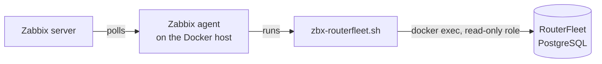

# Zabbix integration

An optional kit that lets Zabbix watch RouterFleet's own work: whether backups
are happening, whether devices are who they were, and whether someone is
trying passwords. RouterFleet runs the same without it. Everything is in
[`contrib/zabbix/`](../contrib/zabbix/README.md): a template, a collector
script, an agent configuration fragment and the SQL for a read-only role.

## What it reports

| Item | Per | Alarms when |
|---|---|---|
| Time since the last successful backup | device | over 48 hours (warning), over 7 days (high) - both adjustable |
| Result of the latest backup attempt | device | the latest attempt failed |
| Devices with a backup profile, and how many are failing | fleet | - (counted) |
| Devices without a stored SSH host key | fleet | one stays without a key for 24 hours |
| Host keys learned in the last hour | fleet | any: a device was rebuilt, replaced - or is not the one trusted before |
| Failed sign-ins in the last 15 minutes | fleet | they stay at 5 or more for 15 minutes |
| Configuration changes in the last hour | fleet | never - graphed, so a burst is visible afterwards |
| Fleet Commander jobs with a failed task, last 24 hours | fleet | any |
| The collector itself | - | it cannot reach the database, a counter cannot be read, or no data for 30 minutes |

Devices are discovered automatically: adding one to RouterFleet puts it under
monitoring within the discovery interval.

## How it connects

The collector runs on the Docker host next to RouterFleet and reads the
database through `docker exec`. The database needs no published port, and
Zabbix never talks to RouterFleet directly.

## What it can and cannot read

The collector's database role is granted only the columns it counts. It can
read whether and when backups succeeded, which device has a host key and since
when, whether a sign-in succeeded and when a change was recorded. It **cannot**
read device passwords, the text of backed-up configurations, SSH keys, user
names, addresses, the keys of open sessions, or what a change was. CI checks
both sides on every push, against a real database.

A counter the collector cannot read - a grant that is missing, a table that is
not there - reports `-1` and raises an alarm of its own. It never reports a
reassuring `0`.

## Backups that keep only changes

A backup whose configuration did not change is still recorded - succeeded, with
its finish time - and only its content is not stored again, so the backup age
and result items count it like any other. This is a [contract for
integrations](backups.md#a-contract-for-integrations): the test suite enforces
it, and a release that changes it, or the columns the kit reads, says so in the
changelog under **Monitoring**. The kit's design notes give a query to confirm
it after an upgrade.

## What you need

- RouterFleet Improved with the bundled PostgreSQL (`docker-compose.yml`)
- Zabbix server 7.0 or later, and the Zabbix agent (or agent 2) on the Docker host
- On that host, permission for the agent to run the collector with `docker exec`
  - through a narrow `sudoers` rule, not membership of the `docker` group

## Setting it up

Four steps, each detailed in the kit's
[installation guide](../contrib/zabbix/README.md#installation):

1. create the read-only role from `sql/zbx_monitor.sql`, with a password of your own;
2. install the collector script on the Docker host;
3. add the agent configuration fragment and restart the agent;
4. import the template in Zabbix and link it to the host.

The thresholds are macros on the template. Why each item is built the way it
is - including a query that looks right and can never report a failure - is in
the kit's [design notes](../contrib/zabbix/docs/design-notes.md).
